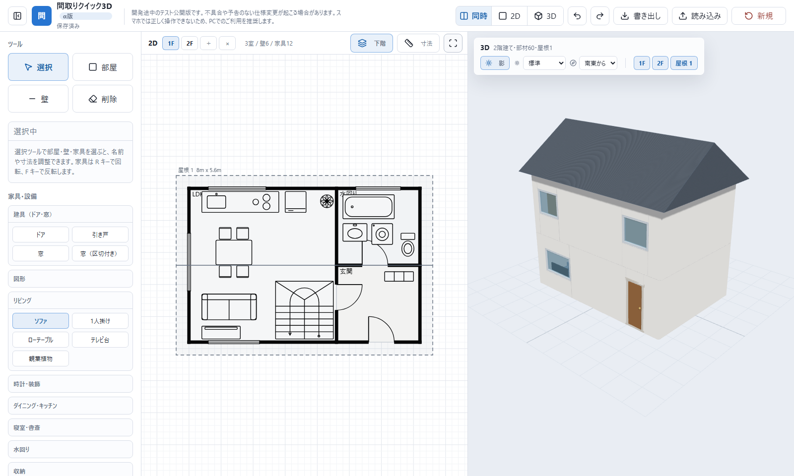

# 間取りクイック3D / Madori Quick 3D

[](https://github.com/tghcgu/madori/actions/workflows/deploy.yml)


ブラウザで2Dの間取りを描き、その場で3Dへ変換できる、インストール不要の間取り作成ツールです。

A browser-based floor plan editor that turns a 2D plan into an interactive 3D view, with no installation or account required.

**[日本語](#日本語) | [English](#english)**

## 公開サイト / Live App

| 種類 / Channel | URL |
| --- | --- |
| Cloudflare Pages 本番 / Production | **https://madori-5yu.pages.dev/** |
| 間取り専用版（3Dなし） / Plan-only edition | https://madori-5yu.pages.dev/plan/ |
| GitHub Pages ミラー / Mirror | https://tghcgu.github.io/madori/ （間取り専用版 / plan-only: https://tghcgu.github.io/madori/plan/ ） |
| `develop` プレビュー / Development preview | https://develop.madori-5yu.pages.dev/ |
| ソースコード / Repository | https://github.com/tghcgu/madori |

> [!IMPORTANT]
> 本ツールはPC向けのα版です。スマートフォンでも使えるように画面を整えていますが、細かい作業はPCのほうが楽です。最新のChromeまたはEdgeを推奨します。



---

# 日本語

<details>
<summary><strong>目次</strong></summary>

- [このアプリについて](#このアプリについて)
- [すぐに使う](#すぐに使う)
- [主な機能](#主な機能)
- [画面構成](#画面構成)
- [基本操作](#基本操作)
- [保存、書き出し、読み込み](#保存書き出し読み込み)
- [データとプライバシー](#データとプライバシー)
- [ローカルで実行する](#ローカルで実行する)
- [技術構成](#技術構成)
- [ディレクトリ構成](#ディレクトリ構成)
- [データモデル](#データモデル)
- [ブランチとデプロイ](#ブランチとデプロイ)
- [トラブルシューティング](#トラブルシューティング)
- [現在の制限](#現在の制限)
- [フィードバックと開発参加](#フィードバックと開発参加)
- [利用条件、クレジット、免責](#利用条件クレジット免責)

</details>

## このアプリについて

間取りクイック3Dは、専門的なCADソフトを覚えなくても、部屋・壁・建具・家具を2Dキャンバスへ配置し、同じ内容を3Dで確認できるWebアプリです。

アカウント登録、インストール、バックエンドサーバーは不要です。作業中のデータはブラウザ内へ自動保存され、必要に応じてJSONファイルとして書き出せます。

### こんな用途に

- 小説、漫画、ゲーム、TRPGなどの舞台設計
- 引っ越し前の家具配置の検討
- リフォームや模様替えのラフ案
- 住宅・店舗・会場の簡易レイアウト
- 2Dと3Dを行き来しながらのアイデア整理
- WebGL、Three.js、Canvasを使った学習・試作

## すぐに使う

1. **[本番サイトを開きます](https://madori-5yu.pages.dev/)**。
2. 左側の「部屋」「壁」「ドア」「窓」「家具」などを選びます。
3. 2D画面をクリックまたはドラッグして配置します。
4. 「選択」で要素を選び、移動、サイズ変更、回転、色変更を行います。
5. 上部の「同時」「2D」「3D」で表示を切り替えます。
6. 大切なプランは「書き出し」からJSONファイルとして保存します。

インストールもログインも不要です。最初から用意されている間取りを編集するか、「テンプレート」から家・マンション・洋館・旅館・お店・病院・学校・寺・城・駅・遊園地・宇宙船など153種類の間取りを読み込めます。

## 主な機能

### 2D間取り編集

- 部屋をドラッグして作成。作った部屋・床には最初は名前を付けず、2Dに文字を出しません（必要なときだけ「選択中」で名前を付けられます）
- 「線で囲んで床を作成」で点を順につなぎ、好きな輪郭の床を2D・3Dに作成。凹形、作図中の戻す・やり直す、タップ操作にも対応
- 壁を直線・斜線で作成。壁の種類は、ふつうの壁・コンクリート・レンガ・ブロック塀・板塀・土塀（瓦の笠つき）・ガラス・石垣・生け垣・竹垣・フェンスから選べます（一覧の「壁」から選んで2Dをドラッグ。選んだ壁の種類も、選択中の欄の絵から変えられます）。厚み・高さ・色は種類ごとで、2Dは3Dを真上から見た形と同じです。石垣・生け垣・竹垣・フェンスは、自由な形と同じ見た目です。厚みは、選んだ壁の欄の「厚み」で変えられます（フェンス・竹垣を除く。厚くした壁も角がすき間なくつながります）
- ドア（開き戸）、両開きドア、引き戸、和風の建具（障子・襖・格子戸の玄関戸・板戸）、門扉（門戸）、戸のない開口（壁の切れ目）、通常窓、中央区切り付き窓を配置。ドアの種類は、置いたあとでも「選択中」の「扉の種類」で変えられます。開口は2Dでは壁の切れ目だけ、3Dでは戸のない出入口です。壁をクリックするだけでも、いつもの幅（ドア80cm・両開き160cm・窓120cmなど）で壁の上に置けます（開き戸は押した側に開きます。ドア・窓の上を押すと、そのドア・窓を選びます）。開き戸は「吊元（ちょうつがい）を反対側に」で、ちょうつがいの位置を変えられます。ドア・窓のツールでは、選択中の欄で置く幅を決められます（選んだドア・窓の「幅」を変えると、次からその幅で置きます）
- 扉の種類の「壁の大穴」（壁を突き破ったような、ふちのぎざぎざな大きな穴。まわりにひび）と「崩れ落ちた壁」（上が崩れて低くなった壁）は、壁をぎざぎざに切り抜き、足もとにかけらを散らします。3Dでは向こうが見え、2Dでは残った壁・崩れたふちと、3Dと同じ所のかけらを描きます。どの種類の壁でも、その壁の見た目のまま崩れます（石垣・生け垣・竹垣・フェンスは、大穴なら穴の上と下に垣が残り、崩れ落ちた壁なら崩れた所が段々に低くなり、ガラスは透けるガラスのかけら。低い壁は高さの半分ほどまで崩れます）。一覧の「壁」と「建物の部分・工事」にもあります
- 円、円弧、多角形を壁として3D化
- 家具・設備を配置し、移動、サイズ変更、回転、左右反転。幅・奥行は1cm単位で決められます（小物も小さいまま。角のハンドルでも、小さな家具は細かく変わります）。壁の近くに置くと、背を壁に向けて壁に付きます（`Alt`を押しながら置くと付けません。人・小物・床に描く物などは付けません）
- 部屋を動かすと、中の家具・文字・その部屋の壁とドア・窓・載っている屋根も一緒に動きます（隣の部屋との境の壁は動かしません。`Alt`を押しながらなら部屋だけ）。中に物がある部屋を消すと、一緒に消すかを聞きます（「キャンセル」で部屋だけ）
- 「削除」ツールは、クリックした物を消すほか、ドラッグすると通った所の家具・文字・ドア・窓を続けて消せます（部屋・壁は消しません。「元に戻す」1回で全部戻ります）
- 家具のデザインを「選択中」の見本から選択（椅子・ソファ・ベッド・テーブル・冷蔵庫・洗濯機・トイレ・植物・ラグ・岩・外灯・花壇・フェンス・スツール・番号の印・足跡・倒れた人・血など43種類。観葉植物の「らせんの葉」は、ひとつ前の標準の3Dの形を残したもの）。2Dの記号と3Dの形が同じデザインに変わります（例: 丸い座面の椅子は3Dでも丸い座面と曲げ木の背もたれ、布団を折り返したベッドは3Dでも掛け布団の角が折れ、ガラス天板のテーブルは3Dでもガラス越しに下の棚が見える）。`V`キーで順に切り替え、同じ種類を続けて置くと最後に選んだデザインを使います。「2Dの記号のみ」と書かれたデザイン（クローゼットの斜線など）は、3Dは標準の形のままです
- 3Dを真上から見た形は、2Dの記号と同じになるように作っています。岩の輪郭と稜線、池の輪郭と石の位置、飛び石・花壇の花の並び、木目、ラグの柄、植物の葉の向きなどは、2Dと3Dが同じデータから作られます（冷蔵庫の雪の結晶や靴箱の靴のように、見分けるための図柄は2Dだけに描きます）
- 部屋名を本文とは別にドラッグして自由配置
- 部屋名の「文字サイズ cm」を変更できます（空欄で自動）。部屋名と自由テキストは「横書き」「縦書き」を切り替えられ、縦書きの改行は右から左へ列を増やします。保存・Undo/Redo・PNGにも反映されます
- 「ペン」ツールで、好きな色で床に描けます（血だまりや汚れ、印などに）。2Dの上をドラッグすると線、クリックで点、「囲んで塗る」にすると囲んだ所を塗りつぶします。よく使う色（血の色・赤・黒・白など）から選ぶか、カラーコード（透明度も可）で決め、太さは1〜300cm。描いた線は3Dでも床に同じ形で描かれ、選ぶと色・太さ・描き方をあとから変えられます（線の上をクリックすると選べます）。描く前から、マウスの所にペン先の大きさの丸が出るので、太さが分かります（太さを変えている間は、2Dの真ん中に同じ丸が出ます）。ペンの欄の「描く物」で、川・小道・生け垣・石垣・フェンス・竹垣・線路・飛び石・池・花壇・芝生・ラグも選べます。川・小道などの線の形はなぞった道すじで描け（川・小道・生け垣・石垣は幅も決められます）、池・花壇・芝生・ラグは、はじめから「ペンで塗る」で、塗った所がその形になります（下の「自由な形」）。「描き方」で「直線で描く」「曲線で描く」にすると、なぞる代わりにクリックで点を打って描けます（直線は点と点をまっすぐ、曲線は点を通るなめらかな線でつなぎます。閉じる形は最初の点を押すと、線は Enter かダブルクリックで描き終えます。直線は、点を打つ前にドラッグすると1本の直線になります）。ペンの色や太さ、描く物、描き方はブラウザに記憶されます
- 「テキスト」ツールで間取りの好きな場所に文字を配置。内容（改行可）・大きさ・回転・色・太字を編集でき、ドラッグ移動・固定・Undo / Redo・保存に対応。空にすると削除。2Dだけに表示され、3Dには出ません
- 幅・奥行・長さ・角度・座標を数値で編集
- 2D色と3D色を個別指定。見本から選ぶほか、カラーコード（`#RRGGBB`）を直接入力できます。末尾に2桁足した`#RRGGBBAA`では透明度も決められ（`00`で透明〜`ff`で不透明。例: `#2775d180`で半分透ける）、2Dでは同じ色の要素をまとめて1回で透かすので重なった所や壁の角も同じ濃さ、3Dでは床・壁・建具・家具がまるごと透けます（透けている物は影を落としません）。見本では透明度が市松模様で分かり、見本で色を選び直しても透明度はそのまま。カラーコードを空にすると標準の色に戻ります
- 寸法ラベル（部屋・屋根の幅×奥行）の表示・非表示。初期状態は非表示
- 2Dの上の「表示」で、間取りの名前（書き出すファイルの名前になります）・部屋名の表示・部屋の広さ（帖・㎡。1帖は1.62㎡、階段の穴は引きます）・方眼の表示と大きさ（おまかせ・25cm・50cm・91cm（半間）・1m・1.5m・182cm（1間）・2m・3m）を切り替え。方眼の大きさを決めると、部屋の上にも方眼をはっきり重ねます。`G`キーで方眼の表示を切り替えられます
- 好きな画像（PNG・JPEG・WebP・GIF）を取り込めます。「画像を取り込む」を押すか、2Dに画像のファイルをドラッグすると、長い辺3mで置きます。2Dに描き、3Dでは床に貼ります（2Dと同じ向き・大きさ）。大きさ（縦横の比を保てる）・回転・反転・濃さを変えられ、濃さを下げて「配置を固定」すれば下絵にもできます。画像は長い辺1600pxまでに縮めて、間取りのデータ（自動保存・書き出しのファイル）に入ります
- 家具・画像を「最前面へ」「最背面へ」動かして、重なりの順を変えられます
- ほかの階を半透明で重ねる「透過」表示。横の▼から、透かす階（すぐ下・すぐ上・ほかの階すべて・階を名前で指定）、透かす色（カラーコード。空欄なら元の色）、濃さを選べます。透かした階は一度ふつうに描いてから1回だけ半透明で重ねるので、壁の角や重なった所も同じ濃さです
- 2D上の屋根の一時表示・非表示
- 2Dの「絵柄」で、間取り全体の描き方を切り替え（標準・モノクロ・設計図・CAD・コピー・鉛筆・水彩・クレヨン・黒板・筆と和風・墨絵・古地図・マンガ・ポップ・ドット・レトロゲーム・ネオン・ホラーの18種類）。詳しくは下の「2Dの絵柄」
- パーツ検索（ひらがな・カタカナ・別名でも検索可。例: いす、まど、れいぞうこ）
- 選択した要素の配置固定
- マウスホイールによるズーム（0.0001倍〜1万倍まで、ほぼ無限に拡大・縮小。遠くまで引くと方眼の間隔も自動で広がり、大きく拡大したときは部屋の中にも方眼を薄く表示して、右ドラッグで動かしていることが分かるようにします）
- 右ドラッグによるキャンバス移動
- 全体表示への自動フィット
- Undo / Redo

壁とドア・窓が重なった場所では、ドアと窓の開口が優先されます。2D図面と3Dモデルの両方で、壁が建具部分をふさがないよう処理されます。

### 3Dプレビュー

- 2D間取りをThree.jsでリアルタイム変換（2Dで家具・壁・床などをドラッグしている間も、3Dがすぐ追いつきます）
- `同時`、`2Dのみ`、`3Dのみ`の表示モード
- `同時`表示では、2Dと3Dの境目をドラッグして広さを自由に変更（境目を選んで矢印キーでも5%ずつ動かせます。ダブルクリックで元の半分ずつに戻ります）。境目の位置はブラウザに記憶され、タブレットやスマホの上下表示でも使えます
- マウスドラッグによる視点回転・移動。左ドラッグは押した所（マウスの下の物）を中心に回り、押した物が画面の同じ所にとどまります。上下の向きに制限はなく、真上から見下ろすことも、下から見上げることもできます
- ホイールによるズーム（マウスのある場所に向かって進み、拡大し続けると窓や壁を越えて室内まで入れます。近づいても前進が止まらず、逆回転で後退できます。タッチ操作ではピンチに対応）
- 右ドラッグの移動は、つかんだ物がマウスについてくる速さで動きます。すぐ目の前まで寄ったあとでも、止まったようにならず動かせます
- 壁、床、ドア、引き戸、障子・襖などの和風の建具、窓、家具、設備、階段、屋根を立体化
- 階段は出発する下の階に1つ配置すれば、到着する上の階の2D図とPNGにも下り向きの記号で自動表示します（下階の透過表示がオフでも表示）。上の階に同じ階段を複製する必要はありません。記号の位置・大きさは下階の階段に追従し、編集は下階で行います
- すでに上下階へ同じ階段を重ねていた場合は、上階の階段を選択して「下階の階段表示に切り替え」を押すと、上階の実物だけを削除して下階の記号表示にできます。固定中は操作できず、取り消しにも対応します。上階からさらに上へ登る階段は、そのまま残せます
- 草地・芝生の床には、細い草の葉が立ち上がって見えるように生やします（池・飛び石・ラグの下には生やしません）
- 3Dの絵柄を16種類から選べます（標準・リアル・白模型・線画・モノクロ・古写真・鉛筆・水彩・墨絵・アニメ・マンガ・ドット・レトロゲーム・設計図・ネオン・ホラー）。選んだ絵柄は記憶され、3Dの画像の書き出しにも使われます
- リアルの絵柄は、光（トーンマッピング・周りの映り込み・細かい影・物の間の暗がり）と、家具・設備の材質（木目・布目・金属の筋・石の粒・陶器や漆のつや など）を本物らしくし、空と地面も描きます
- 影のON/OFF
- 5段階の明るさ調整
- 8方位と真上から選べる光の向き
- 階ごとの表示・非表示
- 屋根全体の一時表示・非表示（屋根ごとに色も変えられ、透かせば中が見えます）
- 3D上の家具・ドア・窓はダブルクリックで選択（スマホ・タブレットは長押し）。マウスを乗せると薄い枠と「ダブルクリックで選択」の案内が出ます。1回クリックでは選択を変えず、選び方を案内します。固定した家具も選択でき、Ctrl／Cmd＋クリックでの複数選択はそのまま使えます。床・壁・屋根などは1回クリックで選択します
- 家具を選んで3D画面をクリックすると、編集中の階へ連続配置
- 「選択」ツールで家具をダブルクリックすると、その家具や複数選択した家具をドラッグで移動できます。3D欄の移動ボタン（十字の矢印）を押すと移動モードになり、何も選んでいなくても、押した物（床・壁・ドア・窓・屋根・家具など）をそのままドラッグで動かせます。移動モードは、もう一度押すか Esc で終わります。移動中のEscは元の位置に戻します。通常の左ドラッグは家具の上でも視点回転です
- 右ドラッグ／Shift＋左ドラッグは、画面に沿った上下左右の平行移動です。上下ドラッグで高さも変わり、2階・3階の室内まで視点を持ち上げられます

### 複数階

- 「＋」で上の階を、「＋B」で地下の階を、何階でも追加（地下はいちばん下に増え、B1F、B2F…と呼びます）
- 階はタブで切り替え（増えて入りきらないときは横にスクロール。`[` `]`キーでも下の階・上の階へ）。階を消すと残りの階の名前を付け直します
- 階のタブをダブルクリックすると、階に名前を付けられます（例: 地下牢・屋上）。タブ・3Dの表示の切り替え・書き出す画像の見出しとファイルの名前に出ます。空にすると、いつもの名前（1F・B1F など）に戻ります
- タブの右の重ねた四角のボタンで、いまの階を複製（すぐ上に同じ階が増え、この階の屋根は上の階へ移ります）
- ほかの階をゴースト表示（透かす階・色・濃さを選択可）
- 3Dでは階ごとに表示・非表示を切り替え
- 階高、床スラブ、最上階の壁上端を考慮して積層。地下の階は地面より下に積み、1Fの床が地下の天井をふさぎます

### ナイトモード

上のバーの月のボタンで、画面のまわり（ボタン・欄・メニュー）と3Dの背景を暗くできます。もう一度押すと元に戻り、選んだ明るさはブラウザが覚えます。2Dの間取りの紙は白のままです（書き出す画像と同じ見え方。暗い紙にしたいときは2Dの「絵柄」の背景で選べます）。

### 言語（日本語・英語・韓国語・繁体字中国語）

上のバーの「言語」（JP・EN・KR・繁中）で、画面の言語を切り替えられます。

- ボタン・メニュー・選択中の欄・お知らせ・確かめの窓・家具やテンプレートの名前と説明など、画面の文字がその言語になります。選んだ言語はブラウザが覚えます
- URL に `?lang=en`・`?lang=ko`・`?lang=zh-Hant` を付けても、その言語で開けます（覚えている言語より優先。覚えはしません）
- テンプレートの部屋の名前は、選んでいる言語で作ります。自分で書いた部屋の名前・文字は、言語を変えてもそのままです（間取りのデータは変わりません）
- 家具やテンプレートは、その言語の名前でも検索できます
- 何も選んでいなければ日本語です（ブラウザの言語からは決めません）。日本語以外では、広い画面の上のバーのお知らせ・注意書きは出しません（スマートフォンではお知らせを出します。注意書きは「このアプリについて」で読めます）
- 更新履歴は、日本語以外では英語の文を出します

### 間取り専用版（3Dなし）

3Dを使わずに2Dの間取りだけを編集したいときは、間取り専用版（https://madori-5yu.pages.dev/plan/ ）を使えます。

- 2Dの画面だけで、3Dの欄・表示の切り替え・3Dの色・高さ・屋根・3Dの画像の書き出しは出しません
- 間取りのデータは本体と共通です。間取り専用版で描いた間取りを、上部の「3Dでも見る」から本体で開いて3Dで確かめられます（同じブラウザのとき）
- 本体の表示の切り替えや3Dで見ていた向きは、間取り専用版を開いても変わりません
- 上のバーの文字の所に、新しいお知らせ、間取り専用版のお知らせ（本体だけ）、開発中の注意書きの順に1つずつ出します（横幅1600px以上の画面のとき。スマートフォンでは、上のバーのボタンの下に1行で出します）。×で消すと次の文に替わり、消した文は次からも出ません（新しいお知らせは、次のお知らせが出るとまた出ます）。広い画面では画面の高さは使いません

### 2Dの絵柄

2Dの上の「絵柄」から、間取り全体の描き方を選べます。メニューは「線画」と「背景」のタブに分かれていて、線の描き方と地（紙や板）を別々に選んで組み合わせられます（例: 鉛筆の線画を黒板に、ネオンの線画を羊皮紙に）。線画の見本はいまの背景で、背景の見本はいまの線画で描いて並べます。間取りのデータ（形・大きさ・色）と3Dは変わらず、描き方だけが変わります。選んだ線画と背景はブラウザに保存され、画像の書き出しもその絵柄になります。

- 線画は18種類で、線画・手描き・和と古風・マンガとゲーム・夜と雰囲気の5つに分けて並べます（下の一覧）
- 背景は14種類: おまかせ（線画に合わせる）・白・和紙・画用紙・水彩紙・羊皮紙・コピー用紙・クリーム・青焼き・黒板・黒・夜・暗がり・ゲームの緑。紙の模様や縁の暗がりも背景といっしょに変わります。筆の仲間の線画では、床の模様に重ねる色も背景の色になります

- 標準: これまでどおりの、くっきりした線画
- モノクロ: 標準と同じ線画を、色だけ白黒の濃淡にします（紙の模様やむらは付けません）。床の模様も色を抜いて残します
- ドット: ドット絵のマップのように、間取り全体を四角いドットで描きます。細い線はドットのます目に沿った1ドットの線（曲線は階段状、四角の角はそのまま）、壁などの太い線と塗りはドットごとに1色にまとめます。文字はぼかさずにくっきり描きます。ドットの大きさは細かい（2px）・ふつう（3px）・粗い（5px）から選べ、スクロールしてもドットの形がちらつかないよう、間取りを1ドットずつ動かします
- レトロゲーム: ドットの絵柄を、昔の携帯ゲーム機のような緑の4色だけで描きます。間の明るさは、決まった並びの点（ディザ）で隣の色と混ぜます。点の並びは間取りに貼り付いているので、スクロールしてもちらつきません。ドットの大きさも選べます
- 筆・和風: 和紙の地に、墨の筆で描いたように描きます。線は入りで押さえてふくらみ、止めで押さえて終わるか、払いで細く抜け、途中でも筆圧で太さが変わり、手で引いたように揺れて少し反ります。四角は辺ごとに筆を運び、角で少し突き抜けます。壁などの太い線（少し細い線も）は筆の毛ごとに描き、終わりの方でかすれます。1本の中でも、入りの方は墨が濃く、かすれる終わりの方は薄くなり、線のまわりは和紙に少しにじみます。塗りは縁が少し波打って少し濃くたまる淡い色で、むらがあり、白は和紙の色になり、最後に和紙の繊維とむらを重ねます。文字は楷書・教科書体（なければ明朝）で、墨が少しにじんだように描きます。同じ形の線はいつ描いても同じ形なので、動かしたりスクロールしたりしても線がちらつきません
- 鉛筆: 白い画用紙に、鉛筆で下描きしたように描きます。線は2〜3回なぞったように少しずつずれ、端は少し行き過ぎたり手前で止まったりします。壁などの太い線は細い線を並べて塗り、部屋や家具の塗りは色鉛筆の薄い色に、濃い色ほど細かい斜線（とても濃い所は網目）を重ねます。文字は手書きらしい教科書体です
- マンガ: 白黒で描きます。線は黒く、塗りは色の濃さに合わせたスクリーントーン（網点）に、とても濃い色はベタ（黒）になります。トーンは間取りに貼り付いているので、スクロールしても網点は動きません
- 設計図: 青焼きの図面のように、青い地に白っぽい線で描きます。塗りは淡い白、文字は図面の文字らしいゴシックです
- 古地図: 羊皮紙の地に、セピアのペンで描きます。色は褪せて紙になじみ、紙のむらと縁の暗がりを重ねます。文字は明朝です
- 黒板: 緑の黒板に、チョークで描きます。線は粉っぽくところどころかすれ、塗りは板の上に淡く、文字は手書きらしい教科書体です
- ネオン: 夜のように暗い地に、光る線で描きます。線の色はあざやかに明るくなり、まわりがぼんやり光ります
- CAD: 黒い画面に細い線で描きます。黒い線は白に、色のある線は色相ごとにCADらしい原色（赤・黄・緑・水色・青・紫）になり、塗りは地の色で下の線を隠します
- コピー: コピー機で刷った資料のように、白黒の濃淡を少し強めて描き、トナーのむらと粒を重ねます。床の模様も色を抜いて残します
- 水彩: 細い線と、透ける絵の具で描きます。色は少しあざやかに、塗りの縁には絵の具が少し濃くたまり、塗りの中にはむらが出ます。水彩紙の目を重ねます
- クレヨン: 太くてところどころかすれる線と、紙の目が白く残る塗りで描きます。色はあざやかです
- 墨絵: 色を使わず、墨の濃淡だけで描きます。強い赤（血など）だけは朱にします。床の模様も色を抜いて墨の濃淡にします
- ポップ: 太い黒い線と、あざやかな色の網点で描きます。灰色は白地に黒い点、とても濃い色はベタ（黒）です
- ホラー: 暗がりに、骨のような白っぽい線で描きます。赤い物（血など）だけは暗い赤ではっきりと描き、文字は赤くにじみます。汚れやしみ、ひっかき傷と、まわりの濃い暗がりを重ねます
- 筆の仲間（筆・和風、墨絵、古地図、黒板、水彩、クレヨン）では、床の模様（木・畳・タイル・石・草など）の上に紙や板の色を薄く重ね、模様の色が浮かないようにします
- 選択中の枠のつまみ・作図中の線・屋根の破線などの操作用の印は、どの絵柄でもくっきり描きます

### 画像の書き出し

上部の「画像」から、間取りをPNG画像にできます。

- 書き出す階: 表示中の階 / 全部の階を1枚に（階の名前付きで並べる） / 階ごとに1枚ずつ。複数の階は同じ範囲・同じ倍率にそろえるので、重ねて見比べられます
- 方眼と部屋の名前は入れるかどうかを選べます。寸法と部屋の広さは2Dの表示に合わせます。選択の枠・屋根・ほかの階の透過・固定の印は入りません
- 「表示」で方眼の大きさを決めて方眼を入れると、画像の端を方眼の線に合わせ（画像の左上から方眼が並ぶ）、「1マスの大きさ」で方眼1つを50〜140pxにできます。ココフォリアなどのマップのマス目に合わせられます
- 「背景を透明にする」で、地の色や紙の模様を入れずに書き出せます（ドットの絵柄では背景も入ります）。「画像をコピー」で、画像をクリップボードにコピーできます
- 2Dの「絵柄」が標準以外なら、画像もその絵柄で描きます（ドットは画面と同じ大きさのドット。筆は和紙、設計図は青い地、黒板は緑の板のように、地の色や紙の模様も入ります）
- 線の太さや文字の大きさの割合は、2Dで間取り全体を表示したときと同じにします（大きな間取りでも、縮めて見たときに線が細く薄くならないように）。細かさは画面の2倍以上・1cmが1.5ピクセル以上で、大きすぎる間取りはどの端末でも作れる大きさまで下げます
- 「3Dの画像（いまの見え方）」は、3Dで見ている向きのまま画面の2倍の細かさで書き出します
- ファイル名は`madori-YYYY-MM-DD-1F.png`、`madori-YYYY-MM-DD-all.png`、`madori-YYYY-MM-DD-3d.png`のようになります

### 複数屋根

- 切妻、寄棟、陸屋根、円すい、ドーム、正多角形を何枚でも追加
- 屋根ごとに幅、奥行、位置を編集
- 円すい・ドームは直径で一括変更、幅・奥行を別々に変えると楕円形に
- 正多角形は3〜12辺、向き、外接円の直径で編集。角をドラッグしても正多角形を維持
- 円すい・ドーム・正多角形は屋根の高さを10〜2000cmで指定（空欄なら寸法から自動計算）
- 「設置階」を屋根ごとに指定。階を追加しても設置階は変わらず、対象階を隠すと屋根も非表示
- 「上げ下げ cm」で屋根ごとに置く高さをずらせます（設置階の壁の上から。下げるときはマイナス、±3000cmまで）。同じ階の屋根でも、下屋や重なった屋根を別の高さに置けます
- 2D上でドラッグ移動
- 四隅のハンドルでサイズ変更
- 幅と奥行を90度入れ替え
- 2Dまたは3Dから屋根を選択。2Dでは屋根の縁（破線）か棟などの屋根の中の線をクリックします。床も家具もない軒先を押しても選べます（選択ツールのとき）。庭や地面の床の上にある線でも選べ、同じ所に線が重なるときは、いま見ている階の屋根を選びます
- 屋根ごとに色を指定（いぶし瓦・黒・赤茶・朱・緑青・青などの見本か、カラーコード）。末尾2桁で透かすと、3Dで屋根越しに中が見えます。2Dの屋根の線と面も、その色でうすく描きます
- 2D上の屋根には名前を表示せず、寸法表示がONのときだけ大きさを表示
- 屋根ごとの固定、選択、削除
- 旧形式の1枚屋根データを自動移行

部屋を選択してから屋根を追加すると、その部屋を覆う大きさで配置されます。部屋を選択していない状態で2枚目以降を追加すると、重なって見失わないよう右隣へ配置されます。

円・楕円・多角形の壁を選択して丸い屋根や正多角形の屋根を追加すると、その図形を基準に配置します。正多角形の壁では辺の数と向きも引き継ぎます。「魔法使いの塔」と「城」の塔は円すい屋根になりました（保存済みの間取りは変更しません）。

### 家具・設備

左パネルの「家具・設備」は、よく使う順に並べています（建具 → 椅子・テーブル・ベッドなど家の中の家具 → 階段・なぞって形を決める物・床・地面・屋外・屋根 → 和風・学校・お店などの場面ごとの物 → 図形の壁）。はじめに開いているのは建具と椅子・ソファだけで、開け閉めはブラウザが覚えます。家具は置く部屋ではなく種類で分類しているため、店舗や学校など部屋の種類が決まっていない創作でも探しやすくなっています。探しやすいように、いくつかの物は複数の分類に重ねて出します（たとえば座布団は「和風」と「椅子・ソファ」の両方、障子や襖は「建具」と「和風」の両方）。下の表の（）の中が、ほかの分類にも出している物です。検索の結果では、重ねて出している物も、上の分類の1つだけを出します。

| 分類 | 収録要素 |
| --- | --- |
| 建具（ドア・窓） | ドア（開き戸）、両開きドア、引き戸、障子、襖、格子戸（玄関戸）、板戸、門扉（門戸）、開口（壁の切れ目）、壁の大穴、崩れ落ちた壁、窓、中央区切り付き窓 |
| 壁 | 壁、コンクリート、レンガ、ブロック塀、板塀、土塀、ガラス、石垣、生け垣、竹垣、フェンス（壁の大穴、崩れ落ちた壁、壁のヒビ、崩れた壁、壁の穴） |
| 椅子・ソファ | ソファ、2人掛けソファ、L字ソファ、1人掛け、椅子、オフィスチェア、座椅子、スツール、カウンターチェア、ベンチ（座布団、縁台、玉座、車椅子） |
| テーブル・机 | ダイニングセット、丸テーブル、ローテーブル、サイドテーブル、こたつ、長テーブル、机、L字デスク、机と椅子、丸いダイニング（4人）（ちゃぶ台、カウンター、学校の机と椅子、教卓） |
| ベッド・寝具 | シングルベッド、セミダブルベッド、ダブルベッド、二段ベッド、布団、ベビーベッド、天蓋付きベッド、ナイトテーブル（病院のベッド） |
| 収納・棚 | クローゼット、タンス、棚・本棚、食器棚、靴箱、コートハンガー、段ボール箱、ドレッサー（階段箪笥、ロッカー、金庫、陳列棚、木箱） |
| キッチン | キッチン、L型キッチン、アイランドキッチン、シンク、コンロ（冷蔵庫、食器棚、カウンターチェア、かまど） |
| 浴室・トイレ・洗面 | 浴槽、ユニットバス、シャワー、トイレ、洗面台（洗濯機、檜風呂、和式トイレ） |
| 家電 | 冷蔵庫、洗濯機、テレビ台、エアコン、室外機、扇風機、ストーブ（複合機、自動販売機） |
| 照明・インテリア | 観葉植物、大きな観葉植物、ラグ、フロアライト、暖炉、壁掛け時計、ホールクロック、水槽、ピアノ、ゴミ箱、キャットタワー、カーテン、グランドピアノ、蓄音機（行灯、屏風、障子の衝立、囲炉裏、火鉢、提灯、パーティション） |
| 天井（照明など） | シャンデリア、ペンダントライト、シーリングライト、シーリングファン、ダウンライト、スポットライト（レール）、裸電球、ミラーボール、吊り鉢（ハンギングプラント）、プロジェクター（天井）、天井埋め込みエアコン、火災報知器（煙感知器）、スプリンクラー（3Dでは天井の高さに付きます） |
| 階段 | 直階段、折り返し階段、らせん階段（直階段・折り返し階段は、3Dで段の下を斜めの板にして下をあけた形。設定の「階段の下を埋める」で、床まで詰まった形にもできます） |
| なぞって形を決める | ペン、池、花壇、芝生、ラグ、川、小道、生け垣、石垣、フェンス、竹垣、線路、飛び石、足跡、破片（床・地面の素材と部屋も、ぐるっとなぞるとその形） |
| 床・地面 | 標準、フローリング、ヘリンボーン、ウッドデッキ・板張り、畳、カーペット、タイル、モザイクタイル、市松・チェッカー、大理石、石の床、石畳、レンガ、コンクリート、アスファルト、鉄板（縞鋼板）、草地・芝生、土・土間、砂・砂浜、砂利、雪、水面 |
| 屋外・庭 | 木、針葉樹、ヤシの木、低木・植え込み、岩、飛び石、花壇、池、芝生、川、小道、生け垣、石垣、フェンス、竹垣、外灯、石灯籠、墓石、十字架の墓、郵便ポスト、物置、犬小屋、パラソル、物干し台、ブランコ、井戸、噴水、石像、焚き火、テント（門扉、ベンチ、つくばい、縁台、鳥居、室外機、自転車、車） |
| 屋根 | 切妻、寄棟、陸屋根、円すい、ドーム、正多角形 |
| 和風（和室・和の設備） | 障子、襖、格子戸（玄関戸）、板戸、門扉、畳、座布団、ちゃぶ台、屏風、障子の衝立、行灯、階段箪笥、囲炉裏、火鉢、縁台、檜風呂、つくばい、仏壇、神棚、床の間、かまど、和式トイレ、提灯、座卓、縁側（板敷き）、刀掛け、鹿威し、石橋、太鼓橋（木の橋）、松、竹、苔、茶室（建物を外から）（座椅子、こたつ、布団、石灯籠、飛び石、池、墓石、竹垣、生け垣、石垣、井戸、鳥居） |
| 学校・オフィス | 黒板、ホワイトボード、教卓、学校の机と椅子、ロッカー、複合機（コピー機）、パーティション、金庫、消火器、事務机、受付カウンター、書類棚、会議テーブル（6人）、島型デスク（4席）、モニター壁、作戦卓、通信機、銃架（机、L字デスク、オフィスチェア、長テーブル、棚・本棚、跳び箱、ピアノ） |
| お店・飲食店 | カウンター、ショーケース、陳列棚、自動販売機、立て看板（A型）、レジカウンター、冷蔵ショーケース、ATM、理容椅子（カウンターチェア、ダイニングセット、椅子、丸テーブル、キッチン、提灯、ゴミ箱） |
| 人・事件・調査 | 人（手足を動かせる模型）、倒れた人、足跡、番号の印、血だまり、破片、手がかりの印、危険の印、指紋の印、メモ・紙片、日記・手帳、鍵、刃物、写真、携帯電話、薬瓶、懐中電灯、工具箱、鞄、財布、書類の束、ファイル、ノートPC、録音機、カメラ、使用済みの薬莢、弾痕、焼け跡、壊れた家具、立入禁止テープ、拘束された人 |
| 人物・動物・怪物（コマ） | 男性、女性、子ども、老人、警官、兵士、医師、看護師、研究員、作業員、駅員、船員、警備員、ローブ姿、猫、犬、大型犬、鳥、野生動物（熊）、人型の敵、小型モンスター（スライム）、モンスター、大型モンスター、強大な敵（竜）、超大型の敵 |
| 乗り物 | 車、バイク、自転車、バス、電車・客車、機関車、バン、トラック、パトカー、救急車、消防車、ショベルカー、ブルドーザー、クレーン車、フォークリフト、戦車、飛行機（小型機）、ヘリコプター、小舟、救命艇、救命いかだ、錨、係船設備（ビット）、操舵輪、レーダー卓、海図卓、船舶エンジン、船舶用ハッチ |
| 駅・線路 | ポイント（分岐器）、車止め（線路の終端）、ホームの端（点字ブロック）、改札、券売機、駅名標、駅の売店 |
| 病院・介護 | 病院のベッド、点滴スタンド、車椅子、診察台、手術台、薬品棚、遺体安置庫、実験台、培養槽、サーバーラック、ドラフトチャンバー、顕微鏡、超低温フリーザー、除染シャワー（カーテン、パーティション、洗面台） |
| 街・道路 | カラーコーン、電柱、バス停、電話ボックス、マンホール、ドラム缶、線路、道路（2車線）、横断歩道、駐車区画、路面の矢印、道路標識、信号機、車止め（ポール）、水たまり、崖、土砂、工事柵（仮囲い）（小道、川、車、バス、自転車、自動販売機、室外機、郵便ポスト、外灯、フェンス、ベンチ、木、ゴミ箱、立て看板、消火器） |
| 建物の部分・工事 | 柱、はしご、エレベーター、床の扉（地下・床下へ）、下り階段（地下へ）、瓦礫、壁のヒビ、崩れた壁、壁の穴、非常階段（屋外の鉄骨）、外階段、仮設階段、手すり、ガードレール、足場、工事用バリケード、換気口、ダクト（天井）、排水溝、グレーチング、土嚢（壁の大穴、崩れ落ちた壁） |
| 設備・インフラ | ブレーカー、配電盤、制御盤、電気の引込み口、ケーブルラック（天井）、パイプ、太い工業用パイプ、水道管、バルブ、ポンプ、ボイラー、大型タンク、非常用発電機、給水塔（高架水槽）、換気設備、アンテナ、消火栓、防犯カメラ、カードリーダー、警報装置、水門 |
| 物流・工場・倉庫 | パレット、パレット積み、貨物コンテナ、台車、工具棚、工作機械、発電機（持ち運び）、工業用タンク、ベルトコンベア、作業台、資材の山、建築資材（鉄骨・木材）、大型ラック |
| 博物館・教会・図書館 | 講義室の机（固定席）、両面書架、額縁の絵、展示台・彫刻、ロープパーティション、恐竜の骨格標本、パイプオルガン、洗礼盤、告解室 |
| 神社・寺 | 鳥居、狛犬、賽銭箱、手水鉢、手水舎、祠、須弥壇・本尊、梵鐘（鐘楼）（門扉、石灯籠、提灯、神棚、仏壇、篝火、竹垣、墓石、つくばい） |
| 遊具・スポーツ・音楽 | すべり台、ジャングルジム、鉄棒、砂場、跳び箱、卓球台、ビリヤード台、ドラムセット、ステージ（舞台）、客席（1列）、長椅子（教会）、スピーカー、音響卓（PA）、ボックス席、宴会テーブル（8人）、プール、デッキチェア、ランニングマシン、エアロバイク、ベンチプレス、ダンベルラック（ブランコ、ピアノ） |
| ファンタジー | 宝箱、樽、木箱、玉座、祭壇、棺、檻、篝火（かがり火）、武器ラック、鎧、大釜、水晶玉、旗・タペストリー、金床、鍛冶炉、依頼掲示板、トゲの罠、壁の松明、干し草（石像、焚き火、十字架の墓、噴水、テント、川、石垣） |
| ホラー・オカルト | 奇妙な像、地蔵、魔法陣、燭台、骨、培養ポット（人型）、石棺、儀式台、鎖、奇妙な石碑、トーテム、供物、呪物、肉塊・異形、黒い染み、触手の侵食、異常な穴 |
| SF・宇宙船 | 操作卓・コンソール、操縦席、冷凍睡眠カプセル、動力炉、ホログラム卓、ハッチ |
| 図形の壁 | 円、楕円、円弧、三角形〜八角形 |

パネル上部の検索欄に入力すると、該当するパーツだけに絞り込めます。

各家具は2D用の平面記号と3Dモデルを持ちます。椅子や枕のように向きがあるものは背もたれ側を塗り分け、壁の高い位置に付くエアコンは破線で描きます。幅・奥行を変更しても、できるだけ形状の特徴を保つように生成されます。

和風の家具・鳥居・学校やお店の設備・遊具など（`src/furniture-shapes.ts` の `PART_KINDS`）は、箱・円柱・輪・横倒しの円柱・楕円体・傾けた板といった部品の組み合わせで作ります。2Dの記号は同じ部品を低い順に真上から描くので、3Dを真上から見た形と同じになります。高さを変えると部品の高さも一緒に変わり、竹垣・檻・ジャングルジム・カーテンは幅に合わせて柱やひだの数が増えます。神棚・提灯・黒板・額縁の絵・防犯カメラ・天井のダクトなどは壁に掛けたり天井から吊るしたりする物なので、3Dでも床から浮いた高さに付きます。メモ・鍵・携帯電話・ノートPCなどの小物は、机やテーブルの上に重ねて置くと、3Dではその家具の上にのります。

- 家具・設備・小物の410種類あまりに、クッション、脚、取っ手、棚板、寝具、家電の操作部などを個別に表現しています。
- 和風の12種類は幅・奥行・高さをそれぞれ調整できます（高さ1cm〜30m）。2D記号と3Dモデルは同じ部品の位置・寸法を使っています。
- 木・針葉樹・ヤシの木・低木・岩・フェンス・外灯・キャットタワーは「選択中」の「高さ cm」で高さを変えられます（10cm〜30m）。いちばん高い所がその高さになるように3Dを作ります。
- 2D記号には文字を使いません。形・線・塗り分けだけで見分けられるように描いています（番号の印に書く番号だけは別です）。
- 「人」と「倒れた人」は、体の関節を自由に動かせる人の模型です。3Dはデッサン人形のような、一色で関節に玉のある落ち着いた形です。「選択中」の「姿勢」で立っている・うつぶせ・あおむけを切り替え、「ポーズの見本」（気をつけ・歩く・手を上げる・両手を広げる・指さす・座る・ひざをつく・しゃがむ・うつぶせ・手足を広げて・あおむけ）から始めて、「関節の角度」で胴（腰を前・横へ倒す、ねじる）、首（うなずく・かしげる・振り向く）、腕・脚ごとの開く・前後・ひじやひざの曲げ・曲げる向き・手首・足首を変えられます。2Dで選ぶと、手首・足首（白）、ひじ・ひざ（水色）、頭に丸いつまみが出ます。手首・足首をドラッグするとその所まで手足が届き（寝ているときは床の上で、立っているときは腕や脚の向きを変えて）、ひじ・ひざをドラッグすると腕・脚の付け根が回り、頭をドラッグすると腰から曲がります。「身長」で大きさを変えられ、立つと約170cm。座る・ひざをつく・しゃがむでは、いちばん低い所が床に着くように体が下がります。体は太さのある部品（両端の太さが違う丸い部品と関節の玉）の集まりで、3Dはその部品を立体に、2Dは同じ部品を真上から見た形（立った人は頭や肩の輪郭を重ねて）を描くので、どのポーズでも2Dと3Dが同じ形です。倒れた人は、手足を動かすまでは前からある形のままで、デザインの「標準」「手足を広げて」を選ぶといつでもその形に戻せます。「チョークの線」は今のポーズの輪郭になります
- 自由な形: 池・花壇・芝生・ラグは、パーツを選んで2Dをドラッグで囲むと、その形になります（クリックだけなら、いつもの形）。川・小道・生け垣・石垣・フェンス・竹垣・線路・飛び石は、なぞった道すじに沿って置けます（クリックだけなら、まっすぐ）。川・小道・生け垣・石垣は幅を変えられ、「選択中」で形をなぞり直したり、いつもの形に戻したりできます。選ぶときは、範囲の四角ではなく形の上をクリックします。3Dも同じ形で、草地の草は川や小道の上には生えません。なぞって形を決められる物は、一覧のボタンの右に波線の印があり、「なぞって形を決める」の欄にもまとめてあります。どれも「選択中」の「描き方」で「直線で描く」「曲線で描く」にすると、クリックで点を打って描けます（石垣・竹垣・フェンス・生け垣・線路は、はじめから直線。描き方は物ごとに覚えます）。池・花壇・芝生・ラグは、描き方を「ペンで塗る」「囲んで描く」「直線で囲む」「曲線で囲む」から選べます。「ペンで塗る」は、2Dをドラッグして塗った所がその形になり、同じ種類の物に重ねて塗るとつながり、輪のように塗ると真ん中があいた形（ドーナツ）になります。「けずる」にすると、塗った所を取りのぞけます（真ん中をけずると穴）。塗る幅は10〜2000cm で、物ごとに覚えます
- 足跡は、パーツの「足跡」を選んで2Dをドラッグすると、なぞった道すじに沿って、歩く向きにつま先を向けた足跡が左右交互に付きます（クリックだけなら、まっすぐな足跡）。「選択中」で歩幅を変えたり、「道すじを描き直す」でなぞり直したり、「まっすぐにする」で戻したりできます
- 「人・事件・調査」の印は、探索や事件現場の図に使えます。番号の印は置くたびに次の番号（どの階も含めていちばん大きい番号の次）になり、「選択中」の「番号」で4文字まで書き換えられます。3Dでも札の上の面に同じ番号が出ます。足跡（靴・素足）、倒れた人（うつぶせ・手足を広げて・チョークの線）、血（血だまり・飛び散った血・引きずった跡）、破片は、2Dの形と3Dを真上から見た形が同じです。足跡と血は「色 2D」が跡の色になります
- 「破片」（割れたガラスなど）は、パーツの「破片」を選んで2Dをドラッグすると、なぞった所に破片が散らばります（クリックだけなら、前からあるひとまとまりの形）。「選択中」で、まく幅・量（少なめ・ふつう・多め）を変えたり、「なぞり直す」「ひとまとまりにする」ができます。色を決めていなければ透けたガラス、「色 2D」「色 3D」を決めるとその色の破片（陶器や木の破片など）になります
- 観葉植物は茎と葉、水槽は透明なガラスと魚・水草、時計は目盛りと針を持ちます。テレビ画面は幅に合わせて16:9の比率を維持します。
- 色変更は主な張地・本体に適用され、ガラス、金属、文字盤、葉などの色は維持します。
- 開き戸は3Dでは閉じた状態です。引き戸は別々のレールに配置した2枚の扉、窓は枠・サッシ・ガラス・取っ手で表現します。
- 和風の建具は、障子が組子の格子と和紙と腰板、襖が黒い縁と引き手、格子戸（玄関戸）が細かい縦格子とすりガラスと腰板、板戸が縦板の継ぎ目と裏の横桟です。2.4m以上の広い障子・襖は、引き違いの4枚建て（外の2枚が奥、中の2枚が手前のレール）になります。2Dの記号は、3Dと同じ板の並び・組子や格子の位置を、真上から見た形で描きます（障子は白い戸に組子の線、襖は塗った戸と黒い縁、格子戸は細かい線、板戸は木の色）
- 両開きドアと門扉は、両端のつりもとから半分ずつの扉が同じ側へ開きます。門扉は縦の板を間をあけて並べた扉で、2Dでは板の継ぎ目を描きます
- 幅・奥行は3Dの設置範囲にも反映され、回転・反転後も保持されます。既存の保存JSONはそのまま利用できます。
- 不透明な部品は材質ごとにまとめて描画し、細部を増やした際の描画負荷を抑えています。実製品を再現したCADモデルではありません。

「床・地面」で素材（22種類）を選び、2Dキャンバスをドラッグすると、その床材の領域を配置できます。斜めにドラッグすると四角、ぐるっとなぞると、その形の床になります（部屋のツールも同じです）。「描き方」で「直線で囲む」「曲線で囲む」にすると、「線で囲んで床を作成」と同じく、クリックで点を打って床を描けます（曲線は点を通るなめらかな形）。「ペンで塗る」にすると、ドラッグして塗った所がその床材の床になります。同じ床材の床（名前の付いた部屋を除く）に重ねて塗るとつながり、輪のように塗ると真ん中があいた床（ドーナツ）になります。「けずる」にすると、塗った所の同じ床材の床を取りのぞけます（真ん中をけずると穴）。畳は180×90cmの畳を半畳ずつずらして敷いた模様、レンガ・石畳・モザイクタイル・市松などは実際の大きさの目地で描きます。既存の部屋は「選択中」の「床材」の模様の絵から選んで変更できます。幅・奥行、2Dと3Dの色を調整でき、素材は上階にも反映されます。模様は寸法に合わせて繰り返すため、広げても引き伸ばされません。床材も自動保存・JSON書き出し・Undo/Redoに対応し、従来のデータは標準床として読み込まれます。

ラグは家具の下に表示されます。床やラグを後から追加した場合も、上に見えている家具を選択できます。

「線で囲んで床を作成」を選び、2Dで角になる点を順にクリック（タップ）します。始点をもう一度押す・`Enter`・キャンバス上のチェックボタンで閉じると、その形の床ができます。`Shift`で最後の点から水平・垂直に、`Backspace`または戻るボタンで1点戻し、やり直しボタンで復元、`Esc`または×で中止できます。交差した輪郭は確定せず、理由を表示します。作図だけでは壁は作られません。

既存の床は長方形・円・楕円・正多角形・L字の見本で形を変更できます。通常の選択では全体のサイズを変更し、「なぞり直す」で2Dをぐるっとなぞるとその形（斜めにドラッグすると四角）に描き直せます（床材・名前・色はそのまま）。「輪郭を編集」では頂点をドラッグ、辺の中央の＋をクリック・ドラッグで点を追加します。選んだ頂点は青く表示され、座標欄、矢印キー（1cm、Shift付きで20cm）、`Delete`で調整・削除できます。完了ボタンまたは`Esc`で通常の選択に戻ります。階段の穴が床の外に出る変更は、穴を消さずに止めます。

正多角形の床は、床を選んで形の見本の六角形を押すと作れます。「辺の数」で三角形〜十二角形、「向き」で角度、「外接円の直径」で大きさを指定できます。頂点のつまみや幅・奥行を変更しても、辺の長さがそろうように縦横を一緒に拡大縮小します。「輪郭を編集」で頂点を個別に動かすと自由な形に変更できます。正多角形の床を選んで正多角形の屋根を追加すると、辺数・向き・中心がそろいます。床材・名前・色はそのまま引き継ぎ、階段の開口が床の外に出る形への変更は止めます。

円の壁・円形の床は、円周の4つのつまみ、直径の数値、＋／−、スライダーで中心を保って拡大縮小できます。円形床の幅・奥行を個別に変えると楕円になります。円弧・多角形の壁も外周のつまみと直径欄で変更できます。スライダー操作は1回のUndoで戻せます。図形の壁の「この図形に合わせて床を追加」は元の壁を残して円・円弧（扇形）・多角形に合う床を作ります。床の輪郭は2D・3D・PNG・JSONで共通です。

楕円の壁は「図形の壁」の「楕円」を選び、2Dで四角を描くようにドラッグして配置します。既存の円でも「幅 cm」「奥行 cm」を別々に変えるだけで楕円になります。楕円の壁・床は左右のつまみで幅、上下のつまみで奥行だけを変更でき、中心は動きません。楕円の壁に合わせた床も追加できます。壁の形を「円」に戻すと縦横が同じになり、`R`で楕円の縦横を入れ替えられます。

### テンプレート

階段のあるテンプレートは、上階の床に階段用の開口を設けています。最上階には余分な上り階段を置かず、下階からの階段を参照表示します。「魔法使いの塔」と「城」の塔は円形の壁・床です。これらは新しく読み込むテンプレートに適用され、保存済みの間取りは自動で変更しません。

家・和風の建物・お店・学校・病院・街・乗り物・ファンタジー・SFなど153種類を、11の分類に分けて並べています。どれも壁・ドア・窓・家具・床の模様・屋根まで入っていて、2Dでも3Dでもそのまま見られます（部屋の名前は家具に隠れない場所に置いています）。

| 分類 | テンプレート | 内容 |
| --- | --- | --- |
| 住まい | ワンルーム | 1部屋と水回りの小さな家 |
| 住まい | 1K | 洋室・キッチン・ユニットバスとベランダ |
| 住まい | 1LDK | LDKと寝室 |
| 住まい | 2LDK | LDKと洋室2つ |
| 住まい | 二階建て 3LDK | 1階にLDK、2階に寝室と洋室、屋根 |
| 住まい | 三階建て | 1階に車庫と水回り、2階にLDK、3階に寝室。狭い土地の三階建て |
| 住まい | マンション | 3LDKのマンションの1戸。玄関からの廊下とバルコニー |
| 住まい | タワーマンション | 高層階の2LDK。大きな窓とバルコニー、ウォークインクローゼット |
| 住まい | メゾネット | 1階にLDKと水回り、2階に寝室と子ども部屋 |
| 住まい | アパート | 1Kが3部屋ずつの二階建て。外廊下と外階段 |
| 住まい | 団地 | 昭和の団地の3DK。和室2つとダイニングキッチン |
| 住まい | シェアハウス | 共用のLDKと水回り、個室5つの二階建て |
| 住まい | 二世帯住宅 | 1階に親世帯、2階に子世帯の二階建て |
| 住まい | ガレージハウス | 1階にガレージと作業場、2階にLDKと寝室 |
| 住まい | 中庭のある家 | 中庭を囲む平屋 |
| 住まい | 平屋の洋風住宅 | テラスと庭のある平屋 |
| 住まい | ログハウス | 暖炉のあるリビングとデッキ、森の中の丸太の家 |
| 住まい | ペントハウス | 最上階の広いリビングと屋上テラス |
| 住まい | 小さな家 | 1部屋に寝床・台所・シャワーをまとめた小屋 |
| 住まい | サンプル（作例） | いろいろな家具や床を置いた二階建ての作例 |
| 和風・歴史 | 平屋の日本家屋 | 茶の間・座敷・土間・縁側と庭のある和風の家 |
| 和風・歴史 | 古民家 | 土間・囲炉裏の間・座敷と縁側、庭と蔵 |
| 和風・歴史 | 武家屋敷 | 広間・書院・茶室、池と枯山水の庭、白い土塀と表門 |
| 和風・歴史 | 京町家 | 通り庭の土間・店の間・坪庭・奥の間 |
| 和風・歴史 | 長屋 | 路地に面した4軒の長屋。土間とかまど、共同の井戸 |
| 和風・歴史 | 忍者屋敷 | 隠し部屋・仏間・納戸と竹垣 |
| 和風・歴史 | 日本の城 | 石垣と堀に囲まれた本丸、三重の天守・本丸御殿・櫓門・隅櫓 |
| 和風・歴史 | 神社 | 本殿・拝殿・神楽殿・社務所、二つの鳥居の長い参道、玉垣と池 |
| 和風・歴史 | 寺 | 本堂・庫裏・鐘楼・五重塔・山門と墓地、築地塀に囲まれた境内 |
| 和風・歴史 | 日本庭園 | 池・流れ・飛び石・石灯籠の庭と茶室・東屋 |
| 和風・歴史 | 温泉 | 男湯・女湯の内湯と、竹垣で仕切った露天風呂 |
| 和風・歴史 | 茶室 | 茶室・水屋と、飛び石とつくばいの露地 |
| 和風・歴史 | 屋台 | 提灯をさげた夜のラーメン屋台 |
| 屋敷・宿 | 洋館 | 大広間・食堂・書斎のある二階建てと地下室（B1F） |
| 屋敷・宿 | 宮殿 | 謁見の間・舞踏の間と東西の間、噴水と花壇の前庭 |
| 屋敷・宿 | 海辺の別荘 | プールとヤシの木のある白い別荘 |
| 屋敷・宿 | 山荘・ペンション | 暖炉のラウンジと客室4つ。森とテラス |
| 屋敷・宿 | 旅館 | 客室・宴会場・大浴場と中庭。2階にも客室と談話室 |
| 屋敷・宿 | 民宿 | 帳場・食堂・客室・風呂の小さな宿 |
| 屋敷・宿 | ホテル | 1階にロビーとレストラン、2・3階に客室（三階建て） |
| 屋敷・宿 | ゲストハウス | ラウンジとキッチン、2段ベッドのドミトリー |
| 屋敷・宿 | カプセルホテル | カプセルが並ぶ寝室・ロッカー・浴場・ラウンジ |
| 屋敷・宿 | 寮 | 個室が並ぶ二階建て。食堂・大浴場・洗濯室 |
| お店 | カフェ | カウンターと客席、テラス席 |
| お店 | 喫茶店 | レトロなソファ席とカウンター |
| お店 | レストラン | テーブル席・個室・厨房とワインセラー |
| お店 | ラーメン屋 | L字のカウンターと厨房、テーブル席 |
| お店 | 寿司屋 | つけ台のカウンター・座敷・厨房 |
| お店 | 焼肉店 | ロースター付きのテーブル席とレジ |
| お店 | ファストフード | カウンター・客席・厨房と駐車場 |
| お店 | 居酒屋 | カウンター・座敷・個室と厨房 |
| お店 | バー | カウンターとボックス席 |
| お店 | パン屋 | パンの棚とショーケース、工房、イートイン |
| お店 | 花屋 | 鉢植えと花の並ぶ売り場、作業場、店先の花壇 |
| お店 | 駄菓子屋 | 駄菓子の棚と店番の茶の間、店先のベンチ |
| お店 | スーパー | 陳列棚の並ぶ売り場・レジ・バックヤードと駐車場 |
| お店 | コンビニ | 売り場・レジ・事務所と駐車場 |
| お店 | 薬局 | 売り場・調剤室・待合 |
| お店 | 服屋 | 洋服の棚・試着室・ストック |
| お店 | 本屋 | 本棚の列・平台・レジとカフェ |
| お店 | 骨董屋 | 古道具の並ぶ店と奥の間 |
| お店 | おもちゃ屋 | おもちゃの棚とレジ |
| お店 | 美容院 | 鏡の前の席・シャンプー台・待合 |
| お店 | 床屋 | 理容椅子の並ぶ店と待合 |
| お店 | コインランドリー | 洗濯機の並ぶ小さな店 |
| お店 | ガソリンスタンド | 給油機の屋根と事務所 |
| お店 | ゲームセンター | ゲーム機が並ぶフロアと景品・両替 |
| お店 | カラオケ | 受付・ドリンクバーと個室4つ |
| お店 | ネットカフェ | 受付・マンガの棚と個室ブース |
| 学校・仕事場 | 学校 | 3階建て。教室・職員室・保健室・理科室・音楽室・図書室・美術室 |
| 学校・仕事場 | 教室 | 黒板・教卓と30の机の教室と廊下 |
| 学校・仕事場 | 講義室 | 壇上とホワイトボード、長机の並ぶ大学の講義室 |
| 学校・仕事場 | 部室 | 長机とロッカー・ソファの文化部の部室 |
| 学校・仕事場 | 学校の屋上 | フェンスに囲まれた屋上と塔屋 |
| 学校・仕事場 | 保育園 | 保育室・お昼寝の部屋・給食室と園庭 |
| 学校・仕事場 | 図書館 | 本棚と閲覧席・書庫、2階に学習室と郷土資料室 |
| 学校・仕事場 | オフィス | 執務室・会議室・社長室 |
| 学校・仕事場 | 漫画家の仕事場 | 作画机の並ぶ仕事場・資料室・仮眠室 |
| 学校・仕事場 | 研究所 | 実験室・資料室・サーバー室 |
| 公共・医療 | 病院 | 1階に待合・診察室・手術室、2階に病棟 |
| 公共・医療 | 診療所 | 待合室・受付・診察室・処置室の町のお医者さん |
| 公共・医療 | 歯医者 | 診療台の並ぶ診療室・待合・受付・技工室 |
| 公共・医療 | 動物病院 | 待合・診察室と、ケージの並ぶ入院室 |
| 公共・医療 | 老人ホーム | 食堂・機能訓練室・浴室と個室4つ、庭 |
| 公共・医療 | 警察署 | 刑事課・取調室・留置場、2階に道場と会議室 |
| 公共・医療 | 交番 | 小さな交番。机と奥の休憩室 |
| 公共・医療 | 消防署 | 消防車の車庫・事務室・仮眠室 |
| 公共・医療 | 市役所 | 窓口・待合・会議室・市長室と前の広場 |
| 公共・医療 | 郵便局 | 窓口・事務室・仕分け室 |
| 公共・医療 | 銀行 | ロビーと窓口・事務室・金庫室・応接室 |
| 公共・医療 | 法廷 | 裁判官席・証言台・傍聴席と控室 |
| 公共・医療 | 刑務所 | 独房の並ぶ廊下・看守室・食堂と運動場 |
| 公共・医療 | 葬儀場 | 祭壇の式場・控室・受付 |
| 文化・娯楽 | 美術館 | 展示室5つ・ショップ・2階にカフェと収蔵庫 |
| 文化・娯楽 | 水族館 | 大水槽・水槽の並ぶ通路・ショップ |
| 文化・娯楽 | 映画館 | スクリーンと客席・ロビー・映写室 |
| 文化・娯楽 | 劇場 | 舞台と幕・客席・楽屋・ロビー |
| 文化・娯楽 | コンサートホール | ステージと客席、ホワイエ。丸い屋根 |
| 文化・娯楽 | ダンススタジオ | 鏡とバーのスタジオ・更衣室・受付 |
| 文化・娯楽 | 録音スタジオ | ブース・コントロール室・ロビー |
| 文化・娯楽 | 天文台 | 丸い観測室と丸屋根 |
| 文化・娯楽 | 教会 | 長椅子の並ぶ礼拝堂と、芝生の庭・墓地・外灯の小道 |
| 文化・娯楽 | 結婚式場 | 長椅子の並ぶ白いチャペルと控室、花壇の小道 |
| 文化・娯楽 | 体育館 | 広いアリーナ・ステージ・更衣室・器具庫 |
| 文化・娯楽 | 屋内プール | 25mプールと更衣室・シャワー |
| 文化・娯楽 | 銭湯 | 男湯・女湯と番台 |
| 屋外・街 | 公園 | 遊び場・池・広場 |
| 屋外・街 | 校庭 | トラックのある校庭と遊具・体育倉庫・朝礼台 |
| 屋外・街 | 商店街 | アーケードに7軒の店が並ぶ通り |
| 屋外・街 | 交差点 | 十字路・角のコンビニ・バス停・電柱 |
| 屋外・街 | 踏切 | 線路と道路の踏切、詰所 |
| 屋外・街 | 駅 | 駅舎・駅員室・ホームと線路、駅前のバス停 |
| 屋外・街 | 駐車場 | 車の並ぶ駐車場と管理室 |
| 屋外・街 | 夏祭り | 参道に屋台が並ぶお祭り。鳥居と舞台 |
| 屋外・街 | 海水浴場 | 海の家・パラソル・ヤシの木と砂浜 |
| 屋外・街 | 港 | 倉庫・事務所・岸壁と桟橋 |
| 屋外・街 | 河川敷 | 広い川・土手の道・橋とボート小屋 |
| 屋外・街 | 農家と田畑 | 母屋と納屋、畑の畝と田んぼ |
| 屋外・街 | 動物園 | ゾウ舎・サル山・ペンギン池と売店 |
| 屋外・街 | 遊園地 | 園内を回る汽車の線路・お化け屋敷・噴水・ステージと売店 |
| 屋外・街 | 霊園 | 和型と洋型の墓が並ぶ霊園と管理棟 |
| 屋外・街 | キャンプ場 | テント・タープ・焚き火・バンガローと川 |
| 乗り物 | 客船 | 客室・レストラン・プールデッキ・操舵室 |
| 乗り物 | 寝台列車 | 個室の寝台車と食堂車の2両 |
| 乗り物 | 新幹線 | 2列と2列の座席が並ぶ客室とデッキ・トイレ |
| 乗り物 | バスの車内 | 運転席と座席、前と中の扉 |
| 乗り物 | 飛行機の機内 | 客席・ギャレー・操縦室 |
| 乗り物 | 潜水艦 | 魚雷室・発令所・居住区・機関室 |
| ファンタジー | 城 | 玉座の間・大広間・塔・兵舎、城壁と見張り台に囲まれた中庭、堀と跳ね橋。2階に王の寝室と礼拝室 |
| ファンタジー | 冒険者の宿 | 酒場・暖炉・依頼の掲示板と2階の客室 |
| ファンタジー | 冒険者ギルド | 受付ホール・依頼の掲示板・ギルド長室 |
| ファンタジー | 武器屋 | 武器の棚とショーケース、倉庫 |
| ファンタジー | 鍛冶屋 | 炉と金床の鍛冶場、店先と井戸 |
| ファンタジー | 錬金術師の工房 | 大釜と実験台の実験室、書庫 |
| ファンタジー | 魔法学校 | 魔法の教室と図書室、2階に寮 |
| ファンタジー | 魔法使いの塔 | らせん階段でつながる書庫・研究室・寝室 |
| ファンタジー | 村 | 宿屋・道具屋・民家・教会と小道、川 |
| ファンタジー | 砦 | 石壁に囲まれた兵舎・武器庫・見張り台 |
| ファンタジー | 闘技場 | 丸い壁に囲まれた砂の闘技場と観客席 |
| ファンタジー | 魔王城 | 玉座の間・大広間・牢・宝物庫と赤い堀 |
| ファンタジー | 地下牢 | 牢屋・大広間・武器庫・宝物庫のダンジョン |
| ファンタジー | 迷宮 | 入り組んだ通路の先に宝箱 |
| ファンタジー | 竜の巣 | 財宝の積まれた洞窟と溶岩の川 |
| ファンタジー | ツリーハウス | 木の上の小屋と根元の物置 |
| SF・ホラー | 宇宙船 | 操縦室・居室・食堂・医務室・機関室 |
| SF・ホラー | 宇宙ステーション | 丸い司令室と居住・ドッキング・温室のモジュール |
| SF・ホラー | 秘密基地 | 司令室・格納庫・研究室・仮眠室 |
| SF・ホラー | 管制室 | 壁に並ぶモニターと机の列、サーバー室 |
| SF・ホラー | 幽霊屋敷 | 荒れた広間・食堂・書斎と2階の子ども部屋 |
| SF・ホラー | 廃病院 | 待合・診察室・手術室・霊安室 |
| SF・ホラー | 廃校 | 荒れた教室・理科室・廊下 |
| SF・ホラー | 廃工場 | 作業場・倉庫・事務所 |
| SF・ホラー | 地下水道 | 水路と通路、制御室 |

> [!WARNING]
> テンプレートを適用すると現在の間取りを置き換えます。確認ダイアログの内容を確認し、必要なプランは先に書き出してください。

## 画面構成

| エリア | 役割 |
| --- | --- |
| 上部バー | 表示切替、Undo / Redo、JSON書き出し・読み込み、画像の書き出し（間取り・3D）、新規作成 |
| 左パネル | 作図ツール、選択中のプロパティ（物を選んでいる間は2Dの上にも出します。つまみのドラッグで動かす・たたむ・左に戻すができ、「表示」で切り替え）、パーツ検索、家具・設備（建具・家具・床材・階段・図形の壁・屋根）、テンプレート |
| 2Dペイン | 間取りの作成、選択、移動、リサイズ、絵柄（標準・モノクロ・ドット・筆と和風など18種類）、透過・寸法・屋根の表示切替 |
| 3Dペイン | 自動生成モデルの確認、視点操作、光・影・階表示の調整 |

左上のパネル切替ボタンで、編集パネルを一時的に隠せます。作業内容に応じて、上部の表示切替から2Dまたは3Dを広く表示できます。

## 基本操作

### マウス操作

| 場所 | 操作 | 内容 |
| --- | --- | --- |
| 2D | 左ドラッグ | 要素の作成、選択中の要素の移動・サイズ変更 |
| 2D | 右ドラッグ | 表示位置の移動 |
| 2D | ホイール | 拡大・縮小 |
| 2D | ダブルクリック | 要素を選択してプロパティを表示 |
| 2D | 四隅・端点をドラッグ | 部屋、家具、屋根、線要素のサイズ変更 |
| 3D | 左ドラッグ | 押した所を中心に視点回転（上下の制限なし）。ダブルクリックで選んだ家具は移動。移動モードでは押した物（床・壁・屋根・家具など）を移動 |
| 3D | 右ドラッグ | 画面に沿って視点を上下左右へ平行移動（高さも変更） |
| 3D | ホイール | 拡大・縮小。拡大を続けると室内へ前進、逆回転で後退 |
| 3D | ダブルクリック | 家具・ドア・窓を選択。家具は、固定されていなければ、そのままドラッグで移動できる |
| 3D | クリック | 床・壁・屋根などを選択。家具ツールでは編集中の階へ配置 |

### キーボードショートカット

| キー | 内容 |
| --- | --- |
| `R` | 選択中の要素を90度回転。屋根では幅と奥行を入れ替え |
| `Shift + R` | 家具や線要素を15度単位で細かく回転 |
| `F` | 家具の左右反転、ドアの開き・引き戸の重なりを反転 |
| `V` / `Shift + V` | 家具のデザイン（2Dの記号と3Dの形）を切り替え（逆順） |
| `L` | 選択中の要素を固定・固定解除 |
| `Delete` / `Backspace` | 選択中の要素を削除（中に物がある部屋は、一緒に消すかを聞きます） |
| `Alt`（家具を置く・部屋を動かすとき） | 家具を壁に付けない・部屋だけを動かす |
| `Ctrl + Z` / `Cmd + Z` | 元に戻す |
| `Ctrl + クリック` / `Cmd + クリック` | 複数選択に追加・選択から解除 |
| `Ctrl + ドラッグ` / `Cmd + ドラッグ` | 四角で囲んだ物を選択に追加 |
| `Ctrl / Cmd + A` | 表示中の階の物をすべて選択 |
| `Ctrl / Cmd + D` | 選択した物を複製 |
| `Ctrl / Cmd + C` / `Ctrl / Cmd + V` | 選択した物をコピー・貼り付け |
| 矢印キー / `Shift + 矢印キー` | 選択した物を20cm / 100cm移動 |
| `Esc` | 操作をキャンセルして選択ツールへ。操作中でなければ選択を解除 |
| `Ctrl + Y` / `Cmd + Shift + Z` | やり直す |
| `Ctrl / Cmd + S` | 間取りをファイル（JSON）に書き出す |
| `Space` + ドラッグ / 中ボタンのドラッグ | 2Dの画面を動かす（右ドラッグと同じ） |
| `[` / `]` | 下の階 / 上の階へ |
| `G` | 方眼の表示・非表示 |
| `0` | 全体を表示 |
| `+` / `-` | 拡大・縮小 |

入力欄や選択欄を編集中は、文字入力を妨げないよう一部のショートカットが無効になります。

## 保存、書き出し、読み込み

### 自動保存

間取りはブラウザの`localStorage`へ自動保存されます。ログインやクラウド保存はありません。

一部の項目が壊れている場合は、元データを退避して読み込める項目を復旧します。画面上部の「元データを書き出し」から、元のJSONをそのまま取得できます。容量不足などで退避できない場合は、元データを上書きしないよう自動保存を停止します。その場合、編集中の内容は通常の「書き出し」で保存してください。構文が壊れたJSONは自動復旧できませんが、元データの取得は可能です。

「新規」は作成済みの要素がある場合に確認を表示します。確定した後もUndoで戻せます。名前などの入力中は、Ctrl / Cmd + Zは入力欄の文字だけを取り消します。

複数選択した物の1つをドラッグすると、間隔を保ってまとめて移動します。固定した物はその場に残ります。「選択中」で一括固定・削除・選択解除ができ、移動や削除は1回のUndoで戻せます。3Dでは選択した家具をつかんで動かします。右ドラッグ／Shift＋左ドラッグは視点移動です。

複数選択中のRキーは全体を中心のまわりに90度回転します。コピーはアプリ内だけで使うクリップボードです。同じ階への複製・貼り付けは40cmずらし、別の階への貼り付けは元の位置を保ちます。

部屋・壁などを描くツールでも、物を短くクリックすると選択に戻れます。家具・文字の配置や消去のツールでは、物をダブルクリックするか約0.45秒長押しすると、配置・消去せずに選択できます（ダブルクリックの1回目で置いた家具・消した物は取り消します）。3Dでも、家具を置くツールのままダブルクリックすると、そこにある物を選べます。スマホ・タブレットでは2回タップか長押しです。家具の配置とそのままのドラッグは1回のUndoで取り消せます。

- 保存キー: `madori-quick-3d-plan`
- 表示モード、2Dと3Dの境目の位置、寸法表示、影、光、透過表示（透かす階・色・濃さ）、2Dの絵柄とドットの大きさ、画像の書き出しの設定もブラウザへ保存
- 再読み込みしたり開き直したりしても、2Dで見ていた場所と倍率、3Dのカメラの位置と向き、3Dで隠した階・屋根、2Dの屋根の表示、ツールパネルの開閉、左の一覧の開閉、家具ごとに選んだデザインをそのまま戻します（表示モードを切り替えたとき、テンプレート・新規・読み込みのときは全体が入るように合わせ直します）
- 通常は再読み込みやブラウザ再起動後も復元
- サイトデータ、Cookie、ストレージを削除すると消去
- 別ブラウザ、別PC、別ドメインには自動同期されない

### JSON書き出し

上部の「書き出し」で、プラン全体を`madori-YYYY-MM-DD.json`として保存します。階、部屋、壁、建具、家具、図形、複数屋根、色、位置、固定状態、番号の印の番号（`markerLabel`）が含まれます。

### JSON読み込み

上部の「読み込み」で、以前に書き出したJSONを復元できます。旧バージョンの単一階データや1枚屋根データも、可能な範囲で現在の形式へ変換します。

### ファイルの組み合わせ

上部の「組み合わせ」で、書き出したJSONを、いまの間取りに足せます。ファイルはいくつでも一度に選べます。置き方は次の3つから選びます（選んだ置き方は覚えておきます）。

| 置き方 | 内容 |
| --- | --- |
| 右に並べる | いまの間取り（屋根も含む）の右へ200cmあけて、上の端をそろえて置きます。複数のファイルは順に右へ並びます |
| 同じ位置に重ねる | ファイルに保存された位置のまま足します |
| 上の階に積む | ファイルの階を、いまのいちばん上の階の上に足します |

並べる・重ねるときは、1Fは1Fへ、地下は地下へと同じ階どうしを合わせ、足りない階は足します。屋根は元の階と一緒に移り、足した物には新しいIDが付きます。足したあとは、表示中の階の足した物が選ばれた状態になるので、そのままドラッグや矢印キーで位置を直せます。1回の「元に戻す」で、足した物も足した階も元に戻ります。何もない間取りに足すときは、ファイルの位置と階のまま入れます。

> [!TIP]
> 重要なプランは、ブラウザの自動保存だけに頼らず、定期的にJSONを書き出してください。

## データとプライバシー

- 間取りデータは利用中のブラウザ内に保存
- 間取りデータをアプリのサーバーへ送信しない
- アカウント、データベース、クラウド同期なし
- 広告なし
- 訪問数の把握にはCloudflare Web Analyticsを使用
- Cloudflare Web AnalyticsはCookieを使用せず、個人を追跡しない構成
- ご意見・ご要望のフォームはGoogleフォーム。フォームに書いた内容と、自動で入る使用環境（アプリの版・ブラウザ・画面の大きさ・URL）はGoogleに送られる。間取りのデータは送られない。画像付きのフォームでは、送った人のGoogleアカウントの名前・メールアドレス・写真が記録される

JSONファイルを「読み込み」した場合も、処理はブラウザ内で行われます。

## ローカルで実行する

### 必要なもの

- Git
- Node.js 22以上（脆弱性を直した最新の版を使ってください。Node.js 20は保守が終わっています）
- GitHub Actions のビルドは、22系のいちばん新しい版を使います
- WebGL対応のPC向けブラウザ

### セットアップ

```bash
git clone https://github.com/tghcgu/madori.git
cd madori
npm install
npm run dev
```

起動後に次のURLを開きます。

```text
http://127.0.0.1:5173/
```

Windows PowerShellで`npm.ps1`の実行がブロックされる場合は、`.cmd`版を使用してください。

```powershell
npm.cmd install
npm.cmd run dev
```

### npmスクリプト

| コマンド | 内容 |
| --- | --- |
| `npm run dev` | Vite開発サーバーを`127.0.0.1`で起動 |
| `npm run build` | TypeScriptの型チェック後、`dist/`へ本番ビルド |
| `npm run preview` | `dist/`の本番ビルドをローカルで確認 |
| `npm ci` | `package-lock.json`に基づいて依存関係を再現 |
| `npm test` | 家具・建具の形状、壁・床の幾何計算、保存データ保護の単体テスト（Node.js 22.6以上） |
| `npm run test:e2e` | Playwrightによる編集・復旧・表示のブラウザ回帰テスト |
| `npm run test:visual` | 全家具・建具の3D一覧を描画し、空白チェックと画像出力 |
| `npm run compare -- [種類,…]` | 2Dの記号と3Dの真上図を並べた見比べ画像を`.codex/compare/`へ出力（種類を指定するとその種類だけ） |
| `npm run changelog` | READMEの「更新履歴」「Changelog」を`src/changelog.ts`から書き直す |
| `npm run check:deploy -- develop` | プレビュー（`develop`）が、いまのコミットのビルドになるまで待つ。`main`なら本番2か所 |

ブラウザテストは独立したViteサーバーと一時ブラウザを起動するため、普段の保存データには触れません。Windowsではインストール済みのEdgeを使います。他のOSでは先に`npx playwright install chromium`を実行してください。`E2E_BROWSER_CHANNEL`でブラウザを変更できます。テスト画像は`.codex/regression/`へ出力します。

家具の単体テストでは標準・最小・横長・縦長の寸法、有限の頂点座標、設置範囲、部品を統合した前後の形状、材質別の色、テレビ画面比率を検証します。E2Eでは全159種類のサイズ変更・回転・反転・色変更と保存、および複数選択・一括移動・固定・キャンセル・Undoを確認します。3D一覧画像は`.codex/furniture-quality/`に出力されます。画像は自動の空白チェックに加え、形状や重なりを目視で確認してください。

本番ビルド:

```bash
npm run build
npm run preview
```

Windows:

```powershell
npm.cmd run build
npm.cmd run preview
```

## 技術構成

| 技術 | 用途 |
| --- | --- |
| TypeScript | 状態管理、編集処理、データモデル、UI制御 |
| Vite | 開発サーバー、本番ビルド、静的配信向けバンドル |
| HTML / CSS | アプリシェル、レスポンシブ表示、操作パネル |
| Canvas 2D | 間取り、家具記号、寸法、選択ハンドルの描画 |
| Three.js | 3Dモデル、カメラ、ライト、影、WebGL描画 |
| OrbitControls | 3Dカメラの回転、移動、ズーム |
| Lucide Icons | ツールバーと操作ボタンのアイコン |
| localStorage | プランと表示設定のローカル自動保存 |
| Cloudflare Pages | 本番・プレビュー配信 |
| GitHub Actions / Pages | `main`の自動ビルドとミラー配信 |

サーバーAPIやデータベースを持たない、静的なシングルページアプリケーションです。

## ディレクトリ構成

```text
madori/
├─ CLAUDE.md                 # 作業のきまり（Claude Code が毎回読む）
├─ .github/
│  └─ workflows/
│     └─ deploy.yml          # GitHub Pagesへの自動デプロイ
├─ docs/
│  ├─ handover.md            # 引き継ぎ（新しいPCでの再開手順・外部サービス・コードの地図・経緯）
│  └─ images/                # README用画像
├─ public/
│  └─ google*.html           # Search Console確認ファイル
├─ scripts/
│  ├─ plan-edition.mjs       # ビルド後に間取り専用版（/plan/）を置く
│  ├─ compare-2d-3d.mjs      # 2Dの記号と3Dの真上図の見比べ画像
│  ├─ changelog-readme.mjs   # READMEの更新履歴を src/changelog.ts から書き直す
│  ├─ check-deploy.mjs       # 公開先がいまのコミットになったかを確かめる
│  └─ i18n-strings.mjs       # 画面の日本語を集め、辞書に訳がない物を出す
├─ src/
│  ├─ main.ts                # 2D編集、状態、3D生成、保存処理、間取り専用版の切り替え
│  ├─ i18n.ts                # 画面の言語（日本語の文を辞書で英語・韓国語・繁体字に置き換える）
│  ├─ i18n/                  # 辞書（日本語 → [英語, 韓国語, 繁体字]。日本語以外を選んだときだけ読み込む）
│  ├─ furniture-more.ts      # 足した家具・小物（約250種類）の名前・大きさと部品
│  ├─ furniture-shapes.ts    # 2Dの記号と3Dで共通の形のデータ
│  ├─ plan-style.ts          # 2Dの絵柄（モノクロ・ドット・筆・鉛筆・水彩・マンガ・設計図・ホラーなど18種類）の描き方
│  ├─ templates.ts           # テンプレート（家・病院・洋館など）の分類と間取りのデータ
│  ├─ changelog.ts           # 更新履歴（アプリとREADMEで共通）
│  ├─ colors.ts              # カラーコード（透明度付き）の読み取り
│  ├─ translucency.ts        # 透明度のある色の3Dの材質
│  ├─ furniture-catalog.ts   # 家具の種類・名称・標準寸法
│  ├─ furniture-models.ts    # 家具165種類の3D形状と材質
│  ├─ selection.ts           # 複数の物の位置関係を保った移動
│  ├─ opening-models.ts      # ドア・引き戸・和風の建具・窓の3D形状
│  ├─ opening-shapes.ts      # ドアの種類と、2Dと3Dで共通の戸の並び・組子や格子の位置
│  ├─ geometry.ts            # 斜め壁の開口、床領域の分割
│  ├─ persistence.ts         # 自動保存データの復旧と原本保護
│  ├─ surfaces.ts            # 床材と模様
│  └─ styles.css             # アプリ全体のスタイル
├─ tests/                    # 単体テストとブラウザ回帰テスト
├─ index.html                # UI構造とアプリのエントリ
├─ package.json              # 依存関係とnpmスクリプト
├─ package-lock.json         # 依存関係の固定
├─ tsconfig.json             # TypeScript設定
└─ vite.config.ts            # 配信先ごとのbase設定、ビルドしたコミットの番号
```

## データモデル

書き出しJSONの最上位は、おおむね次の構造です。

```json
{
  "floors": [
    {
      "id": "floor-...",
      "name": "1F",
      "entities": [
        {
          "id": "room-...",
          "type": "room",
          "name": "LDK",
          "x": 0,
          "y": 0,
          "w": 600,
          "h": 400,
          "color": "#ffffff"
        }
      ]
    }
  ],
  "activeFloor": 0,
  "selectedId": null,
  "roofs": [
    {
      "id": "roof-...",
      "type": "roof",
      "kind": "gable",
      "x": -40,
      "y": -40,
      "w": 680,
      "h": 480
    }
  ]
}
```

座標と寸法の単位はセンチメートルです。主な`entity.type`は`room`、`wall`、`door`、`window`、`furniture`、`shape`、`text`です。家具の`symbol`はデザイン番号（2Dの記号と3Dの形で共通。標準のときは省略）、`height`は高さを変えられる家具の高さ（標準のときは省略）です。色は`#rrggbb`、透明度があるときは`#rrggbbaa`で保存します（読み込み時は`#RGB`や大文字も受け付けます）。`floors`は下の階から順に並び、地下があるときは`basements`に地下の階の数が入ります（先頭から`basements`個が地下。地下がなければ省略）。屋根は全階共通の`roofs`配列で管理し、各屋根の`floorId`で設置階、`color`で屋根の色（標準の色のときは省略）、`elevation`で置く高さのずれ（cm。0のときは省略）を指定します。未指定の旧データは読み込み時の最上階に割り当てます。設置階を削除すると対応する屋根も削除され、Undoで一緒に戻せます。

## ブランチとデプロイ

| ブランチ | 用途 | 公開先 |
| --- | --- | --- |
| `main` | 本番 | Cloudflare Pages本番、GitHub Pages |
| `develop` | 次期版の確認 | Cloudflare Pagesブランチプレビュー |

### Cloudflare Pages

| 項目 | 設定 |
| --- | --- |
| Production branch | `main` |
| Framework preset | Vite、またはNone |
| Build command | `npm run build` |
| Build output directory | `dist` |
| Root directory | 空欄 |

`main`へのpushで本番が更新され、`develop`へのpushでプレビューが生成されます。Cloudflare PagesのビルドのNode.jsは、Cloudflareのいつもの版です。

### GitHub Pages

`.github/workflows/deploy.yml`が`main`へのpushを検知し、Node.js 22系の最新版で`npm ci`と`npm run build`を実行して`dist/`を公開します。

GitHub Pagesでは`/madori/`配下、Cloudflare Pagesとローカルでは`/`配下になるため、`vite.config.ts`が`DEPLOY_TARGET=github`を見て`base`を切り替えます。

## トラブルシューティング

### `npm`を実行できない

Windows PowerShellの実行ポリシーで`npm.ps1`が止められる場合があります。

```powershell
npm.cmd install
npm.cmd run dev
```

### `ERR_CONNECTION_REFUSED`が表示される

開発サーバーが起動していません。プロジェクトフォルダーで`npm.cmd run dev`を実行し、ターミナルを閉じずに`http://127.0.0.1:5173/`を開いてください。

### 3Dが真っ白、または表示されない

- ブラウザを最新版へ更新
- ChromeまたはEdgeでハードウェアアクセラレーションを有効化
- WebGLが無効化されていないか確認
- ブラウザ拡張機能を一時的に無効化
- ページを再読み込み

### 保存した間取りが消えた

サイトデータの削除、シークレットモードの終了、別ドメインへの移動で`localStorage`が変わると復元できません。書き出したJSONがある場合は「読み込み」から復元してください。

### Cloudflare版とGitHub Pages版でデータが違う

ブラウザストレージはドメインごとに分離されています。`madori-5yu.pages.dev`と`tghcgu.github.io`のデータは自動共有されません。JSON書き出し・読み込みで移動してください。

### 変更が公開サイトに反映されない

- 対象ブランチが`main`または`develop`か確認
- GitHub ActionsまたはCloudflare Pagesのビルド状態を確認
- デプロイ完了後に強制再読み込み
- `dist/`ではなくソースを直接アップロードしていないか確認

## 現在の制限

- α版のため、データ形式やUIが予告なく変わる可能性があります。
- PC操作を前提にしていますが、スマートフォンでも使えます。幅760px以下では、画面の高さに収めて開いてすぐ間取りを見せ、道具・家具の一覧は左上の ≡ で開く引き出し（指で選ぶと閉じます）、書き出しなどは上のバーの「…」、選んだ物の設定は下から出る欄（見出しだけにたたんで出し、見出しを押すと開きます。≡ の引き出しを開いている間は、引き出しの「選択中」に出します）になります。指で1つ置くと「選択」に戻るので、続けてほかの物をタップで選べます。スマートフォン・タブレットの2Dでは、タップで選び、選んだ物はドラッグで動かす（つまみで大きさを変える）、ほかの所のドラッグで地図を動かし、2本指でつまむと拡大・縮小します。お知らせは、スマートフォンでは上のバーのボタンの下に1行で出します（開発中の注意書きは出しません）。
- 建築CAD、構造計算、法規確認、施工図作成の代替ではありません。
- 寸法、壁厚、建具、家具、屋根の表現は簡易モデルです。
- クラウド保存、ログイン、共同編集、URL共有はありません。
- ブラウザやGPUによって3Dの描画品質・速度が異なります。
- 非常に大きいプランや部材数の多いプランでは処理が重くなる場合があります。
- 自動保存データはドメインとブラウザプロファイルごとに分かれます。

## 更新履歴

アプリ左の「更新履歴」と同じ内容です（新しい順）。

### 2026年10月25日

- 3Dの直階段・折り返し階段を、段の下を斜めの板にして、その下をあけた形にしました（学校の階段のような形）。前の、下を床まで埋めた形は、階段の設定の「階段の下を埋める」で選べます
- スマホで ≡ の引き出しを開いたとき、「選択中」に選んだ物の設定が出ず、「ここに戻す」も効かなかったのを直しました。引き出しを開くと「選択中」の所に設定を出し（そこまで送って開きます）、閉じると画面の下の欄に戻ります。たたんだ下の欄には「タップで開く」と出します
- スマホの「…」の中で、ナイトモードのボタンの絵と文字が縦に重なって崩れていたのを直しました

### 2026年10月24日

- スマホ・タブレットの2Dで、指でドラッグしても間取りや家具を動かせず、大きさも変えられなかったのを直しました。タップで選び、選んだ物はドラッグで動かす（つまみで大きさを変える）。ほかの所をドラッグすると地図が動き、2本指でつまむと拡大・縮小します
- お知らせは、上のバーの文の所（間取り専用版のお知らせと同じ所）に出すようにしました。スマホでは、上のバーのボタンの下に1行で出します。×で消すと、次のお知らせまで出ません。画面の上の黄色い案内の帯はなくしました

### 2026年10月23日

- スマホの2Dで、置いた後や選んだ後に、ほかの物をタップしても選べないことがあったのを直しました。指で1つ置いたら「選択」に戻り、選んだ物の設定の欄は見出しだけにたたんで出します（見出しを押すと開きます）

### 2026年10月22日

- スマホで使いやすくしました。画面の高さに収めて、開いてすぐ間取りが見えます（2D・3Dの欄の外はスクロールしません）。道具・家具の一覧は左上の ≡ で開く引き出しにし、指で選ぶと閉じて、そのまま間取りをタップして置けます。上のバーは1行にまとめ、書き出し・画像・読み込みなどは「…」の中に。選んだ物の設定は下から出る欄で直せます（たためます）。3Dの設定の欄も小さくしました
- テンプレートの階段の向きを直しました。学校・旅館・ホテル・図書館・警察署・博物館・アパート・シェアハウス・ガレージハウス・ロッジ・日本の城・洋館・メゾネット・冒険者の宿・ダンジョンで、上り口と上り切った所が壁ではなく通れる床に向くように、階段の向きと位置（必要な所は扉や家具も）を変えました
- 「壁の大穴」を、壁を突き破ったような形に作り直しました（ふちのぎざぎざな大きな丸い穴で、まわりの壁にひびが入ります）。竹垣・石垣・生け垣・フェンスにも、穴の上と下に垣が残る大穴があくようにしました（前はただの切れ目でした）
- 「崩れ落ちた壁」「壁の大穴」は、どの種類の壁でも、その壁の見た目のまま崩れるように（レンガ・ブロック塀・板塀・土塀はその色と形で崩れたふちが残り、石垣・生け垣・竹垣・フェンスは崩れた所が段々に低くなり、ガラスは透けるガラスのかけらになります。低い壁は、高さの半分ほどまで崩れます）。一覧の「壁」にも、壁の大穴・崩れ落ちた壁・壁のヒビ・崩れた壁・壁の穴を並べました
- 3Dで家具・ドア・窓にマウスを乗せると、薄い枠と「ダブルクリックで選択」の案内が出るように（1回だけクリックしたときは、案内を青く目立たせます）。物を選んでいる間は「選択中」の欄を2Dの上にも出します（選んだ物と反対の側に出し、つまみのドラッグで動かす・たたむ・左の欄に戻すができます。「表示」で切り替え）
- 天井に付ける物を13種類追加（シャンデリア・ペンダントライト・シーリングライト・シーリングファン・ダウンライト・スポットライト・裸電球・ミラーボール・吊り鉢・プロジェクター・天井埋め込みエアコン・火災報知器・スプリンクラー）。一覧の「天井（照明など）」にあり、3Dでは天井の高さに付きます。扉の種類に「壁の大穴」と「崩れ落ちた壁」を追加（壁をぎざぎざに切り抜き、足もとにかけらが散らばります。向こうが見え、大穴は通り抜けられます。一覧の「建物の部分・工事」にもあります）
- 家具の幅・奥行を1cm単位で決められるように（20cm刻みに丸めず、小物も小さいままにできます。角のハンドルでも、小さな家具は細かく変わります）。選んだドア・窓の欄は「長さ」を「幅」と表示し、ドア・窓のツールでは置く幅を決められます（選んだドア・窓の幅を変えると、次からその幅で置きます）。一覧の壁・ドア・窓のボタンに2Dの記号の絵を付け、壁の見本を大きくしました
- どの家具・設備も「色 3D」で色を変えられるように（色を変えられる部品がなかった物は、いちばん大きい部品の色が変わります）。「リアル」の絵柄で、色を変えた金属の部品が暗く沈んで色が分からなかったのを直しました（塗った金属として、選んだ色で見せます）

### 2026年10月21日

- 壁の近くに置いた家具は、背を壁に向けて壁に付くように（Alt を押しながら置くと付けません）。部屋を動かすと、中の家具・文字・その部屋の壁とドア・窓・載っている屋根も一緒に動きます（隣の部屋との境の壁は動かしません。Alt を押しながらなら部屋だけ）。中に物がある部屋を消すと、一緒に消すかを聞きます
- 「削除」ツールでドラッグすると、通った所の家具・文字・ドア・窓を続けて消せるように（「元に戻す」1回で全部戻ります）。扉の種類に「開口（壁の切れ目）」を追加しました（戸のない出入口）。ドア・窓は、壁をクリックするだけで、いつもの幅で壁の上に置けます（開き戸は押した側に開きます）。選んだ開き戸は「吊元（ちょうつがい）を反対側に」で、ちょうつがいの位置を変えられます
- ナイトモードを追加。上のバーの月のボタンで、画面のまわりと3Dの背景を暗くできます（2Dの間取りの紙は白のまま）。「表示」で間取りの名前を付けられるように（書き出すファイルの名前になります）。階のタブをダブルクリックすると、階に名前を付けられます（空にすると 1F・B1F などに戻ります）。Space を押しながらのドラッグと、中ボタンのドラッグでも2Dの画面を動かせます。文字に太字を追加。上のバーのお知らせの文は、横幅1600px以上の画面で出します
- 対応言語に英語・韓国語・繁体字中国語を追加しました。上のバーの「言語」（JP・EN・KR・繁中）で切り替えると、ボタン・メニュー・家具やテンプレートの名前と説明など、画面の文字がその言語になり、ブラウザが覚えます（URL に ?lang=en・?lang=ko・?lang=zh-Hant を付けても開けます）。テンプレートの部屋の名前もその言語で作り、家具はその言語の名前でも探せます。自分で書いた部屋の名前や文字は、言語を変えてもそのままです
- 壁の厚みを変えられるように。選んだ壁の欄の「厚み」で、ふつうの壁・コンクリート・レンガ・ブロック塀・石垣・生け垣などの厚みを変えられます。2Dと3Dの厚みは同じで、厚くした壁も角がすき間なくつながります
- 2Dの上に「表示」を追加。部屋名の表示・部屋の広さ（帖・㎡）・方眼の表示と大きさ（25cm・50cm・半間・1m・1.5m・1間・2m・3m）を切り替えられます。方眼の大きさを決めると部屋の上にも方眼が重なり、画像の書き出しでは画像の左上からその大きさの方眼が並び、1マスの大きさ（px）も選べます（ココフォリアなどのマップのマス目に合わせられます）
- 画像の書き出しで、背景を透明にしたり、画像をクリップボードにコピーしたりできるように
- いまの階を複製できるように（階のタブの右の、重ねた四角のボタン）。すぐ上に同じ階が増え、この階の屋根は上の階へ移ります
- 絵柄に「モノクロ」を追加（2Dと3D）。色を白黒の濃淡にします
- 好きな画像を取り込めるように。「画像を取り込む」を押すか、2Dに画像のファイルをドラッグすると置けます。2Dに描き、3Dでは床に貼ります。大きさ・向き・濃さを変えられ、濃さを下げて「配置を固定」すれば下絵にもできます
- 家具・小物を約250種類追加しました。新しい分類は「建物の部分・工事」（柱・はしご・エレベーター・床の扉・瓦礫・壁のヒビや穴・非常階段・足場・土嚢など）、「設備・インフラ」（配電盤・配管・バルブ・ボイラー・タンク・給水塔・防犯カメラ・水門など）、「物流・工場・倉庫」（パレット・コンテナ・台車・工作機械・ベルトコンベアなど）、「博物館・教会・図書館」（恐竜の骨格・パイプオルガン・告解室など）、「駅・線路」（ポイント・車止め・ホームの端・改札・券売機など）、「人物・動物・怪物（コマ）」（いろいろな仕事の人・猫・犬・鳥・大小の怪物）、「ホラー・オカルト」（魔法陣・儀式台・石碑・肉塊・触手・異常な穴など）、「SF・宇宙船」（操作卓・冷凍睡眠カプセル・動力炉・ホログラム卓など）。ほかの分類にも、手術台や研究の機械、劇場の客席・プール・ジムの器具、電車・救急車・消防車・重機・戦車・飛行機・ヘリ・船の物、道路・横断歩道・信号、事務机や司令室の物、天蓋付きベッド・グランドピアノ、和風の庭の物、梵鐘、手がかりの小物（メモ・鍵・携帯電話・写真・刃物など）、ファンタジーの物を足しました。どれも2Dの記号と3Dの形が同じです。机やテーブルに重ねて置いた小物は、3Dではその上にのります
- 家具の一覧のボタンに、2Dの記号の小さな絵を付けました
- テンプレートを名前で探せるように。「家具なし（間取りだけ）で開く」にすると、家具を外して開きます（階段や川・塀などの外まわりは残します）
- 家具・画像を「最前面へ」「最背面へ」動かせるように。キーの操作を追加: [ ] で階の切り替え、G で方眼の表示、0 で全体を表示、+ と - で拡大・縮小、Ctrl+S でファイルに書き出し

### 2026年10月19日

- 床・地面と、池・花壇・芝生・ラグを、ペンで塗れるように。描き方の「ペンで塗る」を選んで2Dをドラッグすると、塗った所がその形になります。重ねて塗るとつながり、輪のように塗ると真ん中があいた形（ドーナツ）になります。「けずる」にすると、塗った所を消したり穴をあけたりできます。塗る幅も選べます。これまでの、ぐるっとなぞって囲む描き方は「囲んで描く」です。ペンのツールで池などを描くときは、はじめから「ペンで塗る」です
- テンプレートの池や芝生を、なめらかな自然な形に。引いて見たときに、花壇の花や池の縁の石が黒くつぶれないようにしました
- 動きを軽くしました。選ぶだけのときは3Dを作り直さず、同じ家具・ドア・窓・草は前に作った物を使い回し、影は物や光が変わったときだけ描き直します。2Dだけを表示しているあいだは3Dを作りません。起動も速くしました（一覧の見本の絵は、その欄を開いたときに作ります）
- 川の見た目を直しました。真ん中の線をやめ、岸ほど深い色の水面に、流れに沿った小さな波の印（2Dと3Dで同じ所）を付けました
- 壁の種類を追加: コンクリート・レンガ・ブロック塀・板塀・土塀（瓦の笠つき）・ガラス・石垣・生け垣・竹垣・フェンス。一覧の「壁」から選んで2Dをドラッグすると、その種類の壁になり、選んだ壁の種類も絵から変えられます。厚み・高さ・色は種類ごとで、2Dは3Dを真上から見た形と同じです
- 描き方に「直線で描く」と「曲線で描く」を用意しました（「囲って描く」は「直線で描く」になりました）。直線は角がとがり、点を打つ前にドラッグすると1本の直線（池などの閉じる形は四角）になります。曲線は、打った点を通るなめらかな線です。石垣・竹垣・フェンス・生け垣・線路は、はじめから直線で描けます。描き方は物ごとに覚えます
- 床・地面、ペン、池・川・小道などの自由な形、足跡・破片のどれも、描き方を「ペンで描く」（なぞる）か「囲って描く」（クリックで点を打つ）から選べるように。囲って描くと、点と点のあいだはまっすぐになり、閉じる形は最初の点を押すと、線は Enter かダブルクリックで描き終えます
- 3Dの移動モード（3Dの欄の十字の矢印のボタン）を直しました。1回押せば入り、何も選んでいなくても使えます。押した物（床・壁・ドア・窓・屋根・家具など）を、そのままドラッグで動かせます。もう一度押すか Esc で終わります
- 選んだ床の形を、なぞって描き直せるように（「なぞり直す」）。ぐるっとなぞるとその形、斜めにドラッグすると四角になります。床材・名前・色はそのままです
- 床材を、名前だけでなく模様の絵から選べるように
- ペンで川・小道・生け垣・石垣・フェンス・竹垣・線路・飛び石・池・花壇・芝生・ラグも描けるように。ペンの欄の「描く物」で選びます。川・小道・生け垣・石垣は幅も決められ、描いたあともペンのまま続けて描けます
- ペンの太さが分かるように。描く前から、マウスの所にペン先の大きさの丸が出ます。太さを変えている間は、2Dの真ん中に同じ丸が出ます
- 床・地面の素材と部屋を、なぞって好きな形にできるように。2Dをぐるっとなぞると、その形の床になります（これまでどおり、斜めにドラッグすると四角）
- なぞって形を決められる物が分かるように。一覧のボタンに波線の印を付け、ペン・池・川・小道・足跡などを「なぞって形を決める」の欄にまとめました
- テンプレートを見直しました。屋根のなかったカフェ・レストラン・ラーメン屋・居酒屋・バー・コンビニ・本屋・美容院・マンション・客船・寝台列車・宇宙船・地下牢・公園のトイレに屋根を付け、魔王城・潜水艦・京町家・二世帯住宅の屋根の抜けを直し、ドアの開く所をふさいでいた家具や重なっていた家具を動かしました。新幹線の座席は、進む向きにそろえた2席と2席の列にしました
- テンプレートを153種類に。1K・タワーマンション・京町家・日本の城・温泉・寿司屋・スーパー・教室・診療所・水族館・駅・遊園地・新幹線・冒険者ギルド・魔王城・宇宙ステーション・廃病院など103種類を足し、「和風・歴史」「学校・仕事場」「公共・医療」「文化・娯楽」「乗り物」「SF・ホラー」など11の分類に分け直しました
- 映画館のテンプレートで、スクリーンが屋根から突き出ていたのを直しました
- 家具・設備の一覧の分類名を「ファンタジー」だけにしました
- 池などを自由な形で作れるように。池・花壇・ラグは、選んで2Dをドラッグで囲むと、その形になります（クリックならいつもの形）。フェンス・竹垣・飛び石は、なぞった道すじに沿って置けます。3Dも同じ形です
- 自由な形で作る家具・設備を6種類追加: 芝生・川・小道・生け垣・石垣・線路。川・小道・生け垣・石垣は幅を変えられ、「選択中」で形をなぞり直したり、いつもの形に戻したりできます
- テンプレートの外まわりを作り込み。城は城壁と見張り台・門楼・堀と跳ね橋、神社は玉垣・瑞垣・二つの鳥居の長い参道・神楽殿・手水舎の屋根・池・御神木、寺は山門（二重の屋根と仁王像）・五重塔・築地塀・池と飛び石、武家屋敷は白い土塀と表門・池・枯山水、教会は芝生の庭・墓地・外灯の小道

### 2026年10月18日

- 3Dの絵柄を追加。3Dの欄で、標準・リアル・白模型・線画・古写真・鉛筆・水彩・墨絵・アニメ・マンガ・ドット・レトロゲーム・設計図・ネオン・ホラーの15種類から選べます。選んだ絵柄は記憶され、3Dの画像の書き出しにも使われます
- リアルの絵柄では、すべての家具・設備の材質（木目・布目・金属の筋・石の粒・陶器や漆のつや など）と光（周りの映り込み・細かい影・物の間の暗がり）を本物らしくし、空と地面も描きます
- 3Dの左ドラッグは、画面の真ん中ではなく、押した所（マウスの下の物）を中心に回るように。上下の向きの制限もなくし、下から見上げることもできます
- 2Dで家具・壁・床などをドラッグしている間も、3Dがすぐ追いつくように（これまでは離したときに3Dが変わりました）。3Dで家具を動かすのも軽くなりました

### 2026年10月15日

- いくつかのファイルを組み合わせる「組み合わせ」を追加。書き出したファイルを、いまの間取りに足せます（いくつでも一度に選べます）。置き方は「右に並べる」「同じ位置に重ねる」「上の階に積む」から選べ、1Fは1Fへ・地下は地下へと同じ階どうしを合わせます。足した物は選ばれた状態になるので、そのままドラッグで位置を直せ、1回の「元に戻す」で取り消せます
- 3Dでは、ドア・窓も家具と同じくダブルクリックで選ぶように（スマホ・タブレットは長押し）。1回のクリックでは選択を変えず、選び方を案内します

### 2026年10月14日

- 2Dでドアを選びやすく。開き戸・両開き・門扉は、開いた扉や開く範囲の円弧の中を押しても選べます。引き戸・障子なども、壁の厚みのぶん広く当たります
- 2Dで屋根を選びやすく。縁の破線だけでなく、棟などの屋根の中の線や、床も家具もない軒先を押しても選べます（軒先は選択ツールのとき）
- 屋根ごとに置く高さを上げ下げできるように。「選択中」の「上げ下げ cm」で、設置階の壁の上からずらします（下げるときはマイナス）。同じ階の屋根でも、下屋（げや）や重なった屋根を別の高さに置けます
- 家具・設備の一覧を、よく使う順に並べ直しました（建具 → 椅子・テーブル・ベッドなど家の中の家具 → 階段・床・地面・屋外・屋根 → 和風・学校・お店などの場面ごとの物 → 図形の壁）。はじめに開いておくのは建具と椅子・ソファだけです。いくつかの分類に重ねて出している物は、検索の結果では上の分類の1つだけを出します
- 家具を置く・文字を置く・消すツールのままでも、ダブルクリックでそこにある物を選べるように。2Dでも3Dでも同じで、スマホ・タブレットは2回タップか長押しです。1回目のクリックで置いた家具や消した物は取り消します
- 家具・設備を65種類追加。鳥居・狛犬・賽銭箱・手水鉢、仏壇・神棚・床の間・かまど・提灯・竹垣・井戸・和式トイレ、黒板・ホワイトボード・教卓・学校の机と椅子・ロッカー・複合機・パーティション・金庫・消火器、カウンター・ショーケース・陳列棚・自動販売機・立て看板・カウンターチェア、病院のベッド・点滴スタンド・車椅子・診察台、すべり台・ジャングルジム・鉄棒・砂場・跳び箱・卓球台・ビリヤード台・ドラムセット・ステージ、噴水・石像・焚き火・テント・十字架の墓、カラーコーン・電柱・バス停・電話ボックス・マンホール・ドラム缶・バス、段ボール箱・室外機・扇風機・ストーブ・カーテン、宝箱・樽・木箱・玉座・祭壇・棺・檻・篝火。2Dの記号は、3Dと同じ部品を真上から見た形です。一覧に「神社・寺」「学校・オフィス」「お店・飲食店」「病院・介護」「遊具・スポーツ・音楽」「街・道路」「ファンタジー」の分類を足しました
- 床材を17種類追加: 畳・カーペット・ヘリンボーン・ウッドデッキ（板張り）・モザイクタイル・市松（チェッカー）・大理石・石畳・レンガ・コンクリート・アスファルト・鉄板（縞鋼板）・土（土間）・砂・砂利・雪・水面。2Dの模様と3Dの床は同じ模様・同じ大きさです
- 屋根の色を変えられるように。「選択中」の色の見本かカラーコードで選び、末尾2桁で透かすと、3Dで屋根越しに中が見えます
- 庭や地面の床の上にある屋根の縁も、2Dでクリックして選べるように（1階の屋根を選べないことがありました）。いま見ている階の屋根を先に選びます
- テンプレートに新しい家具と床材を使用。神社に鳥居・狛犬・賽銭箱・手水鉢と玉砂利・石畳、寺の境内も玉砂利に。学校に黒板・教卓・学校の机、病院に病院のベッド・診察台・点滴スタンド・車椅子、コンビニに陳列棚・カウンター・自動販売機、公園と保育園に遊具、キャンプ場にテントと焚き火、ダンジョンと城に玉座・篝火・宝箱。和室は畳の床、土間は土の床です

### 2026年10月13日

- ドアに「両開きドア」と和風の建具（障子・襖・格子戸の玄関戸・板戸）、門扉（門戸）を追加。2Dの記号と3Dの形は、同じ戸の並びと組子・格子の位置から作ります。2.4m以上の障子・襖は引き違いの4枚建てになり、置いたあとも「扉の種類」で変えられます。日本家屋・旅館・武家屋敷・古民家・寺・神社・居酒屋・銭湯のテンプレートも、障子・襖・格子戸・板戸に変えました
- 家具・設備の一覧の分類を見直し。「和風」に障子・襖などのドアと座椅子・こたつ・石灯籠なども集め、「キッチン」と「浴室・トイレ・洗面」を分け、「照明・インテリア」などに整理。探しやすいよう、同じ物を複数の分類に重ねて出します
- 3Dで家具を1回クリックしたときは、ダブルクリックで選べることを案内するように。スマホ・タブレットでは家具を長押しすると選ばれ、そのまま指を動かすと家具を動かせます
- テンプレート「サンプル（作例）」に残っていた、試し書きの文字（「あああ…」）を消しました
- 3Dの家具選択をダブルクリックに変更。1回クリックや長押しでは選択を変えず、通常のドラッグは視点回転のままです。固定した家具の選択、別の階への切り替え、Ctrl／Cmdでの複数選択にも対応。2Dの1回クリックでの選択は変わりません
- 正多角形の床を追加。床の形の見本から選び、3〜12辺・向き・外接円の直径を調整できます。つまみや幅・奥行の変更でも辺の長さをそろえて拡大縮小し、階段の開口を保護します。輪郭の自由編集、同じ辺数・向きの屋根の追加、保存・取り消しにも対応

### 2026年10月12日

- 円すい・ドーム・正多角形の屋根を追加。直径や幅・奥行、高さを調整でき、正多角形は3〜12辺と向きを選べます。2D・3Dで輪郭が一致し、魔法使いの塔と城の塔のテンプレートも円すい屋根に変更しました
- 楕円の壁を直接描けるツールと楕円の床の見本を追加。円の幅・奥行を別々に変えて楕円にでき、楕円のつまみは縦横を独立して変更します。中心を保ったサイズ変更、図形に合う床や屋根の追加、取り消しと保存にも対応
- 「線で囲んで床を作成」を追加。点を順につないで始点をクリック・Enter・完了ボタンで閉じると、同じ輪郭の床が2D・3Dにできます。作図中の1点戻し、キャンセル、Shiftで水平・垂直、交差した輪郭の検出に対応
- 床の形を見本ボタンで選び、全体の拡大縮小と「輪郭を編集」を分離。キャンバスで選んだ頂点を保持し、辺の中央で点を追加、Deleteで削除、座標指定・矢印キーで調整できます。階段の開口を壊す変更は理由を表示して止めます
- 円・円弧・多角形の壁と円形の床を、円周のつまみ・直径入力・スライダーでサイズ変更できるように。中心を保って拡大縮小し、円形床の通常選択では大量の頂点を出しません。スライダー操作は1回で取り消せます
- 間取り見本の名称を「テンプレート」に統一。全50種類を階段の仕様に合わせて点検し、上階の床に階段の開口を設け、二階建て・三階建ての到着側の配置を修正。魔法使いの塔と城の塔は円形の壁・床に変更し、建具と家具も配置し直しました。保存済みの間取りは変更しません
- 同時表示や狭い画面で階のタブがつぶれて押せなくなる問題を修正。ボタンを早めにアイコン表示へ切り替え、必要な幅ではツールバーを折り返します
- 城などの大きなテンプレートを狭い3D表示に収める際、カメラの距離制限で建物の端が切れていた問題を修正

### 2026年10月11日

- 3Dの左ドラッグは通常は視点回転にし、家具をダブルクリックすると移動モードへ。空白クリック・Escで解除でき、固定・複数移動・取り消しにも対応。右ドラッグは画面に沿って上下左右へ動き、2階・3階へ視点の高さも変えられます
- 部屋名の文字サイズを変更でき、部屋名と自由テキストを横書き・縦書きで切り替えられるように。縦書きの改行は右から左へ並び、選択・移動・PNG・保存にも反映します
- 床を円・L字・自由な多角形に変更でき、頂点や辺の中央をドラッグして形を編集できます。頂点の追加・削除・数値指定、図形の壁に合わせた床の追加にも対応し、2Dと3Dで同じ輪郭を使います。重なる床や凹んだ部分も正しく描画します
- 下階からつながる階段を、上階の2D図とPNGに下り向きの記号で自動表示。直階段・折返し・らせんに対応し、3Dには重複追加しません。テンプレートの最上階にあった余分な上り階段を修正し、既存の重複階段は選択欄の「下階の階段表示に切り替え」で取り消し可能な形で解消できます
- アパートのテンプレートで外階段の上を2階の床がふさいでいた配置を修正。階段の到着側に踊り場と手すりを設け、2階の外廊下へつなげました

### 2026年10月10日

- 3Dで拡大し続けると注視点の手前で止まっていた動きを修正。ホイールやピンチで窓・壁を越えて室内まで進めるようになり、逆方向で後退できます。室内の視点も再読み込み後に保ちます
- Ctrl＋ドラッグの範囲選択、Rで選択全体を90度回転、矢印キーで移動、Ctrl＋Dで複製、Ctrl＋C／Vでコピー・貼り付け、Ctrl＋Aで階全体を選択に対応。取り消し後も残っている物の複数選択を保ちます
- Ctrl＋クリック（MacはCmd）で複数の物を選択・解除し、位置関係を保ったまま一括移動できるように。2Dで部屋・壁・家具・文字などをまとめて選び、3Dでは選択した家具をつかんでまとめて移動できます。固定した物は動かさず、一括固定・削除、1回の取り消しにも対応
- 描くツールでも物をクリックすると選択でき、家具・文字・消去などのツールでは長押しで選択できます。Escで描画や移動をキャンセルして選択ツールへ戻り、家具の配置と移動はまとめて1回で取り消せます
- 「和風の家具・設備」に12種類を追加。畳・座布団・ちゃぶ台・屏風・障子の衝立・行灯・階段箪笥・囲炉裏・火鉢・縁台・檜風呂・つくばいを、幅・奥行・高さ・色を変えて配置できます。2Dと3Dは共通の形データから描画します
- テンプレートを50種類に。三階建て・マンション・シェアハウス・古民家・武家屋敷・寮・レストラン・ラーメン屋・居酒屋・美容院・本屋・保育園・体育館・交番・映画館・寺・キャンプ場・客船・寝台列車・城・冒険者の宿・魔法使いの塔・宇宙船を追加し、「屋外・乗り物」「ファンタジー・SF」の分類を足しました
- 2Dの絵柄を17種類に。水彩・墨絵・クレヨン・ポップ・CAD・ホラー・コピー・レトロゲーム（緑の4色のドット）を追加し、絵柄のメニューを分類ごとに並べました
- テンプレートの旅館・ホテル・病院・学校・図書館・警察署・美術館・城に、上の階を足しました（ホテルと学校は三階建て）。階段は上と下の階で同じ場所にあります
- 2Dの「絵柄」を、線画と背景に分けて選べるように。たとえば鉛筆の線画を黒板に、ネオンの線画を羊皮紙に描けます（背景は「おまかせ」で線画に合わせます）
- 筆・和風と墨絵の線を、より筆らしく。入りの押さえと払いの強弱、筆圧の揺れ、かすれ、1本の中の墨の濃淡、にじみと、塗りのむらを付けました
- 家具に「墓石」を追加。2Dの記号と3Dの形は、台石・竿石・花立て・香炉が同じ配置です（寺のテンプレートの墓地にも使っています）

### 2026年10月9日

- テンプレートを27種類に増やし、住まい・屋敷と宿・お店・施設・屋外とそのほかに分けて並べました。平屋の日本家屋・アパート・洋館（地下室つき）・山荘・旅館・ホテル・カフェ・バー・コンビニ・病院・学校・オフィス・図書館・教会・神社・警察署・研究所・美術館・銭湯・公園・廃工場・地下牢を追加。どれも壁・ドア・窓・家具・床・屋根まで入っていて、2Dでも3Dでも見られます
- 2Dの絵柄に、鉛筆・マンガ・設計図・古地図・黒板・ネオンの6種類を追加（全部で9種類）。絵柄のメニューには、それぞれの絵柄で描いた見本が並びます
- 筆・和風の絵柄で、木や草などの床の模様の色が浮かないよう、和紙の色を薄く重ねるように

### 2026年10月7日

- テンプレート「サンプル（作例）」を新しい作例に差し替え。二階建てになり、屋根・文字・芝生や石などの床・庭の木や灯籠・L字デスクや二段ベッドなどの家具も入っています

### 2026年10月5日

- ノートPCやタブレットなど少し狭い画面で、上のバーのボタンが押しつぶされて文字とアイコンが重なっていたのを修正。入りきらない幅ではお知らせを隠し、ボタンをアイコンだけにします

### 2026年10月4日

- 2Dの「絵柄」を追加。間取り全体を、ドット絵のマップや、和紙に墨の筆で描いたような見た目に切り替えられます（画像の書き出しも同じ絵柄）

### 2026年10月3日

- 「割れたガラス」を「破片」に変え、ドラッグでなぞった所に破片をまけるように（まく幅・量・色を変えられます）
- クレジット表記をワンクリックでコピーできるように
- ご意見・ご要望をGoogleフォームで受け付けるように（使っている環境が自動で入ります）。画像を添えて送れるフォームも追加

### 2026年10月2日

- 3Dを使わない「間取り専用版」（/plan/）を公開
- ペンを追加。好きな色で線や点を描いたり、囲んで塗ったりできます
- 人の模型を追加。立つ・うつぶせ・あおむけ、ポーズの見本、腰・首・ひじ・ひざなどの関節を自由に動かせます（3Dはデッサン人形風）
- 足跡を、なぞった道すじに沿って付けられるように
- 事件・調査の印（番号の印・足跡・倒れた人・血・割れたガラス）を追加
- 色をカラーコードで入力できるように。末尾の2桁で透明度も決められます
- 地下の階と、上限のない階数に対応。透かす階・色・濃さを選べるように
- 書き出した画像が薄く見えないように。お知らせを上のバーへ移動

### 2026年9月29日

- すべての家具の3Dを、真上から見たとき2Dの記号と同じ形に
- パーツ7種類とデザイン10種類を追加

### 2026年9月28日

- 2D・3Dともに、ほぼ無限に拡大・縮小できるように
- 再読み込みしても、見ていた場所や表示の設定がそのまま残るように
- 3Dの家具にも、2Dと同じデザインの種類を追加

### 2026年9月25日

- テキストツールを追加。間取りの好きな所に文字を置けます
- 2Dの記号を、文字を使わず形だけで分かりやすく。記号のデザイン違いを追加
- 屋外の物（高さを変えられます）と、3Dの草地を追加
- 2Dと3Dの境目をドラッグで動かせるように

### 2026年9月24日

- パーツ検索（ひらがなや別名でも探せます）を追加し、よく使う物を先頭に
- 2Dの屋根の表示切替を追加。寸法の表示で屋根の寸法も切り替え

### 2026年9月17日

- すべての家具の3Dモデルと、ドア・窓の作りをより細かく
- 名前のない部屋を作れるように。保存データの復旧を改善

### 2026年9月7日

- 床材（フローリング・タイル・石の床・草地）と家具を追加

### 2026年9月1日

- 「支援する」欄を追加（Amazon ほしい物リスト）

### 2026年8月4日

- スマホ・タブレットで開いたときだけ、PCでの利用をおすすめするお知らせを出すように（幅の狭いPCの画面では出ません）

### 2026年7月24日

- Google検索の結果に、サイト名「間取りクイック3D」が出るように

### 2026年7月21日

- アプリのアイコンを追加（ブラウザのタブやホーム画面に出ます）

### 2026年7月20日

- 使い方の説明（README）を日本語と英語で詳しく

### 2026年7月19日

- 屋根を複数置いて、それぞれの形・大きさ・位置を編集できるように

### 2026年7月17日

- 「選択中」の欄を折りたためるように

### 2026年7月13日

- 「選択中」の欄を、ツールのすぐ下に移動
- PCでの利用をおすすめする注意書きを追加
- 利用条件で禁止する使い方を詳しくし、作った間取りや画像を公開するときのクレジット表記を必須に

### 2026年7月12日

- 家具を追加（壁掛け時計・ホールクロック・水槽など）。引き戸を追加
- 置いた物を動かないように固定できるように
- 作例のテンプレート「サンプル」を追加
- Cloudflare Pages（madori-5yu.pages.dev）でも公開
- 訪問数の把握に、Cookieを使わず個人を追跡しないアクセス計測を使うように（プライバシーの説明も更新）

### 2026年7月11日

- 利用条件に、嫌がらせや差別的な目的での利用の禁止を追加

### 2026年7月10日

- 大きな更新：2Dを白黒の図面風の線画に。家具23種類を種類ごとの一覧にし、ドア・窓も一覧へ
- 1F〜4Fの階を切り替えて編集。下の階を薄く重ねて表示し、3Dでは階を積み重ねて表示
- 屋根（切妻・寄棟・陸屋根、軒の出つき）
- 壁・ドア・窓・図形・家具ごとに色を選べ、2Dと3Dで別々の色にもできるように
- 3Dの影の表示の切り替え、光の向き、5段階の光の強さ、階や屋根ごとの表示の切り替え
- 3Dで、ドアの上や窓の上下を壁でふさぎ、開口の所だけ壁を抜くように
- 壁・ドア・窓の長さを数字で入力したり、端のつまみで伸び縮みさせたりできるように
- ドアや家具の左右反転（Fキー）と、真ん中に縦の枠がある窓
- Rキーで回転（Shift+Rで15°ずつ）、角度の入力
- 斜めの壁（15°ずつ）と、円・円弧・三角形〜八角形の図形の壁
- 編集パネルを一時的に隠すボタン
- ショートカット一覧、「このアプリについて」（免責やデータの扱い）、「ご意見・ご要望」を追加。α版として公開

### 2026年7月5日

- GitHub Pages で公開

### 2026年7月2日

- ブラウザのタブに出るアイコンを追加

### 2026年6月27日

- 最初の版：部屋・壁・ドア・窓・家具（ソファ・ベッド・机・テーブル・キッチン・浴槽）を2Dで描くと、そのまま3Dで見られる
- テンプレート（ワンルーム・1LDK・2LDK）、元に戻す・やり直す、ブラウザへの自動保存、ファイルへの書き出し・読み込み
- 2D・3D・同時の表示の切り替えと、右ドラッグでの2Dの移動
- 円と円弧の壁。ドア・窓が壁より優先されるように
- 方眼に合わせた作図、ドアの開き方の描き方、3Dの閉じたドアと窓枠を改善
- 部屋の名前の位置を動かせるように

## フィードバックと開発参加

不具合、改善案、追加してほしい家具や設備は、次の方法でお知らせください。

- フォーム（Googleフォーム。Googleアカウントがなくても送れます）: アプリ左の「ご意見・ご要望」の「フォームで送る（ログイン不要）」から開くと、使っている版（アプリの版・本体か間取り専用版か・ブラウザ・OS・画面の大きさ・URL）が自動で入ります。直接開く場合は https://docs.google.com/forms/d/e/1FAIpQLSd2tDbVHoz1r5CUKdsK221_-KkIjx0U6NSRZFmiZZqPWk7jEg/viewform
- 画像付きのフォーム（Googleアカウントでのログインが必要）: 「画像付きで送る」から、画面の画像などを添えて送れます。直接開く場合は https://docs.google.com/forms/d/e/1FAIpQLSfd6lucVdNQ5GqqXep8xos68t2Ri9CatBdMrap5dHaSH-EdeQ/viewform
- GitHub Issues: https://github.com/tghcgu/madori/issues（内容は公開されます）
- Pull Request: https://github.com/tghcgu/madori/pulls

不具合報告には、利用URL、ブラウザ名、再現手順、期待した動作、実際の動作、可能であればスクリーンショットや書き出しJSONを含めてください。個人情報を含むJSONは公開Issueへ添付しないでください。

## 利用条件、クレジット、免責

- 創作、検討、個人利用、商用利用を問わず利用できます。
- 作成した間取りや画像を公開・配布する場合は、`間取りクイック3D`の名称をクレジット表記してください。
- 可能であれば本番URL `https://madori-5yu.pages.dev/`も併記してください。
- 上部の「画像」メニューと、アプリ左の「このアプリについて」にある「クレジットをコピー」で、`間取りクイック3D https://madori-5yu.pages.dev/`をそのまま貼り付けられます（英語の表記もコピーできます）。
- 嫌がらせ、差別、個人情報の無断公開、スパム、権利侵害、不正アクセス、犯罪の助長、運営妨害などには利用できません。
- 詳細な禁止事項はアプリ内の「このアプリについて」を確認してください。
- 本ツールと作成物は無保証です。
- 寸法や表現の建築的な正確性は保証されません。
- 実際の設計、法規確認、施工には有資格者・専門家へ相談してください。
- 本リポジトリには現在、独立したオープンソースライセンスファイルはありません。ソースコードの再利用・再配布については作者へお問い合わせください。

---

# English

<details>
<summary><strong>Table of Contents</strong></summary>

- [About](#about)
- [Quick Start](#quick-start)
- [Feature Overview](#feature-overview)
- [Interface](#interface)
- [Controls](#controls)
- [Persistence and File Transfer](#persistence-and-file-transfer)
- [Privacy](#privacy)
- [Run Locally](#run-locally)
- [Technology](#technology)
- [Project Structure](#project-structure)
- [Data Model](#data-model)
- [Branches and Deployment](#branches-and-deployment)
- [Troubleshooting](#troubleshooting)
- [Current Limitations](#current-limitations)
- [Feedback and Contributions](#feedback-and-contributions)
- [Usage, Credit, and Disclaimer](#usage-credit-and-disclaimer)

</details>

## About

Madori Quick 3D is a browser-based floor plan editor for quickly placing rooms, walls, openings, furniture, and equipment on a 2D canvas and reviewing the same plan as an interactive 3D model.

It requires no account, installation, backend server, or database. Work is saved automatically in the browser and can be exported as a JSON file for backup or transfer.

### Good for

- Planning locations for novels, comics, games, and tabletop RPGs
- Trying furniture layouts before moving or redecorating
- Sketching renovation and room arrangement ideas
- Creating rough home, shop, office, or venue layouts
- Exploring ideas while switching between 2D and 3D
- Learning or prototyping with Canvas, WebGL, and Three.js

## Quick Start

1. **[Open the production app](https://madori-5yu.pages.dev/)**.
2. Choose a room, wall, door, window, shape, or furniture tool from the left panel.
3. Click or drag on the 2D canvas to place it.
4. Use the Select tool to move, resize, rotate, recolor, or lock an item.
5. Switch between Split, 2D, and 3D views from the top bar.
6. Export important plans as JSON using the Download button.

You can edit the starter plan immediately or load one of 153 templates, from houses and a condominium to a Western mansion, a ryokan, shops, a hospital, a school, a temple, a castle, a train station, an amusement park, and a spaceship.

## Feature Overview

### 2D editing

- Draw rooms by dragging. New rooms and ground areas start without a name, so no text appears in 2D until you add one under Selection
- Draw horizontal, vertical, and angled walls. Choose a wall type: plain, concrete, brick, block wall, board fence, earthen wall with a tile cap, glass, stone wall, hedge, bamboo fence or fence (pick one in the Walls group and drag on the 2D plan, or change a selected wall's type from pictures in the selection panel). Each type has its own thickness, height and color, and the 2D symbol matches the 3D view from above; stone walls, hedges, bamboo fences and fences look the same as the free shapes
- Add swing doors, double doors, sliding doors, Japanese fittings (shoji, fusuma, a lattice entrance door and a plank door), gates, plain openings (a gap in the wall), windows, and divided windows. The door type can be changed later under Selection. An opening is just a gap in the wall in 2D and a doorway without a door in 3D. A click on a wall also places one with the usual width (80 cm for a door, 160 cm for a double door, 120 cm for a window and so on); a swing door opens toward the side you clicked, and clicking an existing door or window selects it. A swing door's hinge can be moved to the other end under Selection. With a door or window tool active, the Selection panel sets the width to place (changing the width of a selected door or window also sets it for the next ones)
- The door types "large hole in the wall" (a big hole blown through the wall, with a ragged rim and cracks around it) and "collapsed wall" (a wall whose top has fallen in) cut the wall with jagged edges and scatter rubble on the floor. 3D shows the view through the gap; 2D draws what is left of the wall, the broken edge and the rubble in the same places as in 3D. Every wall type breaks in its own look (a large hole in a stone wall, hedge, bamboo fence or fence leaves the fence above and below it; a collapse steps down where it fell; glass breaks into see-through shards, and low walls collapse to about half their height). Both are also listed in the wall and building-parts groups
- Turn circles, arcs, and polygons into wall geometry
- Place, move, resize, rotate, and flip furniture. Width and depth can be set to the centimeter (small items keep their size, and corner handles resize small pieces in finer steps). Furniture placed near a wall turns its back to the wall and touches it (hold `Alt` to skip; people, small items and floor marks never snap)
- Moving a room moves its furniture, text, its own walls, doors and windows, and the roof on it as well (walls shared with the next room stay; hold `Alt` to move only the room). Deleting a room with things inside asks whether to delete them too (Cancel deletes only the room)
- The Delete tool removes what you click, and dragging it removes every piece of furniture, text, door or window it crosses (rooms and walls stay; one Undo brings them all back)
- Drag room labels independently from room geometry
- Choose a different design for furniture from the thumbnails under Selection (43 types, including chairs, sofas, beds, tables, fridges, washers, toilets, plants, rugs, rocks, garden lights, flower beds, fences, stools, numbered markers, footprints, the fallen person, and blood; the plant's "spiral leaves" design keeps the previous standard 3D shape). The 2D symbol and the 3D model change together (for example, the round-seat chair also has a round seat and a bentwood back in 3D, the bed with a folded-back duvet shows the folded corner in 3D, and the glass-top table shows its lower shelf through the glass). Press `V` to cycle through them. New items of the same type use the last design you picked. Designs marked "2D symbol only" (such as the hatched closet) keep the standard 3D model
- Seen from directly above, each 3D model matches its 2D symbol. Rock outlines and ridges, pond outlines and rim stones, stepping stone and flower layouts, wood grain, rug patterns, and plant leaf directions are generated from the same data for 2D and 3D (identifying marks such as the fridge snowflake or the shoes on the shoe cabinet appear only in 2D)
- Draw on the floor in any color with the Pen tool (for blood, stains or marks): drag for a line, click for a dot, or choose "囲んで塗る" to fill the area drawn around. Pick a common color (blood red, red, black, white, ...) or a color code (with transparency), and a width from 1 to 300 cm. Strokes appear with the same shape on the 3D floor; select one by clicking on its line to change its color, width or fill later. A circle the size of the pen tip follows the mouse before you draw, so you can see the width (while you change the width, the same circle appears in the middle of the plan). Under 描く物 (what to draw) in the pen settings you can also choose a river, path, hedge, stone wall, fence, bamboo fence, railway, stepping stones, pond, flower bed, lawn or rug. Line shapes such as rivers and paths follow the traced path (rivers, paths, hedges and stone walls have a width setting), while ponds, flower beds, lawns and rugs start with ペンで塗る (paint): the painted area takes that shape (see Free shapes below). Choose 直線で描く (straight lines) or 曲線で描く (curves) under 描き方 (drawing method) to click points instead of tracing: straight lines join the points directly, curves pass smoothly through them, closed shapes finish when you click the first point, and lines finish with Enter or a double-click. With straight lines, a drag before placing any point draws one straight line. The pen color, width, what it draws and the drawing method are remembered in the browser.
- Place free text anywhere on the plan with the Text tool. Edit content (multi-line), size, rotation, color, and bold; move, lock, undo/redo, and save it like other items. Clearing the text deletes it. Text appears only in 2D, not in 3D
- Room labels also have a font size field (blank restores automatic sizing). Both room labels and free text support horizontal and vertical writing, with new vertical columns flowing right to left. Selection bounds, dragging, undo, saved files and PNG use the same layout
- Choose "線で囲んで床を作成" to draw a floor by clicking or tapping successive corners. Close it by clicking the first point, pressing Enter or the check button. Shift constrains the next segment horizontally/vertically; Backspace or the undo button removes the last draft point, redo restores it, and Escape or the cancel button discards the draft. Crossed outlines are rejected with feedback. This creates a floor, not walls
- Existing floors have rectangle, circle, ellipse, regular polygon and L-shaped previews. Normal selection resizes the whole floor; "なぞり直す" (retrace) lets you trace around an area in 2D for a new shape (or drag diagonally for a rectangle), keeping its material, name and colors; "輪郭を編集" enables direct vertex editing. Click or drag an edge midpoint to insert a point, adjust the selected point through coordinates or arrow keys (1 cm, or 20 cm with Shift), and press Delete to remove it. The active point stays highlighted across edits. Finish or press Escape to return to normal selection. Changes that would invalidate stairwell holes are blocked without deleting the holes
- To make a regular polygon floor, select a floor and press the hexagonal preset. Choose 3 to 12 sides, rotation and circumcircle diameter. Perimeter handles and width/depth inputs resize proportionally to keep all sides equal. Contour editing can turn it into a freeform floor. Adding a polygon roof while the floor is selected matches its sides, orientation and center. Materials, names and colors are retained; shape changes that would expose stairwell holes are blocked
- Circle walls and circular floors have four perimeter handles, an exact diameter field, increment/decrement buttons and a live slider. Resizing keeps the center fixed; a slider gesture is one undo step. Changing a circular floor's width and depth independently makes an ellipse. Arc and polygon walls also have radial size handles and a diameter control. Shape walls can add matching floors while keeping the wall; arcs produce sector floors. 2D, 3D, PNG and JSON share the same outline, including concave cutouts and overlap clipping
- Draw an ellipse wall by choosing "楕円" under Shape walls and dragging a bounding rectangle. Alternatively, edit an existing circle's width and depth independently. Ellipse wall and floor handles change only their own axis while keeping the center fixed. Add a matching ellipse floor from the wall properties, switch the wall shape back to Circle to restore equal axes, or press R to swap the ellipse's axes
- Edit dimensions, line length, angle, coordinates, and colors numerically
- Set separate 2D and 3D colors. Pick a swatch or type a color code (`#RRGGBB`); two more digits (`#RRGGBBAA`) set transparency (`00` clear to `ff` solid, e.g. `#2775d180` is half see-through). In 2D, items of the same color are made see-through together so overlaps and wall corners stay even; in 3D, floors, walls, openings and furniture become see-through as a whole (and cast no shadows). Clearing the code goes back to the default color
- Toggle dimension labels for rooms and roofs (off by default)
- The 表示 (view) menu above the 2D plan names the plan (the name is used for exported files), toggles room names, shows room areas in tatami mats (帖, 1.62 m² each, stairwell holes excluded) or square meters, and turns the grid on or off with a size of auto, 25 cm, 50 cm, 91 cm (half a ken), 1 m, 1.5 m, 182 cm (one ken), 2 m or 3 m. A chosen size is drawn clearly over rooms too; `G` toggles the grid
- Import any image (PNG, JPEG, WebP or GIF) with 画像を取り込む or by dragging the file onto the 2D plan; it is placed 3 m on its longer side, drawn in 2D and laid on the floor in 3D at the same size and angle. Size (optionally keeping the aspect ratio), rotation, flip and opacity can be changed; a faint, locked image works as a tracing underlay. Images are scaled to at most 1600 px and stored in the plan (autosave and exported files)
- Bring furniture and images to the front or send them to the back
- Show other floors as a translucent guide ("透過"). The ▼ next to it picks which floors (the one below, the one above, all others, or one by name), a tint color (a color code, or blank for the original colors) and the strength. Ghost floors are drawn normally first and made see-through once, so wall corners and overlaps stay even
- Temporarily hide roofs on the 2D plan
- Switch how the whole 2D plan is drawn with "絵柄" (18 styles: standard, monochrome, blueprint, CAD, photocopy, pencil, watercolor, crayon, chalkboard, brush on washi, ink wash, old map, manga, pop, dots, retro game, neon, and horror); see "2D styles" below
- Search parts by name, including hiragana, katakana, and common aliases
- Lock selected items to prevent accidental movement or deletion
- Zoom with the mouse wheel (almost without limit, from 0.0001x to 10,000x; the grid spacing widens automatically when zoomed far out, and when zoomed far in the grid also shows faintly inside rooms so you can see the view moving) and pan with right-drag
- Fit the complete plan to the viewport
- Undo and redo editing operations

When a wall overlaps a door or window, the opening takes priority. The wall is split around the opening in both the 2D drawing and generated 3D model.

### 3D preview

- Real-time conversion from the 2D plan using Three.js (the 3D view follows while you drag furniture, walls or floors in 2D)
- Split, 2D-only, and 3D-only view modes
- In Split view, drag the boundary between 2D and 3D to resize them freely (or focus it and use the arrow keys to move it 5% at a time; double-click to go back to half and half). The browser remembers the position, and it also works in the stacked layout on tablets and phones
- Orbit, pan, and zoom camera controls. Left-drag orbits around the point you press (whatever is under the mouse stays put), with no limit on the vertical angle, so you can look straight down or up from below. The 3D view zooms toward the mouse pointer; keep scrolling to pass through windows and walls into rooms, and reverse to move back. Forward movement no longer stops near the orbit target. Pinch gestures work too. Right-drag moves the view so that whatever you grab follows the pointer, and it keeps moving at a usable speed even when zoomed right up to a surface
- 3D walls, floors, doors, sliding doors, Japanese fittings such as shoji and fusuma, windows, furniture, equipment, stairs, and roofs
- Place a staircase once on its departure floor. Its arrival is shown automatically as a descending symbol in the next floor's 2D plan and PNG export, even with floor ghosting off. No extra 3D flight is created. The symbol follows edits to the original staircase; edit it on the lower floor
- For an existing duplicate, select the upper flight and choose "下階の階段表示に切り替え" (use the lower-floor stair display). This removes only that upper flight, supports undo, and is disabled for locked stairs. Keep an upper flight when it intentionally leads to another floor
- Grass floors grow thin blades of grass in 3D (except under ponds, stepping stones, and rugs)
- 16 looks for the 3D view: standard, realistic, white model, line art, monochrome, old photo, pencil, watercolor, ink wash, anime, manga, pixel art, retro game, blueprint, neon and horror. The chosen look is remembered and used for 3D image export
- The realistic look adds tone mapping, environment reflections, finer shadows and ambient occlusion, draws a sky and ground, and gives all furniture and equipment realistic materials (wood grain, fabric weave, brushed metal, stone grain, glossy ceramics and lacquer, and more)
- Optional shadows
- Five light intensity levels
- Eight compass directions plus overhead lighting
- Per-floor visibility controls
- Temporary roof visibility toggle
- Double-click furniture, doors and windows in 3D to select and edit them (long press on phones and tablets); hovering shows a light outline and a "Double-click to select" tip, and a single click does not change the selection and explains how to select instead. Locked furniture can still be selected, and Ctrl/Cmd-click still adds or removes items from a group. Floors, walls, roofs and other objects use a single click
- In Select mode, double-click furniture, then drag it (or its selected group). The move button (cross arrows) in the 3D bar turns on the move mode: even with nothing selected, drag whatever you press, including floors, walls, doors, windows, roofs and furniture. Press it again or Escape to finish; Escape during a drag restores the starting position. Normal left-drag rotates the view, including over furniture. Right-drag or Shift-left-drag moves in the screen plane, including up/down elevation for exploring upper floors

### Multiple floors

- Add floors above with "＋" and basements with "＋B"; switch floors with the tabs or the `[` and `]` keys
- Double-click a floor tab to name the floor (for example, a dungeon or a rooftop). The name shows on the tabs, the 3D floor toggles, and exported image headings and file names; leave it empty to go back to the usual name (1F, B1F and so on)
- The overlapping-squares button next to the tabs duplicates the current floor directly above it (this floor's roofs move up onto the copy)
- Translucent lower-floor reference in 2D
- Per-floor visibility in 3D
- Stacked floor heights, slabs, and top-floor wall caps

### Night mode

The moon button in the top bar darkens the frame of the screen (buttons, panels and menus) and the 3D background. Press it again to go back; the browser remembers the choice. The 2D paper stays white, the same as exported images (choose a dark paper under the 2D style's background if you like).

### Languages (Japanese, English, Korean, Traditional Chinese)

The language menu in the top bar (JP / EN / KR / 繁中) switches the language of the screen.

- Buttons, menus, the selection panel, notices, confirmation dialogs, and furniture and template names and descriptions all change to that language, and the browser remembers the choice.
- A link can add `?lang=en`, `?lang=ko` or `?lang=zh-Hant` to open in that language (it overrides the remembered language without changing it).
- Templates create their room names in the chosen language. Room names and text you wrote yourself stay as they are; switching languages never changes the plan data.
- Furniture and templates can be searched by their names in that language.
- Without a choice the app is in Japanese (it does not follow the browser language). In other languages the top bar shows no notice or alpha note (the note is in "About this app").
- The changelog is shown in English for languages other than Japanese.

### Plan-only edition (no 3D)

For editing just the 2D floor plan, open the plan-only edition at https://madori-5yu.pages.dev/plan/.

- It shows only the 2D editor: no 3D pane, view switch, 3D colors, heights, roofs, or 3D image export.
- It shares the saved plan with the full app, so "3Dでも見る" opens the same plan in 3D (in the same browser).
- It leaves the full app's view mode and 3D camera untouched.
- The full app shows a notice about the plan-only edition in the text area of the top bar (on screens at least 1600 px wide), where the alpha note was. Its × closes it and brings back the alpha note, which can also be closed; closed texts stay closed. The notice takes no extra height.

### 2D styles

"絵柄" above the 2D plan changes how the whole plan is drawn. The menu has two tabs, line art (線画) and background (背景), so the way lines are drawn and the ground (paper or board) can be combined freely (for example, pencil lines on a chalkboard or neon lines on parchment). Line-art samples are drawn on the current background, and background samples with the current line art. The plan data (shapes, sizes, colors) and the 3D view stay the same; only the drawing changes. Both choices are saved in the browser, and exported images use them too.

- 18 line-art styles, in five groups: line art, hand-drawn, Japanese and old, manga and games, and night and mood (listed below).
- 14 backgrounds: auto (follows the line art), white, washi, drawing paper, watercolor paper, parchment, copy paper, cream, blueprint blue, chalkboard, black, night, gloom, and game green. Paper textures and darkened edges change with the background, and brush-family line art blends floor patterns into the background color.

- 標準 (standard): the crisp line drawing as before.
- モノクロ (monochrome): the standard line drawing with every color turned into shades of gray, without paper texture; floor patterns stay in gray.
- ドット (dots): the whole plan drawn in square dots like a pixel-art map. Thin lines become one-dot lines on the dot grid (stair-stepped on curves, square at corners); thick lines such as walls and fills take one color per dot. Text stays sharp without blurring. Dots are 2, 3, or 5 px, and the plan moves one dot at a time so the dots do not flicker while scrolling.
- レトロゲーム (retro game): the dot style in the four greens of an old handheld game console. In-between shades mix the neighboring greens in a fixed dot pattern (dithering) that is attached to the plan, so it does not flicker while scrolling. The dot size can be chosen too.
- 筆・和風 (brush): drawn with a sumi ink brush on washi paper. Lines are pressed where the brush lands, end with a firm stop or a tapering sweep, change width with the brush pressure along the way, and wobble and bow slightly like hand-drawn lines; rectangles are drawn one side at a time and overshoot a little at the corners. Thick lines such as walls (and slightly thinner ones too) are drawn bristle by bristle and run dry toward their ends. Within a stroke the ink is darker where the brush lands and lighter where it runs dry, and it bleeds slightly into the paper. Fills are pale washes with slightly wavy, slightly darker edges and some mottling, white becomes the paper color, and the paper's fibers and mottling lie over everything. Text uses a brush-style typeface (kaisho or kyokasho, otherwise mincho) with a slight ink bleed. The same line always gets the same brush shape, so nothing flickers while moving or scrolling.
- 鉛筆 (pencil): a pencil sketch on white drawing paper. Each line is traced two or three times with small offsets, and ends overshoot or stop a little short. Thick lines such as walls are filled with fine strokes; fills are light colored pencil, with hatching that gets denser for darker colors (cross-hatching for the darkest). Text uses a handwriting-style kyokasho typeface.
- マンガ (manga): black and white. Lines are black; fills become screentone dots that follow how dark the color is, and very dark colors become solid black. The tone is fixed to the plan, so the dots do not move while scrolling.
- 設計図 (blueprint): pale lines on blueprint blue, with faint white fills and a drafting-style gothic typeface.
- 古地図 (old map): sepia pen on parchment. Colors fade into the paper, with mottling and darker edges over everything. Text is mincho.
- 黒板 (chalkboard): chalk on a green board. Lines are powdery with small gaps, fills are faint on the board, and text uses a handwriting-style typeface.
- ネオン (neon): glowing lines on a dark night background. Line colors become bright and vivid with a soft glow around them.
- CAD: thin lines on a black screen. Black lines become white, colored lines become CAD-like primaries by hue (red, yellow, green, cyan, blue, magenta), and fills use the background color to hide the lines below.
- コピー (photocopy): like a photocopied handout, in black and white with slightly stronger contrast, toner mottling, and specks. Floor patterns keep their texture without color.
- 水彩 (watercolor): thin lines and see-through paint. Colors are a little more vivid, paint pools slightly darker at the edges of fills, fills are mottled, and watercolor paper texture lies over everything.
- クレヨン (crayon): thick, slightly broken crayon lines and fills where the white paper tooth shows through, in vivid colors.
- 墨絵 (ink wash): sumi ink shades only, without color; only strong reds (such as blood) become vermilion. Floor patterns also lose their color.
- ポップ (pop): bold black lines and vivid colored halftone dots. Grays become black dots on white, and very dark colors become solid black.
- ホラー (horror): bone-white lines in the dark. Red things (such as blood) stay a deep, clear red, text has a red glow, and grime, stains, scratches, and heavy darkness at the edges lie over everything.
- In the brush family (brush, ink wash, old map, chalkboard, watercolor, and crayon), floor patterns (wood, tatami, tile, stone, grass) get a thin layer of the paper or board color so their colors do not stand out.
- Selection handles, lines being drawn, and the dashed roof outlines stay crisp in every style.

### Image export

"画像" in the top bar saves the plan as PNG images.

- Floors: the current floor, all floors in one image (each with its name), or one image per floor. Several floors share the same area and scale so they line up.
- Grid and room names can be left out. Dimensions and room areas follow the 2D view. Selection frames, roofs, ghost floors, and lock icons are never included.
- With a grid size chosen under 表示 and the grid included, the image edges snap to grid lines (the grid starts at the top-left corner) and 1マスの大きさ sets one cell to 50–140 px, to match the grid of online tabletop maps.
- 背景を透明にする leaves out the background color and paper texture (dot styles keep their background), and 画像をコピー copies the image to the clipboard.
- When the 2D style is not the standard one, the image is drawn in that style (dots of the same size as on screen; the paper or board, such as washi, blueprint blue, or the green chalkboard, is included).
- Line widths and text keep the same proportions as the whole plan shown in the 2D view, so large plans do not look faint when the image is scaled down. Resolution is at least twice the screen and 1.5 pixels per centimeter, reduced for very large plans so every device can create the image.
- "3Dの画像" saves the current 3D view at twice the screen resolution.

### Multiple editable roofs

- Add any number of gable, hip, flat, cone, dome, and regular polygon roofs
- Edit width, depth, and position for each roof
- Resize cone and dome roofs by diameter, or set width and depth independently for an elliptical footprint
- Regular polygon roofs support 3 to 12 sides, rotation and circumcircle diameter; corner resizing preserves regular sides
- Set cone, dome and polygon roof rise from 10 to 2000 cm, or leave it blank to calculate it from the footprint
- Assign each roof to a floor. Adding floors does not move existing roofs; hiding a floor also hides its roofs
- Raise or lower each roof with Raise/lower (cm), measured from the top of its floor's walls (negative to lower, up to ±3000 cm), so roofs on the same floor can sit at different heights
- Drag roofs on the 2D canvas
- Resize roofs from corner handles
- Swap width and depth with a 90-degree rotation
- Select roofs from either the 2D or 3D view. In 2D, click the dashed roof edge or a line inside the roof such as the ridge, or (with the Select tool) an empty spot under the roof such as the eaves; lines over gardens and ground floors work too, and where lines overlap, the roof of the floor being viewed is chosen
- Give each roof its own color with swatches (smoked tile, black, terracotta, vermilion, verdigris, blue and more) or a color code. Two extra digits for transparency make the roof see-through in 3D, and the 2D outline is tinted with the same color
- Roofs show no name on the 2D plan; their size appears only when dimension labels are on
- Lock, select, and delete roofs independently
- Automatically migrate legacy single-roof plans

If a room is selected before adding a roof, the new roof is sized around that room. Additional roofs created without a selected room are placed beside the previous roof so they do not disappear underneath it.

Round and polygon roofs can also be placed around a selected circle, ellipse or polygon wall. Polygon roofs inherit the wall's side count and orientation. The wizard tower and castle tower templates now use cone roofs; existing saved plans are unchanged.

### Included objects

The furniture and equipment palette is ordered by how often things are used: openings, then household furniture such as seating, tables and beds, then stairs, things whose shape you trace, floors, outdoor items and roofs, then themed groups such as Japanese, school and shops, and shape walls last. Only openings and seating start open; the browser remembers which groups you open. Search results show each item once, in its highest group. Furniture is grouped by type rather than by room, so it stays easy to find in shops, schools, or other settings without standard room types. To make things easier to find, some items appear in more than one group (for example, the zabuton is in both Japanese and Seating, and shoji and fusuma are in both Openings and Japanese); those are listed in parentheses below.

| Category | Objects |
| --- | --- |
| Openings | Swing door, double door, sliding door, shoji, fusuma, lattice entrance door, plank door, gate, plain opening, large hole in the wall, collapsed wall, window, divided window |
| Walls | Plain wall, concrete, brick, block wall, board fence, earthen wall, glass, stone wall, hedge, bamboo fence, fence (large hole in the wall, collapsed wall, wall crack, collapsed wall overlay, wall hole) |
| Seating | Sofa, two-seat sofa, corner sofa, armchair, chair, office chair, floor chair (zaisu), stool, bar stool, bench (zabuton, veranda bench, throne, wheelchair) |
| Tables and desks | Dining set, round table, low table, side table, kotatsu, long table, desk, L-shaped desk, desk and chair set, round dining set (4 seats) (chabudai, counter, school desk and chair, lectern) |
| Beds and bedding | Single bed, semi-double bed, double bed, bunk bed, futon, crib, canopy bed, nightstand (hospital bed) |
| Storage | Closet, wardrobe, shelf, cupboard, shoe cabinet, coat stand, cardboard box, dresser (stepped chest, locker, safe, store shelves, crate) |
| Kitchen | Kitchen unit, L-shaped kitchen, island kitchen, sink, cooktop (refrigerator, cupboard, bar stool, kamado stove) |
| Bath, toilet and washroom | Bathtub, unit bath, shower, toilet, washbasin (washing machine, hinoki bathtub, squat toilet) |
| Appliances | Refrigerator, washing machine, TV stand, air conditioner, outdoor AC unit, fan, heater (copier, vending machine) |
| Lighting and decor | Plant, large plant, rug, floor lamp, fireplace, wall clock, grandfather clock, aquarium, upright piano, trash can, cat tower, curtain, grand piano, gramophone (andon lantern, folding screen, shoji partition, irori hearth, hibachi, paper lantern, partition) |
| Ceiling (lights, etc.) | Chandelier, pendant light, ceiling light, ceiling fan, downlight, track spotlights, bare bulb, mirror ball, hanging plant, ceiling projector, ceiling cassette air conditioner, smoke detector, sprinkler (they hang from the ceiling in 3D) |
| Stairs | Straight stairs, U-shaped stairs, spiral stairs |
| Trace a shape | Pen, pond, flower bed, lawn, rug, river, path, hedge, stone wall, fence, bamboo fence, railway, stepping stones, footprints, shards (floor and ground materials and rooms also take the shape you trace) |
| Floors and ground | Plain, wood planks, herringbone, wooden deck, tatami, carpet, tile, mosaic tiles, checkerboard, marble, stone paving, cobblestones, brick, concrete, asphalt, checker plate, grass, soil, sand, gravel, snow, water |
| Outdoor & garden | Tree, conifer, palm tree, shrub, rock, stepping stones, flower bed, pond, lawn, river, path, hedge, stone wall, fence, bamboo fence, garden light, stone lantern, grave, cross grave, mailbox, shed, dog house, parasol, clothes drying stand, swing, well, fountain, statue, campfire, tent (gate, bench, tsukubai basin, veranda bench, torii, outdoor AC unit, bicycle, car) |
| Roofs | Gable, hip, flat, cone, dome, regular polygon |
| Japanese | Shoji, fusuma, lattice entrance door, plank door, gate, tatami, zabuton, chabudai, folding screen, shoji partition, andon lantern, stepped chest, irori hearth, hibachi, veranda bench, hinoki bathtub, tsukubai basin, Buddhist altar, household shrine, tokonoma alcove, kamado stove, squat toilet, paper lantern, low table (zataku), engawa deck, sword rack, shishi-odoshi, stone bridge, wooden drum bridge, pine, bamboo, moss, tea house (exterior) (floor chair, kotatsu, futon, stone lantern, stepping stones, pond, grave, bamboo fence, hedge, stone wall, well, torii) |
| School and office | Blackboard, whiteboard, lectern, school desk and chair, locker, copier, partition, safe, fire extinguisher, office desk, reception counter, file cabinet, meeting table (6 seats), island desks (4 seats), monitor wall, operations table, radio set, gun rack (desk, L-shaped desk, office chair, long table, shelf, vaulting box, upright piano) |
| Shops and restaurants | Counter, showcase, store shelves, vending machine, A-frame sign, register counter, refrigerated showcase, ATM, barber chair (bar stool, dining set, chair, round table, kitchen unit, paper lantern, trash can) |
| People and investigation | Person (posable mannequin), fallen person, footprints, numbered evidence marker, blood, shards, clue marker, danger mark, fingerprint marker, memo, diary, key, knife, photo, smartphone, pill bottle, flashlight, toolbox, bag, wallet, papers, file folder, laptop, voice recorder, camera, bullet casings, bullet holes, burn mark, broken furniture, keep-out tape, bound person |
| People, animals and monsters (tokens) | Man, woman, child, elderly person, police officer, soldier, doctor, nurse, scientist, worker, station staff, sailor, security guard, robed figure, cat, dog, large dog, bird, wild animal (bear), humanoid enemy, small monster (slime), monster, large monster, mighty foe (dragon), giant foe |
| Vehicles | Car, motorcycle, bicycle, bus, train car, locomotive, van, truck, police car, ambulance, fire truck, excavator, bulldozer, crane truck, forklift, tank, light airplane, helicopter, rowboat, lifeboat, life raft, anchor, mooring bitt, ship's wheel, radar console, chart table, ship engine, ship hatch |
| Stations and railways | Railway switch, buffer stop, platform edge (tactile paving), ticket gates, ticket machine, station sign, station kiosk |
| Hospital and care | Hospital bed, IV stand, wheelchair, examination couch, operating table, medicine cabinet, morgue refrigerator, lab bench, culture tank, server rack, fume hood, microscope, ultra-low freezer, decontamination shower (curtain, partition, washbasin) |
| Streets | Traffic cone, utility pole, bus stop, phone booth, manhole, oil drum, railway, two-lane road, crosswalk, parking space, road arrow, road sign, traffic light, bollard, puddle, cliff, landslide, site hoarding (path, river, car, bus, bicycle, vending machine, outdoor AC unit, mailbox, garden light, fence, bench, tree, trash can, A-frame sign, fire extinguisher) |
| Building parts and construction | Pillar, ladder, elevator, trapdoor, stairs down to a basement, debris, wall crack, collapsed wall, wall hole, steel fire escape, outdoor stairs, temporary stairs, handrail, guardrail, scaffolding, construction barricade, vent, ceiling duct, gutter, grating, sandbags (large hole in the wall, collapsed wall) |
| Utilities and infrastructure | Breaker box, distribution board, control panel, service entrance, ceiling cable rack, pipe, large industrial pipe, water pipe, valve, pump, boiler, large tank, emergency generator, water tower, ventilation unit, antenna, fire hydrant cabinet, security camera, card reader, alarm, sluice gate |
| Logistics, factories and warehouses | Pallet, pallet stack, shipping container, hand cart, tool shelf, machine tool, portable generator, industrial tank, conveyor belt, workbench, material pile, building materials (steel and lumber), pallet rack |
| Museums, churches and libraries | Lecture hall desks (fixed seats), double-sided bookshelf, framed painting, display pedestal with sculpture, rope barrier, dinosaur skeleton, pipe organ, baptismal font, confessional |
| Shrines and temples | Torii gate, guardian lion-dog, offering box, purification basin, purification pavilion (temizuya), small shrine (hokora), Buddhist dais with main image, temple bell in a belfry (gate, stone lantern, paper lantern, household shrine, Buddhist altar, brazier, bamboo fence, grave, tsukubai basin) |
| Playground, sports and music | Slide, jungle gym, horizontal bar, sandbox, vaulting box, table tennis table, pool table, drum kit, stage, theater seats (one row), church pew, speaker, mixing desk, booth seat, banquet table (8 seats), swimming pool, deck chair, treadmill, exercise bike, weight bench, dumbbell rack (swing, upright piano) |
| Fantasy | Treasure chest, barrel, crate, throne, altar, coffin, cage, brazier, weapon rack, armor stand, cauldron, crystal ball, banner, anvil, forge, quest board, spike trap, wall torch, hay (statue, campfire, cross grave, fountain, tent, river, stone wall) |
| Horror and occult | Strange idol, jizo statue, magic circle, candelabra, bones, human pod, sarcophagus, ritual table, chains, strange stele, totem, offering, cursed item, flesh mass, black stain, tendrils, abyss |
| Sci-fi and spaceships | Console, pilot seat, cryo pod, reactor, hologram table, hatch |
| Shape walls | Circle, ellipse, arc, triangle to octagon |

Type in the search box at the top of the palette to show only matching parts.

Each item has a dedicated 2D plan symbol and a generated 3D representation. Items with a facing direction shade their back side, and the wall-mounted air conditioner is drawn with a dashed outline. The geometry adapts to user-defined width and depth where practical.

Japanese furnishings, the torii, school and shop equipment, playground equipment and similar items (`PART_KINDS` in `src/furniture-shapes.ts`) are built from simple parts: boxes, cylinders, rings, horizontal cylinders, ellipsoids and tilted boards. The 2D symbol draws the same parts from above, lowest first, so it matches the 3D model seen from above. Changing the height scales the parts, and bamboo fences, cages, jungle gyms and curtains add posts or folds as they get wider. The household shrine, paper lantern, blackboard, framed painting, security camera, ceiling duct and similar items hang on a wall or from the ceiling, so they stay above the floor in 3D as well. Small items such as memos, keys, smartphones and laptops rest on top of a desk or table placed under them in 3D.

- Trees, conifers, palm trees, shrubs, rocks, fences, garden lights, and cat towers have a height setting (10 cm to 30 m) under Selection. The top of the 3D model matches that height.
- 2D symbols never use text. They are drawn with shapes, lines, and shading only (except the number on a numbered marker).
- "人" (person) and "倒れた人" (fallen person) are posable mannequins; in 3D they look like a wooden artist's mannequin with ball joints. Under Selection, choose a posture (standing, face down, face up), start from a pose preset (attention, walking, hands up, arms out, pointing, sitting, kneeling, crouching, face down, spread out, face up), and adjust every joint: the waist (bend forward or sideways, twist), the neck (nod, tilt, turn), and for each arm and leg the spread, forward/back, elbow or knee bend, bend direction, and wrist or ankle. In 2D the selected person shows handles on the wrists and ankles (white), elbows and knees (light blue), and head. Dragging a wrist or ankle reaches for that point (on the floor when lying, by turning the limb when standing); dragging an elbow or knee turns the limb at the shoulder or hip; dragging the head bends the waist. "身長" sets the size; standing height is about 170 cm. Sitting, kneeling and crouching lower the body until its lowest point touches the floor. The body is built from tapered rounded parts and ball joints: 3D builds them and 2D draws the same parts seen from above (with the head and shoulders outlined on top for a standing person), so 2D and 3D match in every pose. The fallen person keeps its original shape until a limb is moved, and choosing the "標準" or "手足を広げて" design brings that shape back; the chalk outline follows the current pose.
- Free shapes: choose a pond, flower bed, lawn or rug and drag around an area on the 2D plan to give it that shape (a click places the usual shape). Rivers, paths, hedges, stone walls, fences, bamboo fences, railways and stepping stones follow the path you trace (a click places a straight one). Rivers, paths, hedges and stone walls have an adjustable width, and Selection lets you retrace the shape or go back to the usual one. Click on the shape itself, not its frame, to select it. The 3D view has the same shape, and grass blades do not grow on rivers or paths. Items whose shape you can trace have a wave mark on their buttons and are also gathered in the **なぞって形を決める** (trace a shape) group. Each of them can also be drawn by clicking points: choose 直線で描く (straight) or 曲線で描く (curve) under 描き方 (drawing method) in the selection panel (stone walls, bamboo fences, fences, hedges and railways start as straight lines; the method is remembered for each kind). Ponds, flower beds, lawns and rugs offer ペンで塗る (paint), 囲んで描く (enclose), 直線で囲む (straight) and 曲線で囲む (curve). With paint, the area you drag over takes that shape; strokes over the same kind join it, and painting a ring leaves the middle open like a donut. Switch to けずる (cut) to remove what you paint over (cutting the middle opens a hole). The paint width is 10 to 2000 cm and is remembered for each kind
- Choose 足跡 (footprints) and drag on the 2D plan to lay footprints along the drawn path, alternating left and right with the toes facing the walking direction (a click places a straight trail). The stride can be changed, and the path can be redrawn or straightened from Selection.
- The investigation marks are meant for exploration and crime-scene maps. Each new numbered marker takes the next number across all floors, and the number (up to four characters) can be edited under Selection; the 3D marker shows it on its top face. Footprints (shoes or bare feet), the fallen person (face down, spread out, or a chalk outline), blood (pool, splatter, or drag trail) and shards look the same in 2D and in 3D from above. For footprints and blood, the 2D color colors the mark.
- "破片" (shards, such as broken glass): choose it and drag on the 2D plan to scatter shards along the path (a click places the original cluster). Under Selection, change the spread and the amount (few, normal, many), redraw the path, or gather the shards into the cluster again. Without a color they are see-through glass; with a 2D/3D color they become solid shards of that color (pottery, wood and so on).
- All 410-plus furniture, equipment and small item types include individual details such as cushions, legs, handles, shelves, bedding, and appliance controls.
- The 12 Japanese furnishings have independent width, depth and height settings (height: 1 cm to 30 m). Their 2D symbols and 3D models use the same part dimensions and positions.
- Plants have stems and leaves; aquariums have transparent panes, fish, and aquatic plants; clocks have ticks and hands. TV screens retain a 16:9 aspect ratio when their width changes.
- Custom colors affect primary upholstery or body materials while preserving glass, hardware, clock faces, and foliage.
- Swing doors stay closed in 3D. Sliding doors use two panels on separate tracks; windows include frames, sashes, glazing, and handles.
- Japanese fittings: shoji have a kumiko lattice, paper and a kick panel; fusuma have black rims and recessed pulls; the lattice entrance door has fine vertical bars over frosted glass and a kick panel; the plank door shows board joints and battens. Shoji and fusuma 2.4 m or wider become four sliding panels (the outer two on the back track, the middle two in front). Their 2D symbols draw the same panel layout and bar positions seen from above (white shoji with kumiko lines, filled fusuma with black rims, fine lines for the lattice door, wood color for the plank door).
- Double doors and gates open half a door each from both jambs to the same side. The gate is made of spaced vertical boards, and its 2D symbol shows the board joints.
- The 3D footprint follows the specified width and depth, including rotation and mirroring. Existing saved JSON files remain compatible.
- Opaque parts are batched by material to limit drawing overhead. These are simplified layout models, not CAD replicas of real products.

Choose one of the 22 materials under **床・地面** (floors and ground), then drag on the 2D canvas to place an area: a diagonal drag makes a rectangle, and tracing around an area makes a floor of that shape (the room tool works the same way). Choosing 直線で囲む (straight) or 曲線で囲む (curve) under 描き方 switches to drawing the floor by clicking points, like the floor drawing tool (curves give a smooth outline through the points). With ペンで塗る (paint), the area you drag over becomes a floor of that material; strokes over a floor of the same material (other than named rooms) join it, painting a ring makes a floor with a hole in the middle, and けずる (cut) removes floors of that material where you paint. Tatami are laid as 180 x 90 cm mats offset by half a mat, and brick, cobblestones, mosaic tiles and checkerboard use joints at their real size. For existing rooms, pick a pattern picture under **床材** (floor material) in the selection panel. Width, depth, and separate 2D/3D colors remain editable, including on upper floors. Textures repeat at a consistent physical scale instead of stretching. Materials support autosave, JSON export/import, and Undo/Redo. Older files use plain floors by default.

Rugs render below furniture. Adding a floor or rug afterward does not prevent selecting furniture placed on top.

### Templates

Multi-floor templates include upper-floor stairwell openings and show arriving stairs without adding an extra flight above the top floor. The wizard tower and castle towers use circular walls and floors. These changes apply when loading a new template, not to existing saved plans.

153 templates in 11 groups, from homes, Japanese buildings, shops, schools, and hospitals to towns, vehicles, fantasy, and sci-fi. Each one comes with walls, doors, windows, furniture, floor patterns, and roofs, ready to view in 2D and 3D (room names are placed where furniture does not hide them).

| Group | Template | Contents |
| --- | --- | --- |
| Homes | Studio | A small home with one room and bathroom facilities |
| Homes | 1K | A Western-style room, a kitchen, a unit bath, and a balcony |
| Homes | 1LDK | LDK and a bedroom |
| Homes | 2LDK | LDK and two rooms |
| Homes | Two-story 3LDK | LDK downstairs, bedrooms upstairs, and a roof |
| Homes | Three-story house | A garage and bathroom on the first floor, LDK on the second, and bedrooms on the third, for a narrow lot |
| Homes | Condominium | One 3LDK unit with a hallway from the entrance and a balcony |
| Homes | High-rise condominium | A 2LDK on a high floor with large windows, a balcony, and a walk-in closet |
| Homes | Maisonette | LDK and bathrooms on the first floor, and a bedroom and a child's room on the second |
| Homes | Apartment | Two stories of three 1K units each, with an outdoor corridor and stairs |
| Homes | Danchi apartment | A 3DK in a Showa-era housing complex, with two tatami rooms and a dining kitchen |
| Homes | Share house | A shared LDK and bathrooms with five private rooms on two floors |
| Homes | Two-family house | Two stories, with the parents downstairs and the younger family upstairs |
| Homes | Garage house | A garage and a workshop on the first floor, and an LDK and a bedroom on the second |
| Homes | Courtyard house | A one-story house around a courtyard |
| Homes | Bungalow | A one-story Western-style house with a terrace and a garden |
| Homes | Log house | A log house in the woods with a fireplace living room and a deck |
| Homes | Penthouse | A large living room on the top floor and a rooftop terrace |
| Homes | Tiny house | A cabin with a bed, a kitchen, and a shower in one room |
| Homes | Showcase | A two-story sample with many kinds of furniture and floors |
| Japanese and historic | Japanese house | A one-story Japanese house with a living room, a tatami guest room, an earthen entrance, a veranda, and a garden |
| Japanese and historic | Old farmhouse | An earthen-floored work area, a hearth room, tatami rooms, and a veranda, with a garden and a storehouse |
| Japanese and historic | Samurai residence | A hall, a study, a tea room, a garden with a pond and a dry rock garden, and a white earthen wall with a gate |
| Japanese and historic | Kyoto townhouse | An earthen passage, a shop room, a small inner garden, and back rooms |
| Japanese and historic | Row houses | Four row houses on an alley, with earthen floors, cooking stoves, and a shared well |
| Japanese and historic | Ninja house | A hidden room, a Buddhist altar room, a storeroom, and a bamboo fence |
| Japanese and historic | Japanese castle | An inner citadel inside stone walls and a moat, with a three-tier keep, a palace, a gate tower, and corner turrets |
| Japanese and historic | Shrine | Main hall, worship hall, kagura stage and shrine office, a long approach through two torii gates, a sacred fence and a pond |
| Japanese and historic | Temple | Main hall, priests' quarters, a bell tower, a five-story pagoda, a main gate and a graveyard inside earthen walls |
| Japanese and historic | Japanese garden | A garden with a pond, a stream, stepping stones, and stone lanterns, plus a tea house and an arbor |
| Japanese and historic | Hot spring | Indoor baths for men and women, and open-air baths behind bamboo fences |
| Japanese and historic | Tea house | A tea room and a preparation room, with a garden path of stepping stones and a stone basin |
| Japanese and historic | Food stall | A ramen stall at night, hung with lanterns |
| Mansions and inns | Western mansion | Two stories with a great hall, dining room, and study, plus a cellar (B1F) |
| Mansions and inns | Palace | An audience hall, a ballroom, east and west rooms, and a forecourt with a fountain and flower beds |
| Mansions and inns | Seaside villa | A white villa with a pool and palm trees |
| Mansions and inns | Lodge | A fireplace lounge and four guest rooms, with a terrace in the woods |
| Mansions and inns | Ryokan | Guest rooms, a banquet hall, a large bath, and a courtyard, with more guest rooms and a lounge upstairs |
| Mansions and inns | Minshuku | A small family-run inn with a front desk, a dining room, guest rooms, and a bath |
| Mansions and inns | Hotel | A lobby and a restaurant on the first floor, and guest rooms on the second and third |
| Mansions and inns | Guesthouse | A lounge, a kitchen, and dormitories with bunk beds |
| Mansions and inns | Capsule hotel | Rows of capsules, lockers, a bath, and a lounge |
| Mansions and inns | Dormitory | Two floors of private rooms with a dining hall, a large bath, and a laundry |
| Shops | Cafe | A counter, tables, and terrace seats |
| Shops | Retro coffee shop | Old-style sofa seats and a counter |
| Shops | Restaurant | Tables, a private room, a kitchen, and a wine cellar |
| Shops | Ramen shop | An L-shaped counter, a kitchen, and tables |
| Shops | Sushi restaurant | A sushi counter, a tatami room, and a kitchen |
| Shops | Yakiniku restaurant | Tables with grills and a register |
| Shops | Fast food restaurant | A counter, seats, a kitchen, and parking |
| Shops | Izakaya | A counter, a tatami room, a private room, and a kitchen |
| Shops | Bar | A counter and booth seats |
| Shops | Bakery | Bread shelves and a showcase, a workshop, and an eat-in corner |
| Shops | Florist | A shop of potted plants and flowers, a workroom, and flower beds out front |
| Shops | Penny candy shop | Shelves of cheap sweets, the shopkeeper's sitting room, and a bench out front |
| Shops | Supermarket | A sales floor of shelves, checkouts, a back room, and parking |
| Shops | Convenience store | Sales floor, register, office, and parking |
| Shops | Pharmacy | A sales floor, a dispensary, and a waiting area |
| Shops | Clothing store | Clothes racks, fitting rooms, and a stockroom |
| Shops | Bookstore | Rows of shelves, display tables, a register, and a cafe |
| Shops | Antique shop | A shop full of old things and a back room |
| Shops | Toy shop | Toy shelves and a register |
| Shops | Hair salon | Styling chairs at mirrors, shampoo stations, and a waiting area |
| Shops | Barbershop | A row of barber chairs and a waiting area |
| Shops | Laundromat | A small shop lined with washing machines |
| Shops | Gas station | A canopy over the pumps and an office |
| Shops | Game arcade | A floor of game machines, prizes, and a change machine |
| Shops | Karaoke | A front desk, a drink bar, and four private rooms |
| Shops | Internet cafe | A front desk, manga shelves, and private booths |
| Schools and workplaces | School | Three floors: classrooms, a staff room, a nurse's office, a science room, a music room, a library, and an art room |
| Schools and workplaces | Classroom | A classroom with a blackboard, a teacher's desk, and 30 desks, and the hallway |
| Schools and workplaces | Lecture hall | A university lecture hall with a platform, whiteboards, and rows of long desks |
| Schools and workplaces | Club room | A club room with long tables, lockers, and a sofa |
| Schools and workplaces | School rooftop | A fenced rooftop and its stairwell |
| Schools and workplaces | Nursery school | A playroom, a nap room, a kitchen, and a playground |
| Schools and workplaces | Library | Bookshelves, reading tables, and stacks, with a study room and a local history room upstairs |
| Schools and workplaces | Office | Open office, meeting room, and president's office |
| Schools and workplaces | Manga studio | A workroom of drawing desks, a reference room, and a nap room |
| Schools and workplaces | Laboratory | Labs, archive, and server room |
| Public and medical | Hospital | Waiting room, consulting rooms, and an operating room, with wards upstairs |
| Public and medical | Clinic | A neighborhood doctor's office with a waiting room, reception, a consulting room, and a treatment room |
| Public and medical | Dentist | A treatment room of dental chairs, a waiting room, reception, and a dental lab |
| Public and medical | Animal hospital | A waiting room, a consulting room, and a ward lined with cages |
| Public and medical | Nursing home | A dining room, a rehabilitation room, a bath, four private rooms, and a garden |
| Public and medical | Police station | Detectives' room, interrogation rooms, and cells, with a dojo and a meeting room upstairs |
| Public and medical | Police box | A small koban with a desk and a back room |
| Public and medical | Fire station | A garage for the fire engines, an office, and a nap room |
| Public and medical | City hall | Service counters, a waiting area, a meeting room, the mayor's office, and a plaza out front |
| Public and medical | Post office | Counters, an office, and a sorting room |
| Public and medical | Bank | A lobby and teller windows, an office, a vault, and a reception room |
| Public and medical | Courtroom | The judges' bench, the witness stand, the public gallery, and a waiting room |
| Public and medical | Prison | A corridor of cells, a guard room, a dining hall, and an exercise yard |
| Public and medical | Funeral hall | A ceremony hall with an altar, a waiting room, and reception |
| Culture and entertainment | Art museum | Five galleries, a shop, and upstairs a cafe and a storeroom |
| Culture and entertainment | Aquarium | A large tank, a corridor lined with tanks, and a shop |
| Culture and entertainment | Cinema | A screen and seats, a lobby, and a projection room |
| Culture and entertainment | Theater | A stage with curtains, seats, dressing rooms, and a lobby |
| Culture and entertainment | Concert hall | A stage, seats, and a foyer under a round roof |
| Culture and entertainment | Dance studio | A studio with mirrors and barres, a changing room, and reception |
| Culture and entertainment | Recording studio | A recording booth, a control room, and a lobby |
| Culture and entertainment | Observatory | A round observation room under a dome |
| Culture and entertainment | Church | A chapel lined with pews, with a lawn, a graveyard and a lamp-lit path |
| Culture and entertainment | Wedding chapel | A white chapel lined with pews, a waiting room, and a path between flower beds |
| Culture and entertainment | Gymnasium | A large arena, a stage, locker rooms, and an equipment room |
| Culture and entertainment | Indoor pool | A 25 m pool with changing rooms and showers |
| Culture and entertainment | Public bath | Men's and women's baths and the attendant's booth |
| Outdoors and town | Park | Playground, pond, and plaza |
| Outdoors and town | Schoolyard | A schoolyard with a running track, playground equipment, a sports shed, and an assembly platform |
| Outdoors and town | Shopping street | A covered arcade lined with seven shops |
| Outdoors and town | Intersection | A crossroads with a corner convenience store, a bus stop, and utility poles |
| Outdoors and town | Railroad crossing | A road crossing the tracks, and the crossing keeper's hut |
| Outdoors and town | Train station | A station building, a staff room, a platform and tracks, and a bus stop out front |
| Outdoors and town | Parking lot | A parking lot full of cars and an attendant's booth |
| Outdoors and town | Summer festival | Food stalls along a shrine approach, with a torii and a stage |
| Outdoors and town | Beach | A beach hut, parasols, palm trees, and sand |
| Outdoors and town | Harbor | Warehouses, an office, a quay, and a pier |
| Outdoors and town | Riverbank | A wide river, a path along the bank, a bridge, and a boathouse |
| Outdoors and town | Farm | A farmhouse and a barn, with vegetable rows and rice paddies |
| Outdoors and town | Zoo | An elephant house, a monkey mountain, a penguin pool, and a shop |
| Outdoors and town | Amusement park | A train track looping around the park, a haunted house, a fountain, a stage, and a shop |
| Outdoors and town | Cemetery | Rows of Japanese and Western graves, and an office |
| Outdoors and town | Campsite | Tents, a tarp, a campfire, a bungalow, and a river |
| Vehicles | Cruise ship | Cabins, a restaurant, a pool deck, and the bridge |
| Vehicles | Sleeper train | A sleeping car with private rooms, and a dining car |
| Vehicles | Shinkansen | A car with rows of seats two and two, the vestibule, and a restroom |
| Vehicles | Inside a bus | The driver's seat, rows of seats, and the front and middle doors |
| Vehicles | Airplane cabin | Passenger seats, a galley, and the cockpit |
| Vehicles | Submarine | A torpedo room, the control room, crew quarters, and the engine room |
| Fantasy | Castle | Throne room, great hall, towers and barracks, a courtyard inside curtain walls and turrets, a moat and a drawbridge, with the king's bedchamber and a chapel upstairs |
| Fantasy | Adventurers' inn | A tavern with a fireplace and a quest board, and guest rooms upstairs |
| Fantasy | Adventurers' guild | A reception hall, a quest board, and the guild master's office |
| Fantasy | Weapon shop | Weapon racks and showcases, and a storeroom |
| Fantasy | Blacksmith | A smithy with a forge and an anvil, a shopfront, and a well |
| Fantasy | Alchemist's workshop | A laboratory with a cauldron and workbenches, and a library |
| Fantasy | Magic school | A magic classroom and a library, with a dormitory upstairs |
| Fantasy | Wizard's tower | A library, a laboratory, and a bedroom joined by a spiral staircase |
| Fantasy | Village | An inn, a general store, houses, and a church, with paths and a river |
| Fantasy | Fort | Barracks, an armory, and a watchtower inside stone walls |
| Fantasy | Colosseum | A sand arena inside a round wall, with benches for spectators |
| Fantasy | Demon lord's castle | A throne room, a great hall, a cell, a treasury, and a red moat |
| Fantasy | Dungeon | Cells, a great hall, an armory, and a treasure room |
| Fantasy | Labyrinth | Winding passages leading to a treasure chest |
| Fantasy | Dragon's lair | A cave piled with treasure, and a river of lava |
| Fantasy | Treehouse | A hut up in a tree and a shed at its foot |
| Sci-fi and horror | Spaceship | Bridge, crew cabins, mess hall, sick bay, and engine room |
| Sci-fi and horror | Space station | A round command module with living, docking, and greenhouse modules |
| Sci-fi and horror | Secret base | A command room, a hangar, a lab, and a bunk room |
| Sci-fi and horror | Control room | A wall of monitors, rows of desks, and a server room |
| Sci-fi and horror | Haunted house | A ruined hall, a dining room, a study, and a child's room upstairs |
| Sci-fi and horror | Abandoned hospital | A waiting room, a consulting room, an operating room, and a morgue |
| Sci-fi and horror | Abandoned school | Ruined classrooms, a science room, and a hallway |
| Sci-fi and horror | Abandoned factory | Workshop, warehouse, and office |
| Sci-fi and horror | Sewer | A channel of water, walkways, and a control room |

> [!WARNING]
> Applying a template replaces the current plan after confirmation. Export anything important before replacing it.

## Interface

| Area | Purpose |
| --- | --- |
| Top bar | View mode, undo/redo, JSON export/import, image export (plan and 3D), and new plan |
| Left panel | Drawing tools, selected-item properties (while something is selected they also float over the 2D plan; drag the handle to move them, collapse them or send them back, and toggle this in the view menu), part search, furniture and equipment (openings, furniture, floors, stairs, shape walls, roofs), and templates |
| 2D pane | Drawing, selection, movement, resizing, the 2D style (18 styles such as monochrome, dots and brush), and toggles for ghost floors, dimensions, and roofs |
| 3D pane | Generated model, camera controls, lighting, shadows, and floor visibility |

The left editor panel can be collapsed. Split, 2D-only, and 3D-only modes let you dedicate more space to the current task.

## Controls

### Mouse

| Location | Input | Action |
| --- | --- | --- |
| 2D | Left-drag | Draw, move, or resize an item |
| 2D | Right-drag | Pan the canvas |
| 2D | Mouse wheel | Zoom |
| 2D | Double-click | Select an item and show its properties |
| 2D | Drag handles | Resize rooms, furniture, roofs, and line endpoints |
| 3D | Left-drag | Orbit around the pressed point with no vertical limit, including over furniture; drag furniture selected by double-click; in the move mode, drag whatever you press (floors, walls, roofs, furniture, ...) |
| 3D | Right-drag | Pan along the screen, including camera elevation |
| 3D | Mouse wheel | Zoom; keep zooming in to enter rooms, reverse to move back |
| 3D | Double-click | Select furniture, doors and windows; unlocked furniture can then be dragged |
| 3D | Click | Select floors, walls, roofs and other objects, or place furniture on the active floor with a furniture tool |

### Keyboard

| Key | Action |
| --- | --- |
| `R` | Rotate the selected item by 90 degrees; swaps roof width and depth |
| `Shift + R` | Fine 15-degree rotation for furniture and line elements |
| `F` | Flip furniture or reverse a door/sliding-door side |
| `V` / `Shift + V` | Cycle the design (2D symbol and 3D model) of the selected furniture (forward / backward) |
| `L` | Lock or unlock the selected item |
| `Delete` / `Backspace` | Delete the selected item (a room with things inside asks whether to delete them too) |
| `Alt` (while placing furniture or moving a room) | Do not snap to a wall / move only the room |
| `Ctrl + Z` / `Cmd + Z` | Undo |
| `Ctrl + click` / `Cmd + click` | Add to or remove from a multi-selection |
| `Ctrl + drag` / `Cmd + drag` | Add items fully inside a selection rectangle |
| `Ctrl / Cmd + A` | Select all items on the current floor |
| `Ctrl / Cmd + D` | Duplicate the selection |
| `Ctrl / Cmd + C` / `Ctrl / Cmd + V` | Copy / paste the selection |
| Arrow keys / `Shift + arrow keys` | Move the selection by 20 cm / 100 cm |
| `Esc` | Cancel the gesture and return to selection; clear selection when idle |
| `Ctrl + Y` / `Cmd + Shift + Z` | Redo |
| `Ctrl / Cmd + S` | Save the plan file (JSON) |
| `Space` + drag / middle-button drag | Pan the 2D plan (same as a right-drag) |
| `[` / `]` | Go down / up a floor |
| `G` | Show or hide the grid |
| `0` | Fit the whole plan |
| `+` / `-` | Zoom in / out |

Some shortcuts are disabled while an input, select box, or editable field has focus.

Furniture tools stay active after placement so you can place several items directly in 3D. Press Escape to cancel a placement or move. Completed gestures support Undo / Redo. Ctrl / Cmd + Z inside a text field uses native text undo, without undoing the plan. Drawing walls and floor regions still uses the 2D canvas.

Drag one of the selected items to move the selection without changing its spacing. Locked items stay put. The Selection panel supports batch locking, deletion and clearing; each move or deletion takes one Undo step. In 3D, grab a selected piece of furniture to move the group. Right-drag or Shift+left-drag pans the camera.

R rotates a multi-selection by 90 degrees around its center. Copy and paste use an app-local clipboard. Duplicating or pasting on the same floor offsets the copies by 40 cm; pasting on a different floor preserves their original positions.

Click an existing item while drawing rooms or walls to select it. While placing furniture or text, or using the eraser, double-click an item or hold it for about 0.45 seconds to select it without placing or deleting anything (whatever the first click placed or erased is undone). The same double-click works in 3D while placing furniture. On phones and tablets, double tap or long press. Placing and dragging a new piece of furniture takes one Undo step.

## Persistence and File Transfer

### Automatic browser storage

Plans are saved automatically to browser `localStorage`. There is no login or cloud save.

If some saved items are invalid, the original data is backed up before valid items are recovered. Use the recovery banner to download the original JSON unchanged. If the backup fails, for example because storage is full, autosave stops to protect the original; export ongoing work with the regular Export button. Malformed JSON cannot be recovered automatically, but remains downloadable. New asks for confirmation before removing existing items, and can be undone.

- Main storage key: `madori-quick-3d-plan`
- View mode, the 2D/3D boundary position, dimensions, shadows, lighting, lower-floor display, and the 2D style with its dot size are also saved
- Reloading or reopening the app restores where you were looking in 2D (position and zoom), the 3D camera position and direction, floors and roofs hidden in 3D, the 2D roof display, the collapsed tool panel, which palette groups are open, and the design picked for each furniture type (switching the view mode, or loading a template, a new plan, or a file, still frames the whole plan)
- Data normally survives reloads and browser restarts
- Clearing site storage deletes the saved plan
- Data does not synchronize between browsers, computers, or domains

### JSON export and import

Export creates a file named `madori-YYYY-MM-DD.json`. It contains floors, rooms, walls, openings, furniture, shapes, roofs, colors, positions, lock states, and marker numbers (`markerLabel`).

Import restores a previously exported file. The loader also migrates older single-floor and single-roof formats where possible.

Combine adds exported files to the current plan; you can pick several at once. Choose how to place them (the choice is remembered): side by side (to the right of the current plan, roofs included, with a 200 cm gap and the top edges aligned; several files line up in turn), in the same place (at the positions saved in the file), or stacked (the file's floors go on top of the current top floor). Side by side and same place match floors by level (1F to 1F, basements to basements) and add missing floors. Roofs move with their floors, and added items get new ids. Afterwards, the added items on the shown floor stay selected, so you can drag them or use the arrow keys to adjust their position. One Undo removes everything that was added, including new floors. Combining into an empty plan keeps the file's positions and floors.

> [!TIP]
> Export important work regularly instead of relying only on browser storage.

## Privacy

- Floor-plan data stays in the current browser
- Plans are not uploaded to an application server
- No account, application database, or cloud synchronization
- No advertising
- Cookie-free Cloudflare Web Analytics is used for aggregate visit counts
- The feedback form is a Google Form: what you write and the filled-in environment (app version, browser, screen size, URL) go to Google; plan data is never sent. The form with images records the sender's Google account name, email address and photo

Imported JSON files are processed entirely in the browser.

## Run Locally

### Requirements

- Git
- Node.js 22 or newer (use the latest patched release; Node.js 20 is no longer maintained)
- GitHub Actions builds with the latest Node.js 22 release
- A desktop browser with WebGL support

### Setup

```bash
git clone https://github.com/tghcgu/madori.git
cd madori
npm install
npm run dev
```

Open:

```text
http://127.0.0.1:5173/
```

If PowerShell blocks `npm.ps1`, use the Windows command wrappers:

```powershell
npm.cmd install
npm.cmd run dev
```

### Scripts

| Command | Purpose |
| --- | --- |
| `npm run dev` | Start the Vite development server on `127.0.0.1` |
| `npm run build` | Type-check with TypeScript and build production files into `dist/` |
| `npm run preview` | Preview the production build locally |
| `npm ci` | Install the exact dependency tree from `package-lock.json` |
| `npm test` | Unit tests for furniture, openings, wall/floor geometry, and storage recovery (Node.js 22.6+) |
| `npm run test:e2e` | Playwright regression tests for editing, recovery, and rendering |
| `npm run test:visual` | Render the full 3D object catalog, check for blank output, and capture images |
| `npm run compare -- [kinds]` | Sheets comparing 2D symbols with 3D top views in `.codex/compare/` (optionally only the given kinds) |
| `npm run changelog` | Rewrite the README update history from `src/changelog.ts` |
| `npm run check:deploy -- develop` | Wait until the preview (`develop`) serves the current commit; `main` checks both production sites |

Browser tests start an isolated Vite server and browser context without touching your normal saved plans. Windows uses installed Edge. On other platforms, first run `npx playwright install chromium`. Set `E2E_BROWSER_CHANNEL` to override the browser. Screenshots are written to `.codex/regression/`.

Furniture unit tests cover default, minimum, wide, and deep dimensions, finite vertices, footprints, geometry before/after batching, material colors, and TV aspect ratios. E2E tests exercise resizing, rotation, mirroring, color changes, and persistence for all 159 types, as well as multi-selection, group movement, locking, cancellation and undo. The 3D catalog is captured in `.codex/furniture-quality/`. Alongside automated blank-canvas checks, inspect these images for shape and overlap defects.

Production build:

```bash
npm run build
npm run preview
```

Windows:

```powershell
npm.cmd run build
npm.cmd run preview
```

## Technology

| Technology | Role |
| --- | --- |
| TypeScript | State, editing logic, data model, and UI behavior |
| Vite | Development server and production bundling |
| HTML / CSS | Application shell, panels, and responsive layout |
| Canvas 2D | Floor plan, symbols, dimensions, and selection handles |
| Three.js | 3D geometry, camera, lighting, shadows, and WebGL rendering |
| OrbitControls | 3D orbit, pan, and zoom interaction |
| Lucide Icons | Toolbar and command icons |
| localStorage | Local automatic plan and preference storage |
| Cloudflare Pages | Production and preview hosting |
| GitHub Actions / Pages | Automated `main` build and mirror hosting |

This is a static single-page application with no server API or database.

## Project Structure

```text
madori/
├─ CLAUDE.md                 # Working rules (read by Claude Code at the start of every session)
├─ .github/
│  └─ workflows/
│     └─ deploy.yml          # GitHub Pages deployment
├─ docs/
│  ├─ handover.md            # Handover notes in Japanese (setup on a new PC, services, code map, history)
│  └─ images/                # README images
├─ public/
│  └─ google*.html           # Search Console verification
├─ scripts/
│  ├─ plan-edition.mjs       # Places the plan-only edition (/plan/) after the build
│  ├─ compare-2d-3d.mjs      # Side-by-side sheets of 2D symbols and 3D top views
│  ├─ changelog-readme.mjs   # Rewrites the README changelog from src/changelog.ts
│  ├─ check-deploy.mjs       # Waits until a site serves the current commit
│  └─ i18n-strings.mjs       # Collects the Japanese text on screen and lists any without translations
├─ src/
│  ├─ main.ts                # 2D editor, state, 3D generation, persistence, plan-only edition
│  ├─ i18n.ts                # Screen language (replaces the Japanese text with English, Korean or Traditional Chinese from the dictionary)
│  ├─ i18n/                  # Dictionaries (Japanese → [English, Korean, Traditional Chinese]; loaded only for other languages)
│  ├─ furniture-more.ts      # The added furniture and small items (about 250): names, sizes and parts
│  ├─ furniture-shapes.ts    # Shape data shared by 2D symbols and 3D models
│  ├─ plan-style.ts          # 2D styles (17, such as dots, brush, pencil, watercolor, manga, blueprint, and horror)
│  ├─ templates.ts           # Template groups and the plans of the newer templates
│  ├─ changelog.ts           # Update history shared by the app and the README
│  ├─ colors.ts              # Color codes with transparency
│  ├─ translucency.ts        # 3D materials for see-through colors
│  ├─ furniture-catalog.ts   # Furniture types, names, default dimensions
│  ├─ furniture-models.ts    # Geometry and materials for 165 furniture types
│  ├─ selection.ts           # Group translation that preserves relative positions
│  ├─ opening-models.ts      # Door, sliding door, Japanese fitting, and window geometry
│  ├─ opening-shapes.ts      # Door types and the panel layout and bar positions shared by 2D and 3D
│  ├─ geometry.ts            # Diagonal wall openings and floor subdivision
│  ├─ persistence.ts         # Autosave recovery and original-data protection
│  ├─ surfaces.ts            # Floor materials and textures
│  └─ styles.css             # Application styling
├─ tests/                    # Unit and browser regression tests
├─ index.html                # UI structure and application entry
├─ package.json              # Dependencies and npm scripts
├─ package-lock.json         # Locked dependency tree
├─ tsconfig.json             # TypeScript configuration
└─ vite.config.ts            # Deployment-specific base path and the build's commit ID
```

## Data Model

The exported JSON has the following high-level shape:

```json
{
  "floors": [
    {
      "id": "floor-...",
      "name": "1F",
      "entities": [
        {
          "id": "room-...",
          "type": "room",
          "name": "Living Room",
          "x": 0,
          "y": 0,
          "w": 600,
          "h": 400,
          "color": "#ffffff"
        }
      ]
    }
  ],
  "activeFloor": 0,
  "selectedId": null,
  "roofs": [
    {
      "id": "roof-...",
      "type": "roof",
      "kind": "gable",
      "x": -40,
      "y": -40,
      "w": 680,
      "h": 480
    }
  ]
}
```

Coordinates and dimensions use centimeters. Common entity types are `room`, `wall`, `door`, `window`, `furniture`, `shape`, and `text`. A furniture item's `symbol` is its design number (shared by the 2D symbol and the 3D model) and `height` is the height of adjustable items; both are omitted at their defaults. Roofs are stored in the plan-level `roofs` array, with each roof's `floorId` identifying its supporting floor `color` its color (omitted for the standard color) and `elevation` its height offset in cm (omitted when 0). Legacy roofs without this field are assigned to the highest floor at load time. Deleting a floor also deletes its roofs; Undo restores both.

## Branches and Deployment

| Branch | Purpose | Deployment |
| --- | --- | --- |
| `main` | Production | Cloudflare Pages production and GitHub Pages |
| `develop` | Upcoming changes | Cloudflare Pages branch preview |

### Cloudflare Pages settings

| Setting | Value |
| --- | --- |
| Production branch | `main` |
| Framework preset | Vite or None |
| Build command | `npm run build` |
| Build output directory | `dist` |
| Root directory | Empty |

Pushing to `main` updates production. Pushing to `develop` creates or updates the branch preview.

### GitHub Pages

`.github/workflows/deploy.yml` runs on every push to `main`, installs dependencies with the latest Node.js 22 release, builds the app, and publishes `dist/`.

GitHub Pages serves the app under `/madori/`, while Cloudflare Pages and local development use `/`. `vite.config.ts` switches the Vite `base` when `DEPLOY_TARGET=github` is present.

## Troubleshooting

### PowerShell refuses to run `npm`

Use the `.cmd` wrappers:

```powershell
npm.cmd install
npm.cmd run dev
```

### The browser shows `ERR_CONNECTION_REFUSED`

The development server is not running. Run `npm.cmd run dev` in the repository directory, keep the terminal open, and then visit `http://127.0.0.1:5173/`.

### The 3D view is blank

- Update the browser
- Try a current version of Chrome or Edge
- Enable hardware acceleration
- Confirm that WebGL is enabled
- Temporarily disable browser extensions
- Reload the page

### A saved plan disappeared

Clearing site data, closing a private browsing session, or changing domains removes access to that domain's `localStorage`. Restore from an exported JSON file if available.

### Cloudflare and GitHub Pages show different saved plans

Browser storage is isolated by domain. Data on `madori-5yu.pages.dev` does not automatically appear on `tghcgu.github.io`. Export the plan from one site and import it into the other.

### A deployment does not show the latest change

- Confirm the change was pushed to `main` or `develop`
- Check GitHub Actions or Cloudflare Pages build status
- Wait for the deployment to finish and hard-refresh the page
- Confirm the build output directory is `dist`

## Current Limitations

- This is alpha software, so the UI and file format may change without notice.
- Editing is designed for desktop PCs, but phones work too. At 760 px wide or less, the app fits the screen and opens straight to the plan; the tool and furniture list is a drawer opened with ≡ at the top left (choosing with a finger closes it), export and the rest are under “…” in the top bar, and the selected item's settings rise from the bottom. Opening the app on a phone or tablet shows a short how-to notice at the top (also when the browser requests the desktop site). Closing it hides it only until the next visit.
- It is not a replacement for architectural CAD, structural analysis, code review, or construction drawings.
- Dimensions, wall thicknesses, openings, furniture, and roofs are simplified representations.
- There is no account, cloud save, collaboration, or share-by-URL feature.
- 3D performance and appearance vary by browser and GPU.
- Very large plans or plans with many objects may become slower.
- Automatic saves are isolated by domain and browser profile.

## Changelog

The same history as "更新履歴" in the app, newest first.

### 2026-10-25

- Straight and U-shaped stairs in 3D are now open underneath, with a sloped slab under the steps like school stairs. The previous shape, filled down to the floor, is still available with “Fill under the stairs” in the stair settings
- Fixed phones where the ≡ drawer did not show the selected item's settings under Selection and “Show here” did nothing. Opening the drawer now shows the settings there (scrolled into view), and closing it moves them back to the sheet at the bottom, which says “Tap to open” while folded
- Fixed the night mode button in the phone … menu, whose icon and label were stacked and cut off

### 2026-10-24

- Fixed phones and tablets where a finger drag in 2D could not move rooms or furniture or change their size. Tap to select, drag the selection to move it (or its handles to resize it), drag anywhere else to move the map, and pinch with two fingers to zoom
- Notices now appear as a small line in the top bar, in the same place as the plan-only edition notice. On phones they show as one line under the top bar buttons. Close one with × and it stays closed until the next notice. The yellow strip at the top is gone

### 2026-10-23

- Fixed phones where, after placing or selecting something in 2D, tapping another object did not select it. Placing one item with a finger now switches back to Select, and the settings sheet opens folded to its title (tap the title to open it)

### 2026-10-22

- Phones are easier to use: the app now fits the screen and opens straight to the plan (only the 2D and 3D panes scroll). The tool and furniture list is a drawer opened with ≡ at the top left; choosing something with a finger closes it so you can tap the plan to place it. The top bar fits on one line, with export, image, open and the rest under “…”, the selected item's settings rise from the bottom (and can be collapsed), and the 3D settings take less room
- Fixed the direction of stairs in templates: in the school, ryokan, hotel, library, police station, museum, apartment, share house, garage house, lodge, Japanese castle, Western mansion, maisonette, adventurers' inn and dungeon, the stairs now start and arrive facing open floor instead of a wall (some doors and furniture moved to make room)
- The large hole now looks blown through the wall: a big round hole with a ragged rim and cracks around it. Bamboo fences, stone walls, hedges and fences also get a real hole with the fence left above and below it (before, they only had a plain gap)
- The collapsed wall and the large hole now break every wall type in its own look: brick, block, board and earthen walls keep a jagged rim in their own color, stone walls, hedges, bamboo fences and fences step down where they fell, glass breaks into see-through shards, and low walls collapse to about half their height. The wall group in the palette also lists the large hole, the collapsed wall and the wall crack, broken wall and wall hole overlays
- In 3D, hovering over furniture, a door or a window shows a light outline and a “Double-click to select” tip next to the pointer (a single click makes the tip stand out in blue). While something is selected, the selection panel also floats over the 2D plan on the side away from the selection: drag its handle to move it, collapse it, or send it back to the left panel (toggle in the 表示 (view) menu)
- Added 13 ceiling fixtures (chandelier, pendant light, ceiling light, ceiling fan, downlight, track spotlights, bare bulb, mirror ball, hanging plant, projector, ceiling cassette air conditioner, smoke detector and sprinkler) in the new “Ceiling (lights, etc.)” group; in 3D they hang from the ceiling. Two new door types break walls open: a large hole you can walk through and a collapsed wall, both cut with jagged edges and with rubble scattered on the floor (also listed under building parts)
- Furniture width and depth can be set to the centimeter (no more rounding to 20 cm, so small items keep their size, and corner handles resize small pieces in finer steps). Selected doors and windows show a Width field, and the door and window tools let you choose the width to place (changing a selected door or window also sets the width for the next ones). Wall, door and window buttons in the palette now show their 2D symbols, with larger wall samples
- Every piece of furniture and equipment now takes the 3D color (items without a colorable part change their largest part), and in the realistic look, recolored metal parts no longer sink into dark reflections: they show the chosen color as painted metal

### 2026-10-21

- Furniture placed near a wall now turns its back to the wall and touches it (hold Alt to skip). Moving a room moves its furniture, text, its own walls, doors and windows, and the roof on it too (walls shared with the next room stay; hold Alt to move only the room), and deleting a room with things inside asks whether to delete them too
- Dragging the Delete tool removes every piece of furniture, text, door or window it crosses (one Undo brings them all back), and a plain opening (a gap in the wall, a doorway without a door) joins the door types. Doors and windows can be placed by just clicking a wall: they get the usual width and a swing door opens toward the side you clicked. A selected swing door can move its hinge to the other end
- Added night mode: the moon button in the top bar darkens the frame of the screen and the 3D background (the 2D paper stays white). The 表示 (view) menu can name the plan, and exported files use the name. Double-click a floor tab to name the floor (leave it empty for 1F, B1F and so on). Space + drag and middle-button drag also pan the 2D plan. Text can be bold, and the notice in the top bar now shows on screens at least 1600 px wide
- Added English, Korean and Traditional Chinese. Switch with the language menu (JP / EN / KR / 繁中) in the top bar: buttons, menus, furniture and template names, descriptions and other text on screen change to that language, and the browser remembers the choice (links can also add ?lang=en, ?lang=ko or ?lang=zh-Hant). Templates name their rooms in that language and furniture can be searched by its translated name, while names and text you wrote yourself stay as they are
- Wall thickness can be changed: the Thickness field of a selected wall works for plain walls, concrete, brick, block walls, stone walls, hedges and more. 2D and 3D match, and thick walls still meet cleanly at corners
- A new 表示 (view) menu above the 2D plan toggles room names, shows room areas in tatami mats (帖) or square meters, and turns the grid on or off with a size of 25 cm, 50 cm, half a ken, 1 m, 1.5 m, one ken, 2 m or 3 m. A chosen grid size is drawn over rooms too, and image export starts the grid at the top-left corner with a selectable cell size in pixels, ready for online tabletop maps
- Image export can leave the background transparent and copy the image to the clipboard
- The current floor can be duplicated (the overlapping-squares button next to the floor tabs): the copy is added directly above, and this floor's roofs move up onto it
- Added a monochrome look for both the 2D plan and the 3D view, turning colors into shades of gray
- Any image can be imported: press 画像を取り込む (import image) or drag an image file onto the 2D plan. It appears in 2D and lies on the floor in 3D; its size, rotation and opacity can be changed, and a faint, locked image works as a tracing underlay
- Added about 250 furniture pieces and small items. New groups: building parts and construction (pillars, ladders, elevators, trapdoors, debris, wall cracks and holes, fire escapes, scaffolding, sandbags and more), utilities and infrastructure (switchboards, pipes, valves, boilers, tanks, water towers, security cameras, sluice gates and more), logistics, factories and warehouses (pallets, containers, hand carts, machine tools, conveyors and more), museums, churches and libraries (a dinosaur skeleton, a pipe organ, a confessional and more), stations and railways (switches, buffer stops, platform edges, ticket gates, ticket machines and more), people, animals and monsters as tokens (people in many jobs, cats, dogs, birds and monsters of every size), horror and occult (magic circles, ritual tables, steles, flesh masses, tentacles, an abyss and more), and sci-fi and spaceships (consoles, cryo pods, a reactor, a hologram table and more). Other groups gained operating tables and lab equipment, theater seats, a pool and gym equipment, trains, an ambulance, a fire truck, construction machines, a tank, an airplane, a helicopter and ship fittings, roads, crosswalks and traffic lights, office desks and command-room gear, a canopy bed and a grand piano, Japanese garden pieces, a temple bell, clue items (memos, keys, smartphones, photos, knives and more) and fantasy pieces. Every 2D symbol matches its 3D model, and small items placed on a desk or table rest on top of it in 3D
- Furniture buttons in the parts list now show a small picture of their 2D symbol
- Templates can be searched by name, and 家具なし（間取りだけ）で開く opens one without furniture (stairs and outdoor shapes such as rivers and walls stay)
- Furniture and images can be brought to the front or sent to the back. New keys: [ and ] switch floors, G toggles the grid, 0 fits the whole plan, + and - zoom, and Ctrl+S saves the plan file

### 2026-10-19

- Floors and ground, ponds, flower beds, lawns and rugs can be painted: choose ペンで塗る (paint) as the drawing method and drag on the 2D plan, and the painted area takes that shape. Overlapping strokes join, painting a ring leaves the middle open like a donut, and けずる (cut) erases what you paint over or opens holes. The paint width is adjustable. Tracing around an area is now called 囲んで描く (enclose), and the Pen tool paints ponds and other areas from the start
- Ponds and lawns in the templates have smooth, natural outlines, and flower bed flowers and pond-edge stones no longer turn black when zoomed out
- Editing is faster: selecting no longer rebuilds the 3D view, identical furniture, doors, windows and grass reuse what was already built, shadows are redrawn only when something or the light changes, and the 3D view is not built while only the 2D plan is shown. Startup is quicker too (palette pictures are drawn when their group is opened)
- Rivers look better: no line down the middle, water that deepens in color toward the banks, and small ripple marks along the flow in the same places in 2D and 3D
- Added wall types: concrete, brick, block wall, board fence, earthen wall with a tile cap, glass, stone wall, hedge, bamboo fence and fence. Pick one from the new Walls group and drag on the 2D plan to draw it, or change a selected wall's type from pictures. Each type has its own thickness, height and color, and the 2D symbol matches the 3D view from above
- The drawing method now offers straight lines (直線で描く) and curves (曲線で描く); "囲って描く" became straight lines. Straight lines keep sharp corners, and a drag before placing any point draws one straight line (a rectangle for closed shapes such as ponds). Curves pass smoothly through the clicked points. Stone walls, bamboo fences, fences, hedges and railways start as straight lines, and the method is remembered for each kind
- Floors and ground, the pen, free shapes such as ponds, rivers and paths, footprints and shards can all be drawn either by tracing (ペンで描く) or by clicking points (囲って描く). With clicked points the edges are straight; closed shapes finish when you click the first point, and lines finish with Enter or a double-click
- Fixed the 3D move mode (the cross-arrows button in the 3D bar): one press turns it on, even with nothing selected, and you can drag whatever you press, including floors, walls, doors, windows, roofs and furniture. Press it again or Esc to finish
- A selected floor can be reshaped by tracing (なぞり直す): trace around an area for that shape, or drag diagonally for a rectangle. Its material, name and colors stay the same
- Floor materials are chosen from pictures of their patterns, not just from a list of names
- The pen can also draw rivers, paths, hedges, stone walls, fences, bamboo fences, railways, stepping stones, ponds, flower beds, lawns and rugs: choose one under 描く物 (what to draw) in the pen settings. Rivers, paths, hedges and stone walls have a width setting, and the pen stays ready to keep drawing
- The pen shows its width: a circle the size of the pen tip follows the mouse before you draw, and appears in the middle of the plan while you change the width
- Floors, ground and rooms can take any shape: trace around an area on the 2D plan to make a floor of that shape (a diagonal drag still makes a rectangle)
- Items whose shape you can trace are easy to find: their buttons carry a wave mark, and the pen, ponds, rivers, paths, footprints and more are gathered in a new trace group
- Reviewed the templates: added roofs to the cafe, restaurant, ramen shop, izakaya, bar, convenience store, bookstore, hair salon, condominium, cruise ship, sleeper train, spaceship, dungeon and the park toilet; closed gaps in the roofs of the demon lord's castle, submarine, Kyoto townhouse and two-family house; and moved furniture that blocked doors or overlapped. Shinkansen seats now face forward in rows of two and two
- 153 templates: added 103, including a 1K, a high-rise condominium, a Kyoto townhouse, a Japanese castle, a hot spring, a sushi restaurant, a supermarket, a classroom, a clinic, an aquarium, a train station, an amusement park, a shinkansen, an adventurers' guild, a demon lord's castle, a space station and an abandoned hospital, regrouped into 11 groups such as Japanese and historic, Schools and workplaces, Public and medical, Culture and entertainment, Vehicles, and Sci-fi and horror
- Fixed the screen sticking out through the roof in the cinema template
- The fantasy group in the furniture list is now simply called Fantasy
- Ponds and more can now take any shape. Choose a pond, flower bed or rug and drag around an area in 2D to give it that shape (a click places the usual shape). Fences, bamboo fences and stepping stones follow the path you trace. The 3D view has the same shape
- Added 6 free-shape items: lawn, river, path, hedge, stone wall and railway. Rivers, paths, hedges and stone walls have an adjustable width, and Selection lets you retrace the shape or go back to the usual one
- Templates now have detailed surroundings. The castle has curtain walls, turrets, a gatehouse, a moat and a drawbridge; the shrine a sacred fence, a long approach through two torii gates, a kagura stage, a roofed purification fountain, a pond and a sacred tree; the temple a main gate with a two-tier roof and guardian statues, a five-story pagoda, earthen walls, a pond and stepping stones; the samurai residence a white earthen wall with a gate, a pond and a dry rock garden; and the church a lawn, a graveyard and a lamp-lit path

### 2026-10-18

- Added looks for the 3D view. Choose from 15 in the 3D bar: standard, realistic, white model, line art, old photo, pencil, watercolor, ink wash, anime, manga, pixel art, retro game, blueprint, neon and horror. The chosen look is remembered and used for 3D image export
- The realistic look gives all furniture and equipment realistic materials (wood grain, fabric weave, brushed metal, stone grain, glossy ceramics and lacquer, and more) and realistic lighting (environment reflections, finer shadows and ambient occlusion), with a sky and ground
- Left-drag in 3D now orbits around the point you press (whatever is under the mouse) instead of the screen center, and the vertical angle is no longer limited, so you can look up from below
- The 3D view now follows while you drag furniture, walls or floors in 2D (it used to update only when you let go), and moving furniture in 3D is smoother

### 2026-10-15

- Added Combine for putting several files together: add exported files to the current plan (pick as many as you like at once). Place them side by side, in the same place, or stacked on top; floors are matched by level (1F to 1F, basements to basements). The added items stay selected so you can drag them into place, and one Undo removes them
- In 3D, doors and windows are now selected with a double-click like furniture (long press on phones and tablets). A single click leaves the selection unchanged and explains how to select them

### 2026-10-14

- Doors are easier to select in 2D: click anywhere inside the swing of a hinged, double or gate door, and sliding doors and shoji respond across the full wall thickness
- Roofs are easier to select in 2D: besides the dashed edge, click a line inside the roof such as the ridge, or an empty spot under the roof such as the eaves (with the Select tool)
- Each roof can now be raised or lowered with Raise/lower (cm) under Selection, measured from the top of its floor's walls (negative to lower). Roofs on the same floor can sit at different heights, such as a lean-to below the main roof or stacked roofs
- Reordered the furniture palette by how often things are used: openings, household furniture such as seating, tables and beds, then stairs, floors, outdoor items and roofs, then themed groups such as Japanese, school and shops, and shape walls last. Only openings and seating start open, and items shown in several groups appear once in search results
- While placing furniture or text, or erasing, a double-click now selects whatever is there, in both 2D and 3D (double tap or long press on phones and tablets). Whatever the first click placed or erased is undone
- Added 65 furniture and equipment items: torii gate, guardian lion-dogs, offering box and purification basin; Buddhist altar, household shrine, tokonoma alcove, kamado stove, paper lantern, bamboo fence, well and squat toilet; blackboard, whiteboard, lectern, school desk and chair, locker, copier, partition, safe and fire extinguisher; counter, showcase, store shelves, vending machine, A-frame sign and bar stool; hospital bed, IV stand, wheelchair and examination couch; slide, jungle gym, horizontal bar, sandbox, vaulting box, table tennis table, pool table, drum kit and stage; fountain, statue, campfire, tent and cross grave; traffic cone, utility pole, bus stop, phone booth, manhole, oil drum and bus; cardboard box, outdoor AC unit, fan, heater and curtain; treasure chest, barrel, crate, throne, altar, coffin, cage and brazier. Each 2D symbol is the same set of parts as the 3D model seen from above. New palette groups: shrines and temples, school and office, shops and restaurants, hospital and care, playground, sports and music, streets, and fantasy
- Added 17 floor materials: tatami, carpet, herringbone, wooden deck, mosaic tiles, checkerboard, marble, cobblestones, brick, concrete, asphalt, checker plate, soil, sand, gravel, snow and water. The 2D pattern and the 3D floor share the same pattern at the same scale
- Roof colors can now be changed under Selection with swatches or a color code. Adding two digits for transparency makes the roof see-through in 3D
- Roof edges over gardens and ground floors can now be clicked in 2D (ground-floor roofs could not be selected before). The roof of the floor being viewed is chosen first
- Templates use the new furniture and floors: the shrine has a torii, lion-dogs, an offering box, a basin, gravel and a stone path, and the temple grounds are gravel; the school has blackboards, lecterns and school desks; the hospital has hospital beds, examination couches, an IV stand and a wheelchair; the convenience store has store shelves, a counter and a vending machine; the park and nursery have playground equipment; the campsite has tents and a campfire; the dungeon and castle have thrones, braziers and treasure chests. Japanese rooms have tatami floors and earthen entrances have soil

### 2026-10-13

- New door types: double doors, Japanese fittings (shoji, fusuma, a lattice entrance door and a plank door) and gates. 2D symbols and 3D models share the same panel layout and bar positions, shoji and fusuma 2.4 m or wider become four sliding panels, and the type can be changed after placing. The Japanese house, ryokan, samurai residence, old farmhouse, temple, shrine, izakaya and public bath templates now use these fittings
- Reorganized the furniture palette: the Japanese group now gathers shoji, fusuma and other doors along with the floor chair, kotatsu and stone lantern; the kitchen and the bath, toilet and washroom are separate; and lighting and decor are grouped. Some items appear in several groups to make them easier to find
- A single click on furniture in 3D now explains that a double-click selects it. On phones and tablets, a long press selects furniture and moving the finger drags it
- Removed leftover test text (a long row of the same character) from the Showcase template
- Furniture selection in 3D now requires a double-click. Single clicks and holds leave the selection unchanged, while normal dragging still orbits the camera. Locked furniture remains selectable, selecting an upper-floor item switches floors, and Ctrl/Cmd group selection is preserved. Single-click selection in 2D is unchanged
- Added regular polygon floors with a visual preset, 3 to 12 sides, rotation and circumcircle diameter. Handles and dimension fields scale proportionally to preserve equal sides, and shape changes protect stairwell holes. Supports freeform contour editing, matching polygon roofs, persistence and undo

### 2026-10-12

- Added cone, dome and regular polygon roofs with editable diameter, width/depth and rise. Polygon roofs support 3 to 12 sides and rotation, with matching 2D and 3D footprints. Wizard and castle tower templates now use cone roofs
- Added an ellipse wall tool and ellipse floor preset. Change a circle's width and depth independently to make an ellipse; ellipse handles resize each axis separately while keeping the center fixed. Matching floors and roofs, undo and persistence are supported
- Added a click-to-draw floor tool. Connect points and close the outline by clicking its start, pressing Enter or using the finish button to create matching 2D and 3D floors. Supports undoing draft points, cancellation, Shift-constrained horizontal/vertical segments and crossed-outline validation
- Replaced the floor-shape dropdown with visual presets and separated whole-floor resizing from contour editing. Selected canvas vertices stay selected across edits; insert points at edge midpoints, delete them, or adjust coordinates and nudge with arrow keys. Changes that invalidate stairwell openings are blocked with feedback
- Circle, arc and polygon walls and circular floors now resize through perimeter handles, diameter input and a live slider. Resizing keeps the center fixed, and selecting a circular floor no longer shows every polygon vertex. A slider gesture is a single undo step
- Standardized the Japanese preset name as Template. Reviewed all 50 templates for the new stair behavior, added upper-floor stairwell openings and corrected arrival layouts in the two- and three-story houses. The wizard tower and castle towers now have circular walls and floors with repositioned openings and furniture. Existing saved plans are not changed
- Fixed floor tabs collapsing and becoming unclickable in split view and narrow panes. Toolbar buttons switch to icons earlier, and the toolbar wraps when needed
- Fixed large templates such as the castle being cropped in narrow 3D views because the fit-to-view camera distance was capped

### 2026-10-11

- Left-drag in 3D now orbits by default; double-click furniture to enter move mode, and leave it with an empty-space click or Escape. Locks, group movement and undo still work. Right-drag now pans in the screen plane, including elevation for exploring upper floors
- Room labels now have editable font sizes. Room labels and free text support horizontal or vertical writing, with right-to-left columns for line breaks, matching selection bounds, dragging, PNG export and persistence
- Floors can be circular, L-shaped or freeform polygons. Drag vertices or edge midpoints, add/remove vertices or edit their coordinates, and add a floor matching an existing shape wall. 2D and 3D share the outline, including concave cutouts and overlapping floors
- Stairs arriving from the floor below now appear automatically as descending symbols in the upper 2D plan and PNG exports, without extra 3D geometry. Supports straight, U-shaped and spiral stairs. Removed redundant top-floor flights from templates; existing duplicate stairs can be replaced with the lower-floor display using an undoable command in their properties
- Fixed the apartment template's upper slab covering its exterior stairs. The stairs now lead to a guarded landing connected to the upper corridor

### 2026-10-10

- Fixed 3D zoom stopping short of its orbit target. Keep scrolling or pinching to move through windows and walls into rooms, and reverse to move back. Interior camera views also survive reloads
- Added Ctrl-drag box selection, R to rotate a group by 90 degrees, arrow-key movement, Ctrl+D duplication, Ctrl+C/V copy and paste, and Ctrl+A selection of the current floor. Undo keeps surviving items selected
- Ctrl-click (Cmd on Mac) to add or remove items from a selection and move them together without changing their spacing. Select rooms, walls, furniture, text and more in 2D, or drag a selected piece of furniture in 3D to move the selection. Locked items stay put; batch locking, deletion and single-step undo are supported
- Click an item to select it while using drawing tools, or hold to select while placing furniture, text or erasing. Escape cancels drawing or movement and returns to selection; placing and dragging a new piece of furniture is now one undo step
- 12 Japanese furnishings: tatami, zabuton, chabudai, folding screen, shoji partition, andon lantern, stepped chest, irori hearth, hibachi, veranda bench, hinoki bathtub and tsukubai basin. Width, depth, height and colors are editable, with shared geometry for 2D and 3D
- 50 templates: added a three-story house, a condominium, a share house, an old farmhouse, a samurai residence, a dormitory, a restaurant, a ramen shop, an izakaya, a hair salon, a bookstore, a nursery school, a gymnasium, a police box, a cinema, a temple, a campsite, a cruise ship, a sleeper train, a castle, an adventurers' inn, a wizard's tower, and a spaceship, with new groups for outdoors and vehicles and for fantasy and sci-fi
- 17 2D styles: added watercolor, ink wash, crayon, pop, CAD, horror, photocopy, and retro game (four-green dots), and the style menu is now grouped by kind
- The ryokan, hotel, hospital, school, library, police station, art museum, and castle templates now have upper floors (the hotel and the school have three), with stairs in the same place on each floor
- The 2D style is now split into line art and background, chosen separately: for example, pencil lines on a chalkboard or neon lines on parchment (the background can also follow the line art)
- Brush and ink-wash lines look more like a real brush: pressed starts and tapering sweeps, changing pressure, dry-brush streaks, darker and lighter ink within a stroke, a slight bleed, and mottled washes
- New furniture: a grave, with the same base, upright stone, vases, and incense holder in 2D and 3D (used in the temple's graveyard)

### 2026-10-09

- 27 templates in five groups: added a Japanese house, an apartment, a Western mansion with a cellar, a lodge, a ryokan, a hotel, a cafe, a bar, a convenience store, a hospital, a school, an office, a library, a church, a shrine, a police station, a laboratory, an art museum, a public bath, a park, an abandoned factory, and a dungeon, each with walls, doors, windows, furniture, floors, and roofs in 2D and 3D
- Six more 2D styles: pencil, manga, blueprint, old map, chalkboard, and neon (nine in all). The style menu shows a sample drawn in each style
- In the brush style, floor patterns such as wood and grass now get a thin layer of the paper color so they blend in

### 2026-10-07

- The Showcase template is now a newer, two-story plan with roofs, text, grass and stone floors, garden trees and a lantern, and more furniture such as an L-shaped desk and a bunk bed

### 2026-10-05

- Fixed top bar buttons being squeezed (text over icons) on laptops and tablets; where they do not fit, the notice hides and the buttons show icons only

### 2026-10-04

- 2D styles: draw the whole plan as a pixel-art map or in brush ink on washi paper (exported images follow the style)

### 2026-10-03

- Broken glass is now shards: drag to scatter them along a path, with adjustable spread, amount and color
- Copy the credit line in one click
- Feedback through Google Forms with your environment filled in, plus a form that takes images

### 2026-10-02

- Plan-only edition without 3D at /plan/
- Pen for lines, dots and filled areas in any color
- Posable person: standing or lying, pose presets, and every joint adjustable (a wooden mannequin in 3D)
- Footprints follow a drawn path
- Investigation marks: numbered markers, footprints, a fallen person, blood and broken glass
- Colors can be typed as color codes, with optional transparency
- Basements and unlimited floors; choose which floors to show through, and their color and strength
- Exported images no longer look faint; the notice moved into the top bar

### 2026-09-29

- Every 3D model matches its 2D symbol when seen from above
- 7 new items and 10 new designs

### 2026-09-28

- Zoom 2D and 3D almost without limit
- The viewpoint and display settings survive reloads
- 3D models get the same design variants as the 2D symbols

### 2026-09-25

- Text tool for free text anywhere on the plan
- Clearer 2D symbols drawn with shapes only, and symbol variants
- Outdoor items with adjustable height, and grass in 3D
- Drag the boundary between 2D and 3D

### 2026-09-24

- Part search (hiragana and aliases too), with frequent items first
- Toggle roofs on the 2D plan; the dimension toggle covers roofs too

### 2026-09-17

- More detailed 3D furniture, doors and windows
- Unnamed rooms, and better recovery of saved plans

### 2026-09-07

- Floor surfaces (wood, tile, stone, grass) and more furniture

### 2026-09-01

- A section for supporting the project (an Amazon wishlist)

### 2026-08-04

- The note recommending a PC only appears on phones and tablets, not in narrow PC windows

### 2026-07-24

- Google search results show the site name 間取りクイック3D

### 2026-07-21

- App icons for browser tabs and home screens

### 2026-07-20

- A detailed README in Japanese and English

### 2026-07-19

- Multiple roofs, each with its own shape, size and position

### 2026-07-17

- The selection panel can be collapsed

### 2026-07-13

- The selection panel moved right below the tools
- A note recommending use on a PC
- Usage terms list prohibited uses in detail, and credit is required when publishing plans or images

### 2026-07-12

- More furniture (wall clock, grandfather clock, aquarium and more) and sliding doors
- Lock items in place
- A sample plan template
- Also published on Cloudflare Pages (madori-5yu.pages.dev)
- Cookie-free visit counting that does not track individuals (privacy note updated)

### 2026-07-11

- Usage terms prohibit harassment and hate speech

### 2026-07-10

- Big update: 2D became black-and-white drawing-style line art, with 23 kinds of furniture grouped by type and doors and windows in the list
- Floors 1F to 4F, the floor below shown faintly in 2D, and floors stacked in 3D
- Roofs: gable, hip and flat, with eaves
- Colors for each wall, door, window, shape and piece of furniture, separately for 2D and 3D
- 3D shadow toggle, light direction, five light levels, and showing or hiding each floor and the roof
- In 3D, walls fill the space above doors and around windows, leaving only the openings
- Wall, door and window lengths can be typed or dragged from their ends
- Flip doors and furniture with F, and a window with a center mullion
- Rotate with R (Shift+R for 15 degrees) and type an angle
- Diagonal walls in 15-degree steps, and circle, arc and triangle-to-octagon walls
- A button to hide the editing panel for more room
- A shortcut reference, an about section (disclaimer and data handling) and a feedback section; released as an alpha

### 2026-07-05

- Published on GitHub Pages

### 2026-07-02

- A browser tab icon

### 2026-06-27

- First version: draw rooms, walls, doors, windows and furniture (sofa, bed, desk, table, kitchen, bath) in 2D and see them in 3D
- Templates (studio, 1LDK, 2LDK), undo and redo, automatic saving in the browser, and export and import as a file
- 2D, 3D and side-by-side views, and right-drag panning in 2D
- Circle and arc walls; doors and windows take priority over walls
- Drawing snaps to the grid, clearer door swings, and better closed doors and window frames in 3D
- Room names can be moved

## Feedback and Contributions

- Form (Google Forms, no Google account needed): open it from "フォームで送る（ログイン不要）" under "ご意見・ご要望" in the app to fill in the app version, edition, browser, OS, screen size and URL automatically, or directly at https://docs.google.com/forms/d/e/1FAIpQLSd2tDbVHoz1r5CUKdsK221_-KkIjx0U6NSRZFmiZZqPWk7jEg/viewform
- Form with images (Google sign-in required): "画像付きで送る" accepts screenshots and other images, or open it directly at https://docs.google.com/forms/d/e/1FAIpQLSfd6lucVdNQ5GqqXep8xos68t2Ri9CatBdMrap5dHaSH-EdeQ/viewform
- GitHub Issues: https://github.com/tghcgu/madori/issues (issues are public)
- Pull Requests: https://github.com/tghcgu/madori/pulls

For bug reports, include the site URL, browser, reproduction steps, expected behavior, actual behavior, and screenshots or an exported JSON file when appropriate. Do not attach a JSON file containing private information to a public issue.

## Usage, Credit, and Disclaimer

- The app may be used for creative work, planning, personal projects, and commercial work.
- When publishing or distributing generated plans or images, credit `Madori Quick 3D` / `間取りクイック3D`.
- Include `https://madori-5yu.pages.dev/` with the credit when possible.
- "クレジットをコピー" in the image menu and under "このアプリについて" copies `間取りクイック3D https://madori-5yu.pages.dev/` (or `Madori Quick 3D https://madori-5yu.pages.dev/` in English) ready to paste.
- Do not use the app for harassment, discrimination, doxxing, spam, rights violations, unauthorized access, criminal facilitation, or service disruption.
- See the in-app About section for the fuller prohibited-use list.
- The application and generated output are provided without warranty.
- Architectural and dimensional accuracy is not guaranteed.
- Consult qualified professionals for real design, regulatory review, and construction.
- This repository currently has no standalone open-source license file. Contact the author before reusing or redistributing the source code.

---

**間取りクイック3D / Madori Quick 3D**

- Production: https://madori-5yu.pages.dev/
- Repository: https://github.com/tghcgu/madori
- Feedback: https://docs.google.com/forms/d/e/1FAIpQLSd2tDbVHoz1r5CUKdsK221_-KkIjx0U6NSRZFmiZZqPWk7jEg/viewform
